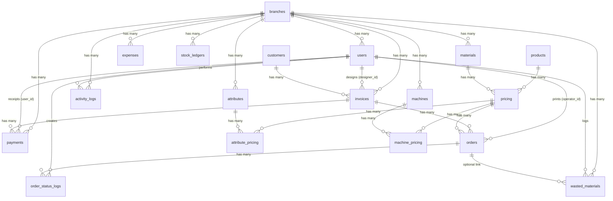

# POS Schema Redesign & Replication-Ready Rebuild Walkthrough

This document summarizes the POS system rebuild, transitioning from the legacy auto-increment schema to a UUIDv7 relational structure, modernizing the frontend UI using Tailwind CSS v4, and refactoring business logic into isolated service classes.

---

## 1. Database Schema Map (UUIDv7 & Relational)

Primary and foreign keys are UUIDv7 (via Laravel's `HasUuids` trait) to prevent conflicts during multi-branch synchronization.

### Relationship Diagram



### Core Table Catalog

For detailed field-level specifications, constraints, and validation parameters, refer to the [schema_details.md](file:///home/arukast/Projects/localDev/projects/pos_alja/.agents/plan/schema_details.md) reference sheet.

| Table | Description | Primary Key | Key Foreign Keys |
| :--- | :--- | :--- | :--- |
| **`branches`** | Physical shop branches. | UUID | - |
| **`users`** | Shop employees. Roles: `owner`, `manager`, `cashier`, `designer`, `production`. | UUID | `branch_id` |
| **`customers`** | Customers (`Reguler` / `Mitra`). | UUID | - |
| **`products`** | Catalog items (pricing type: `unit` or `area`). | UUID | - |
| **`materials`** | Raw inventory tracks (Paper, banners, etc.) with stock levels. | UUID | `branch_id` |
| **`pricing`** | Core price matching tier by product, material, customer type, and quantity thresholds. | UUID | `branch_id`, `product_id`, `material_id` |
| **`attribute_pricing`** | Additive price/cost modifiers for finishing, cuts, or displays. | UUID | `branch_id`, `pricing_id`, `attribute_id` |
| **`machine_pricing`** | Additive price/cost modifiers for print machines. | UUID | `branch_id`, `pricing_id`, `machine_id` |
| **`invoices`** | Main sale metadata (discount, AR, deadline, status). | UUID | `branch_id`, `customer_id`, `designer_id` |
| **`orders`** | Print jobs/lines under an invoice. | UUID | `invoice_id`, `pricing_id`, `operator_id` |
| **`payments`** | Tracks transaction logs (down payments, settlements). | UUID | `branch_id`, `invoice_id`, `user_id` |
| **`expenses`** | Cashier drawer payouts. | UUID | `branch_id` |
| **`wasted_materials`** | Logs failed prints and waste reasons. | UUID | `branch_id`, `material_id`, `machine_id`, `order_id`, `designer_id`, `operator_id` |
| **`stock_ledgers`** | Audit trail cards for inventory. | UUID | `branch_id`, `material_id` |
| **`order_status_logs`** | Order state history (Pending $\rightarrow$ Printing $\rightarrow$ Completed). | UUID | `order_id`, `user_id` |
| **`activity_logs`** | System-wide audit log trail. | UUID | `branch_id`, `user_id` |

---

## 2. Core Business Logic & Operation Rules

### Cashier Payments & Recalculation
- **Dynamic Balance**: Accounts receivable are computed dynamically from payments:
  $$\text{accounts\_receivable} = \max(0, \text{grand\_total} - \sum(\text{payments.amount}))$$
- **Invoice Status**: `0` = Unpaid, `1` = DP Paid (balance > 0), `2` = Fully Paid (balance = 0).

### Designer Intake & Tiered Pricing
- **Numbering**: Prefixed `INV-[BranchPrefix]-[YYYYMMDD]-[4-digit Seq]`.
- **Pricing Engine**: Finds matching core pricing (where `min_qty` $\le$ quantity) and dynamically sums additive modifier values from `attribute_pricing` and `machine_pricing`.
- **Manual Override**: Toggle `is_manual_price` allows entering custom prices/costs.

### Production Queue & Stock Deductions
- **Stock Deductions**: Inventory is deducted upon print job start via [InventoryService.php](file:///home/arukast/Projects/localDev/projects/pos_alja/app/Services/InventoryService.php). Area-based items use `qty * width * length`, unit-based use `qty`.
- **Concurrency Protection**: Row-level locking (`lockForUpdate()`) prevents stock race conditions on material checkouts.

> [!IMPORTANT]
> **Financial Naming Conventions**:
> - **Invoice level**: `grand_total` (Omset), `total_cost` (HPP), `total_profit` (Laba).
> - **Order level**: `subtotal`, `cost`, `profit`.
> - **Material Waste**: Tracked via the `WastedMaterial` model and `wasted_materials` table.

---

## 3. Core Architectural Changes

Instead of placing business logic in Livewire components, core transactions have been extracted to dedicated Service classes:

- **[InventoryService.php](file:///home/arukast/Projects/localDev/projects/pos_alja/app/Services/InventoryService.php)**: Manages inventory checks, low-stock notifications, row-level concurrency locks, and logs to `stock_ledgers`.
- **[PricingService.php](file:///home/arukast/Projects/localDev/projects/pos_alja/app/Services/PricingService.php)**: Evaluates complex additive matrix rates (core + display/finishing + machines).
- **[OrderService.php](file:///home/arukast/Projects/localDev/projects/pos_alja/app/Services/OrderService.php)**: Executes order intake, invoice creation, status state updates, and starts/completes jobs.
- **[PaymentService.php](file:///home/arukast/Projects/localDev/projects/pos_alja/app/Services/PaymentService.php)**: Handles cashier down-payments, final settlements, and dynamic balance offsets.
- **[CustomerService.php](file:///home/arukast/Projects/localDev/projects/pos_alja/app/Services/CustomerService.php)**: Manages customer profiles (Mitra vs Regular) and audit logs.

---

## 4. Key Frontend & UI Rebuilds

The interface was redesigned for dark mode compatibility and a premium aesthetic:

- **Modern Layout Shell**: Replaced top navigation with a collapsible sidebar layout on desktop and a mobile drawer layout in [navigation.blade.php](file:///home/arukast/Projects/localDev/projects/pos_alja/resources/views/livewire/layout/navigation.blade.php). Added a unified [icon.blade.php](file:///home/arukast/Projects/localDev/projects/pos_alja/resources/views/components/icon.blade.php) renderer and user popover settings menu.
- **Tailwind CSS v4 Configuration**: Configured class-based dark mode (`@custom-variant dark`) and brand colors directly in [app.css](file:///home/arukast/Projects/localDev/projects/pos_alja/resources/css/app.css).
- **Owner Dashboard Charts**: Refactored the net profit trend sparkline inside [Owner.php](file:///home/arukast/Projects/localDev/projects/pos_alja/app/Livewire/Dashboards/Owner.php) to render cubic Bezier curves using correct theme branding colors.

---

## 5. Verification & Testing

### Automated Test Suite
Run the dialect-agnostic test suite:
```bash
docker exec -it -w /var/www/html/pos_alja local-php83 php artisan test
```
*Results*: All **53 tests passed** successfully.

### Static Analysis Check
Run PHPStan to verify type safety:
```bash
./vendor/bin/phpstan analyse --memory-limit=1G
```

---

## 6. Rebuilding Designer Leaderboard

To provide a deeper insight into staff performance, we rebuilt the **Designer Leaderboard** from a small widget on the finance dashboard into a fully-fledged, dedicated dashboard tab (`tab=leaderboard`):

- **Accolades & Highlight Cards**: Computes and highlights specific achievements like Top Performer (highest gross revenue), Order Champion (most orders), Highest Avg Ticket (AOV), and Accuracy Leader (lowest material waste logs).
- **Comprehensive Leaderboard Table**: Shows ranks with custom badges (Gold, Silver, Bronze), branch metadata, total order counts, gross revenue (Omset), average order value (AOV), and total design error logs.
- **Revenue Share Contribution**: A visual comparative layout showcasing individual designer contribution percentages using custom progress bars matching the theme's aesthetics.
- **Sparkline Scaling**: Adjusted the Profit Analysis Sparkline card to expand across the full screen (`lg:col-span-3`) when the dashboard's finance tab is active.
