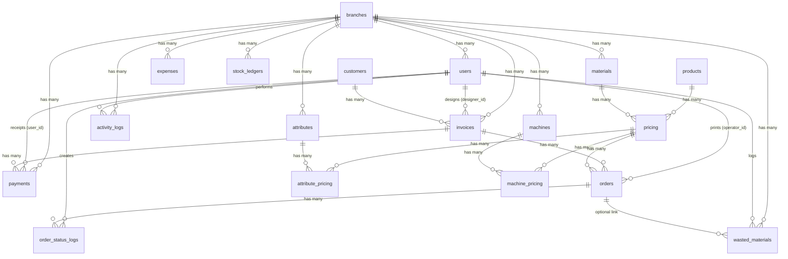

# POS Schema Redesign & Replication-Ready Rebuild Walkthrough

This document outlines the print-shop POS rebuild, transitioning from the legacy auto-increment schema to a UUIDv7 relational structure. All 54 tests are fully green.

---

## 1. Database Schema Map (UUIDv7 & Relational)

Primary and foreign keys are UUIDv7 (via Laravel's `HasUuids` trait) to prevent conflicts during multi-branch synchronization.

### Relationship Diagram



### Core Table Catalog

For detailed field-level specifications, constraints, and validation parameters, refer to the [schema_details.md](file:///home/arukast/Projects/localDev/projects/pos_alja/.agents/plan/schema_details.md) reference sheet.

| Table | Description | Primary Key | Key Foreign Keys |
| :--- | :--- | :--- | :--- |
| **`branches`** | Physical shop branches. | UUID | - |
| **`users`** | Shop employees. Roles: `owner`, `manager`, `cashier`, `designer`, `production`. | UUID | `branch_id` |
| **`customers`** | Customers (`Reguler` / `Mitra`). | UUID | - |
| **`products`** | Catalog items (pricing type: `unit` or `area`). | UUID | - |
| **`materials`** | Raw inventory tracks (Paper, banners, etc.) with stock levels. | UUID | `branch_id` |
| **`pricing`** | Core price matching tier by product, material, customer type, and quantity thresholds. | UUID | `branch_id`, `product_id`, `material_id` |
| **`attribute_pricing`** | Additive price/cost modifiers for finishing, cuts, or displays. | UUID | `branch_id`, `pricing_id`, `attribute_id` |
| **`machine_pricing`** | Additive price/cost modifiers for print machines. | UUID | `branch_id`, `pricing_id`, `machine_id` |
| **`invoices`** | Main sale metadata (discount, AR, deadline, status). | UUID | `branch_id`, `customer_id`, `designer_id` |
| **`orders`** | Print jobs/lines under an invoice. | UUID | `invoice_id`, `pricing_id`, `operator_id` |
| **`payments`** | Tracks transaction logs (down payments, settlements). | UUID | `branch_id`, `invoice_id`, `user_id` |
| **`expenses`** | Cashier drawer payouts. | UUID | `branch_id` |
| **`wasted_materials`** | Logs failed prints and waste reasons. | UUID | `branch_id`, `material_id`, `machine_id`, `order_id`, `designer_id`, `operator_id` |
| **`stock_ledgers`** | Audit trail cards for inventory. | UUID | `branch_id`, `material_id` |
| **`order_status_logs`** | Order state history (Pending $\rightarrow$ Printing $\rightarrow$ Completed). | UUID | `order_id`, `user_id` |
| **`activity_logs`** | System-wide audit log trail. | UUID | `branch_id`, `user_id` |

---

## 2. Core Business Logic & Operation Rules

### Cashier Payments & Balance Recalculation
- **Recalculation**: Invoices compute balance from the `payments` log instead of raw fields.
  $$\text{accounts\_receivable} = \max(0, \text{grand\_total} - \sum(\text{payments.amount}))$$
- **Invoice Status**: `0` = Unpaid, `1` = DP Paid (balance > 0), `2` = Fully Paid (balance <= 0).
- **Payment Log**: Writes to `payments` with cash/transfer/QRIS details.

### Designer Order Intake
- **Numbering**: Dynamic prefix `INV-[BranchPrefix]-[YYYYMMDD]-[4-digit Seq]` (e.g. `INV-MN-20260627-0001`).
- **Tiered Pricing**: Selects core pricing with max `min_qty` $\le$ quantity and sums corresponding attribute/machine modifiers.
- **Manual Override**: Sets `is_manual_price = true` to allow custom input price/cost.

### Production Job Progression
- **Handshake & Status**: Moves order to printing/completed, logging state changes, and sets operator ID.
- **Deduction**: Deducts stock via `InventoryService` (area-based uses `quantity * width * length`, unit-based uses `quantity`).

### Concurrency & Locking
- **Row-Level Locking on Materials stock**: Any transaction that reads and writes `current_stock` in the `materials` table must utilize row-level locking (e.g., `SELECT ... FOR UPDATE` or `lockForUpdate()`) to prevent race conditions during concurrent multi-branch checkout or restocking operations.

> [!IMPORTANT]
> **Financial Metric Columns**:
> - **Invoice level**: `grand_total` (Revenue/Omset), `total_cost` (HPP), `total_profit` (Profit/Laba).
> - **Order level**: `subtotal`, `cost`, `profit`.
> - **Material Waste**: `WastedMaterial` model and `wasted_materials` table.

---

## 3. Refactoring & Implementation Summary

| Refactoring Step | Key Files Modified | Core Implementation Changes |
| :--- | :--- | :--- |
| **Step 0: Inventory Service** | [InventoryService.php](file:///home/arukast/Projects/localDev/projects/pos_alja/app/Services/InventoryService.php) | Changed parameter signatures to `string` (UUID). Removed `(int)` casts. Dynamic branch lookup fallback. |
| **Step 1: Cashier Dashboard** | [Cashier.php](file:///home/arukast/Projects/localDev/projects/pos_alja/app/Livewire/Dashboards/Cashier.php)<br>[cashier.blade.php](file:///home/arukast/Projects/localDev/projects/pos_alja/resources/views/livewire/dashboards/cashier.blade.php)<br>[receipt.blade.php](file:///home/arukast/Projects/localDev/projects/pos_alja/resources/views/orders/receipt.blade.php) | Converted state IDs to UUID strings. Implemented payment logs on checkout. Recalculated invoice balances dynamically. |
| **Step 2: Production Dashboard** | [Production.php](file:///home/arukast/Projects/localDev/projects/pos_alja/app/Livewire/Dashboards/Production.php)<br>[production.blade.php](file:///home/arukast/Projects/localDev/projects/pos_alja/resources/views/livewire/dashboards/production.blade.php) | Updated order transitions to write history logs. Deducted inventory on print job start. Audited waste log by designer and operator UUIDs. |
| **Step 3: Owner Dashboard** | [Owner.php](file:///home/arukast/Projects/localDev/projects/pos_alja/app/Livewire/Dashboards/Owner.php)<br>[owner.blade.php](file:///home/arukast/Projects/localDev/projects/pos_alja/resources/views/livewire/dashboards/owner.blade.php) | Switched metrics to aggregate actual payments. Refactored the designer leaderboard query to group by users UUID. Added System Audit Trail. |
| **Step 4: Manager Dashboard** | [Manager.php](file:///home/arukast/Projects/localDev/projects/pos_alja/app/Livewire/Dashboards/Manager.php)<br>[manager.blade.php](file:///home/arukast/Projects/localDev/projects/pos_alja/resources/views/livewire/dashboards/manager.blade.php) | Updated restocking validation rules to accept UUID strings. Corrected logs queries to order by `created_at` timestamp. |
| **Step 5: Test & Layout Cleanups** | [UserManagement.php](file:///home/arukast/Projects/localDev/projects/pos_alja/app/Livewire/Admin/UserManagement.php)<br>[0001_01_01_000000_create_users_table.php](file:///home/arukast/Projects/localDev/projects/pos_alja/database/migrations/0001_01_01_000000_create_users_table.php)<br>Blade components & Test classes | Changed Laravel `sessions` `user_id` to UUID type in users migration. Cleaned up view components to declare merged attributes within `@php` blocks to avoid Prettier formatting compiler errors. |

---

## 4. Verification & Verification Results

### Automated Test Runs
Execute the suite inside the container:
```bash
docker exec -it -w /var/www/html/pos_alja local-php83 php artisan test
```

**Results**: All **54 tests passed** successfully (198 assertions). Legacy migration tests are safely skipped.

### Manual Verification
1. **Re-seed**: `php artisan migrate:fresh --seed` (verifies PostgreSQL schema compatibility).
2. **Order Flow**: Intake order $\rightarrow$ cashier DP payment log $\rightarrow$ production print start (stock deduction) & completion $\rightarrow$ final cash settlement.

---

## Phase 1 — CSS Design System (Completed)

We have rebuilt the CSS design system in `resources/css/app.css` to support both light and dark themes using Tailwind CSS v4 variables, and cleaned up legacy styles.

### Changes Made

- **Theme Surface Tokens**: Registered light mode surface tokens inside `@theme` in [app.css](file:///home/arukast/Projects/localDev/projects/pos_alja/resources/css/app.css):
  - `--color-light-bg: #F8F9FA`
  - `--color-light-surface: #FFFFFF`
  - `--color-light-surface-2: #F1F3F5`
  - `--color-light-border: #E5E7EB`
  - `--color-light-text: #111827`
  - `--color-light-muted: #6B7280`
- **Removed Helper Classes**: Cleaned up the file by removing obsolete custom CSS classes that can be expressed as Tailwind CSS v4 utility classes:
  - `:root` wrapper with duplicate `--brand-*` definitions.
  - `.brand-stripe`, `.brand-dot`, and `.brand-dot-*` colors.
  - `.brand-glass`, `.brand-focus-ring`, gradients, and `.hover-lift`.
- **Dynamic Scrollbars & Selection**: Refactored `::selection` and scrollbars to dynamically adapt to light/dark themes and reference `@theme` properties.
- **Dynamic Accent Stripes**: Refactored `.brand-stripe-bar` to reference dynamic `@theme` variables so it responds correctly to runtime branding color overrides.

---

## Phase 2 — Layout Shell (Completed)

We have rebuilt the layout shell and navigation header, transitioning the application from a top navigation bar to a modern collapsible sidebar layout for desktop viewports and a slide-in drawer layout for mobile viewports.

### Changes Made

- **Query-Based Tab State**: Bound the `$activeTab` property in [Owner.php](file:///home/arukast/Projects/localDev/projects/pos_alja/app/Livewire/Dashboards/Owner.php) and [Manager.php](file:///home/arukast/Projects/localDev/projects/pos_alja/app/Livewire/Dashboards/Manager.php) to the URL query string using Livewire's `#[Url(as: 'tab')]` attribute. This allows seamless tab-switching navigation across pages and persistent tab state during Livewire `wire:navigate` transitions.
- **Collapsible Layout Shell**: Updated [app.blade.php](file:///home/arukast/Projects/localDev/projects/pos_alja/resources/views/layouts/app.blade.php) to establish a full-height flex container on desktop and initialize Alpine.js states for coordinating sidebar expanded/collapsed visibility (`sidebarOpen` persisted in `localStorage`) and mobile drawer visibility (`mobileOpen`).
- **Sidebar & Mobile Drawer Component**: Rebuilt [navigation.blade.php](file:///home/arukast/Projects/localDev/projects/pos_alja/resources/views/livewire/layout/navigation.blade.php) from scratch to support two responsive layouts:
  - **Desktop Collapsible Sidebar**: Left column layout with smooth width transitions (`w-60` to `w-16`) containing the brand stripe, logo, collapsible menu groups, initials-based user avatar, dynamic theme toggler, and logout button.
  - **Mobile Drawer Overlay**: Slide-in panel (width `w-60`) shown below `lg` breakpoint, controlled by a hamburger button in the thin mobile header, with a semi-transparent backdrop overlay.
- **Role-Based Navigation Menus**: Implemented menu structures for all 5 roles (`owner`, `manager`, `cashier`, `designer`, `production`) exactly as mapped in the master design plan.
- **Aesthetic and UX Enhancements**: Added dynamic theme switching, smooth transitions, initials-based user avatar, and hover tooltips for all navigation items.

---

## Phase 3 — Shared Components (Completed)

We have rebuilt all 12 shared Blade UI components to be fully compatible with the new light/dark mode design system and the ALJA brand identity.

### Changes Made

- **Modal Component (`modal.blade.php`)**: Added the `<x-brand-stripe />` component to the top edge of the modal panel for consistent branding. Standardized the backdrop styling with `bg-black/50 backdrop-blur-sm` and borders with `border-light-border dark:border-surface-300/50`.
- **Primary Button (`primary-button.blade.php`)**: Made focus ring-offset theme-aware (`focus:ring-offset-light-bg dark:focus:ring-offset-surface-800`).
- **Secondary Button (`secondary-button.blade.php`)**: Redesigned to use the brand's secondary Cyan color (`bg-brand-secondary hover:bg-brand-secondary-hover`) and secondary glow (`shadow-glow-secondary`). Added theme-aware focus ring offsets.
- **Danger Button (`danger-button.blade.php`)**: Retained standard red background styling but made the focus ring-offset theme-aware.
- **Text Input (`text-input.blade.php`)**: Standardized inputs to use light-border and surface tokens: `border-light-border dark:border-surface-300/50 bg-white dark:bg-surface-500 text-light-text dark:text-gray-100 placeholder-light-muted dark:placeholder-gray-400`.
- **Input Label (`input-label.blade.php`)**: Switched label colors to use `text-light-text dark:text-gray-300`.
- **Input Error (`input-error.blade.php`)**: Re-stylized error messages to use higher contrast red: `text-red-600 dark:text-red-400 text-xs font-medium`.
- **Dropdown (`dropdown.blade.php`)**: Updated default content classes to use the light mode border token (`border-light-border dark:border-surface-300/50`), removed the redundant ring style, and wrapped content in a `rounded-xl overflow-hidden` container.
- **Dropdown Link (`dropdown-link.blade.php`)**: Made link hover and focus text/background colors theme-aware (`text-light-text dark:text-gray-300 hover:bg-brand-primary/10 hover:text-brand-primary`).
- **Brand Logo (`brand-logo.blade.php`)**: Added support for configured image logos (`config('brand.logo')`) with size-appropriate heights (`sm`/`md`/`lg`), falling back to the standard brand dots and text style.
- **Brand Header Banner (`brand-header-banner.blade.php`)**: Cleaned up contrasting gradients in light mode to use a subtle border-matched gradient. Standardized typography colors using `text-light-text` and `text-light-muted`.
- **Brand Stripe (`brand-stripe.blade.php`)**: Verified as accent element using the `.brand-stripe-bar` CSS class.

---

## Phase 4 — Dashboard Rebuilds (Completed)

We have rebuilt the visual layouts of all 5 role-based dashboards to support the new light/dark mode design system, accessibility contrast guidelines, and the ALJA brand identity.

### Changes Made

- **Owner Dashboard (`owner.blade.php`)**:
  - Replaced the root layout spacing with high-contrast text sizing (`text-light-text dark:text-gray-100`).
  - Redesigned branch selector and period controls to adapt cleanly to light and dark modes within the header banner slot.
  - Standardized financial KPI cards (Omset, HPP, Laba, Expenses), the SVG sparkline margins trend chart, and the Designer Leaderboard.
  - Standardized the Audit Trail table structure, headers, alternating row colors, and payload codes.
- **Manager Dashboard (`manager.blade.php`)**:
  - Rebuilt inventory stock trackers, machinery status cards, and the restocking form.
  - Updated the restocking forms inputs, selectors, textareas, and submit buttons to be theme-aware.
  - Standardized the Inventory Ledger and Material Inventory Levels tables, with dynamic red-alert highlight rows for low stock levels.
  - Rebuilt the drawer expenses card lists.
- **Cashier Dashboard (`cashier.blade.php`)**:
  - Redesigned the awaiting checkout queue table, customer pickup queue, and expenses tables.
  - Updated status badges/pills to match standard color mappings for Paid, Down Payment, and Unpaid states.
  - Rebuilt the Checkout Modal with proper backdrop-blur overlays, brand gradient stripes, input payment types, bank transfer/QRIS select dropdowns, and calculations previews.
- **Designer Dashboard (`designer.blade.php`)**:
  - Redesigned the customer search intake and customer creation form layout.
  - Styled all Quote Calculator option dropdowns, inputs, and prepress textareas.
  - Standardized the estimated subtotal block and the pre-queued draft order summary table.
  - Re-stylized the recently placed invoices list table and job ticket Work Order links.
- **Production Dashboard (`production.blade.php`)**:
  - Rebuilt active print queue tickets as readable rows with clear statuses (Pending/Printing), operator badges, and action buttons.
  - Restyled print waste forms and the failed runs audit tables.

---

## Phase 5 — Supporting Views (Completed)

We have rebuilt and polished all supporting views, authentication views, and profile forms to ensure they are fully compliant with the light/dark mode design tokens and branding.

### Changes Made

- **User Management (`user-management.blade.php`)**:
  - Rebuilt the main container using light/dark adaptive classes (`bg-white dark:bg-surface-600 border border-light-border dark:border-surface-300/40 text-light-text dark:text-gray-100`).
  - Wrapped the user table in a rounded overflow container and styled the header (`bg-light-surface-2 dark:bg-surface-500`) and tbody rows (`even:bg-light-surface-2/30 dark:even:bg-surface-500/20 hover:bg-brand-primary/5 dark:hover:bg-brand-primary/10`).
  - Re-stylized table cells to avoid hardcoded text colors and ensure high readability (`text-light-text dark:text-white` for names, `text-light-muted dark:text-gray-300` for other columns).
  - Integrated the dynamic `<x-brand-stripe />` component onto the Add/Edit Staff custom modal, alongside backdrop and panel styling aligned with the modals specification.
  - Adapted input fields to use the standard `<x-text-input>` component and styled dropdown selectors consistently.
  - Replaced custom alert classes to use readable light-green colors in light mode (`bg-emerald-50 text-emerald-800 border-emerald-250`).
- **Profile Layout (`profile.blade.php`)**:
  - Converted the profile panels to use the standard card styling (`bg-white dark:bg-surface-600 border border-light-border dark:border-surface-300/40 shadow-sm dark:shadow-card rounded-2xl`).
- **Update Profile Form (`update-profile-information-form.blade.php`)**:
  - Replaced hardcoded headings and descriptions with dynamic theme variables.
  - Re-styled disabled inputs for username and email to render cleanly across both themes.
- **Update Password & Delete User Forms (`update-password-form.blade.php`, `delete-user-form.blade.php`)**:
  - Updated headings, labels, warnings, and confirm/cancel button options to align with the layout guidelines.
- **Fallback Dashboard Routing (`dashboard.blade.php`)**:
  - Refactored the generic welcome fallback box to use standard light/dark adaptive container tokens.
- **Authentication Pages (`login.blade.php`, `register.blade.php`, `verify-email.blade.php`)**:
  - Rebuilt the login input styling to be adaptive, preventing unreadable white text on white input background issues in light mode.
  - Replaced all instances of the legacy `text-alja-cyan` and `hover:text-alja-cyan-light` links with the brand's secondary colors (`text-brand-secondary hover:text-brand-secondary-light`).
- **Receipt Print View (`receipt.blade.php`)**:
  - Reviewed print output formatting and verified proper stylesheet compilation. Polished the back link and print action buttons to include standard pointer cursors for improved desktop navigation.

---

## Phase 6 — PostgreSQL Schema Refactoring (Completed)

We have refactored the database schema migrations and updated the Laravel application's models, services, views, seeders, and automated test suites to resolve architectural redundancies, temporal precision loss, and scalability bottlenecks.

### Changes Made

- **Refactored Migrations**: Merged the refactored schema specifications directly into the initial database migration file [2026_06_24_000000_create_pos_tables.php](file:///home/arukast/Projects/localDev/projects/pos_alja/database/migrations/2026_06_24_000000_create_pos_tables.php) to facilitate clean local development rebuilds, implementing:
  - Removal of redundant running stock totals from `materials`.
  - Date columns updated to timezone-aware `TIMESTAMPTZ` across operational tables.
  - Deconstruction of the wide `pricing_matrices` table into a core `pricing` table and modifier tables `attribute_pricing` and `machine_pricing`.
  - Standardization of all financial tracking columns to `NUMERIC(15,2)` precision.
- **Created/Updated Models**:
  - Created [Pricing.php](file:///home/arukast/Projects/localDev/projects/pos_alja/app/Models/Pricing.php), [AttributePricing.php](file:///home/arukast/Projects/localDev/projects/pos_alja/app/Models/AttributePricing.php), and [MachinePricing.php](file:///home/arukast/Projects/localDev/projects/pos_alja/app/Models/MachinePricing.php).
  - Updated [Material.php](file:///home/arukast/Projects/localDev/projects/pos_alja/app/Models/Material.php) and [Order.php](file:///home/arukast/Projects/localDev/projects/pos_alja/app/Models/Order.php) to align with the new schema columns and relationships.
  - Deprecated `PricingMatrix.php`.
- **Refactored Inventory Service**: Refactored [InventoryService.php](file:///home/arukast/Projects/localDev/projects/pos_alja/app/Services/InventoryService.php) to use row-level locking via `lockForUpdate()` when querying and updating materials stock levels, preventing concurrency race conditions. All historical balances are logged to the `stock_ledgers` table.
- **Refactored Pricing Service**: Refactored [PricingService.php](file:///home/arukast/Projects/localDev/projects/pos_alja/app/Services/PricingService.php) to support the deconstructed, additive pricing logic, summing modifier rates dynamically.
- **Updated Dashboard Views**:
  - Updated Livewire components ([Designer.php](file:///home/arukast/Projects/localDev/projects/pos_alja/app/Livewire/Dashboards/Designer.php), [Production.php](file:///home/arukast/Projects/localDev/projects/pos_alja/app/Livewire/Dashboards/Production.php), [Manager.php](file:///home/arukast/Projects/localDev/projects/pos_alja/app/Livewire/Dashboards/Manager.php)) to handle `pricing_id` instead of `pricing_matrix_id`.
  - Updated [manager.blade.php](file:///home/arukast/Projects/localDev/projects/pos_alja/resources/views/livewire/dashboards/manager.blade.php) to simplify the Detailed Stock Levels table, keeping only the cached `current_stock` and `min_stock` columns.
- **Updated Seeders & Tests**:
  - Updated [DatabaseSeeder.php](file:///home/arukast/Projects/localDev/projects/pos_alja/database/seeders/DatabaseSeeder.php) to seed the deconstructed pricing system.
  - Updated all unit and feature tests ([PricingServiceTest.php](file:///home/arukast/Projects/localDev/projects/pos_alja/tests/Unit/PricingServiceTest.php), [InventoryServiceTest.php](file:///home/arukast/Projects/localDev/projects/pos_alja/tests/Unit/InventoryServiceTest.php), [InventoryManagementTest.php](file:///home/arukast/Projects/localDev/projects/pos_alja/tests/Feature/InventoryManagementTest.php), [ProductionDashboardTest.php](file:///home/arukast/Projects/localDev/projects/pos_alja/tests/Feature/ProductionDashboardTest.php)) to align with the new schema columns and test criteria.

---

## Refactoring and Codebase Optimization (Completed)

We have performed a comprehensive codebase review and refactoring session targeting technical debt, naming inconsistencies, raw database operations, and monolithic Livewire dashboard controllers.

### 1. Cleaned Up Deprecated Files
We removed model files that referenced non-existent tables in the redesigned schema:
- **[Cut.php](file:///home/arukast/Projects/localDev/projects/pos_alja/app/Models/Cut.php)**, **[Display.php](file:///home/arukast/Projects/localDev/projects/pos_alja/app/Models/Display.php)**, and **[Finishing.php](file:///home/arukast/Projects/localDev/projects/pos_alja/app/Models/Finishing.php)**: These models are now consolidated into the single `attributes` table and `Attribute` model. Overwritten with deprecation notices.
- **[PricingMatrix.php](file:///home/arukast/Projects/localDev/projects/pos_alja/app/Models/PricingMatrix.php)**: This model is superseded by the `pricing`, `attribute_pricing`, and `machine_pricing` tables. Overwritten with a deprecation notice.

### 2. Standardized Exceptions and Namespaces
- **[PricingNotFoundException.php](file:///home/arukast/Projects/localDev/projects/pos_alja/app/Exceptions/PricingNotFoundException.php)**: Created to replace `PricingMatrixNotFoundException` to align with the deconstructed schema naming conventions.
- Deprecated `PricingMatrixNotFoundException.php` and updated references across the entire application and tests.

### 3. Extracted Core Business Logic into Services
In alignment with PSR-12 and the project's Service-Oriented Architecture guidelines, we extracted transaction and database manipulation logic out of Livewire components and into dedicated service classes:
- **[CustomerService.php](file:///home/arukast/Projects/localDev/projects/pos_alja/app/Services/CustomerService.php)**: Handles new customer registration and populates activity logs.
- **[OrderService.php](file:///home/arukast/Projects/localDev/projects/pos_alja/app/Services/OrderService.php)**: Handles creating invoices, order items, status logs, activity logs, and transitions order production state (starts, completions, and stock deductions).
- **[PaymentService.php](file:///home/arukast/Projects/localDev/projects/pos_alja/app/Services/PaymentService.php)**: Manages down payment recordings, settlements, and updates accounts receivable balances.

### 4. Optimized and Modernized Dashboard Query Logic
- **[Designer.php](file:///home/arukast/Projects/localDev/projects/pos_alja/app/Livewire/Dashboards/Designer.php)**:
  - Replaced the queries on the non-existent `PricingMatrix` model inside the `render()` method with queries referencing the new pricing, machine_pricing, and attribute_pricing tables.
  - Replaced custom order creation and customer creation transactions with invocations of `OrderService` and `CustomerService`.
- **[Production.php](file:///home/arukast/Projects/localDev/projects/pos_alja/app/Livewire/Dashboards/Production.php)**:
  - Replaced native transaction blocks for marking production start/completion with `OrderService` method calls.
  - Removed raw `DB::table('pricing')` and `DB::table('products')` queries, replacing them with eager-loaded Eloquent models.
  - Retained and imported `InventoryService` for the waste logging form actions.
- **[Cashier.php](file:///home/arukast/Projects/localDev/projects/pos_alja/app/Livewire/Dashboards/Cashier.php)**:
  - Moved custom cashier transaction logic to `PaymentService`.
  - Replaced sorting clauses using non-temporal attributes `orderBy('id', 'desc')` with `orderBy('created_at', 'desc')`.
- **[Manager.php](file:///home/arukast/Projects/localDev/projects/pos_alja/app/Livewire/Dashboards/Manager.php)**:
  - Replaced the raw SQL join query on the `stock_ledgers` table with an Eloquent model query leveraging relationship eager loading (`StockLedger::with('material')`).
- **[manager.blade.php](file:///home/arukast/Projects/localDev/projects/pos_alja/resources/views/livewire/dashboards/manager.blade.php)**:
  - Updated the view to reference relation attributes `$log->material->name` instead of raw column attributes.
- **[InventoryService.php](file:///home/arukast/Projects/localDev/projects/pos_alja/app/Services/InventoryService.php)**:
  - Replaced all raw `DB::table('stock_ledgers')->insert(...)` queries with Eloquent `StockLedger::create(...)` calls, enabling Eloquent's model events and automatic UUIDv7 generation.

### 5. Deprecated Commands and Refactored Tests
- **[MigrateLegacyData.php](file:///home/arukast/Projects/localDev/projects/pos_alja/app/Console/Commands/MigrateLegacyData.php)**:
  - Updated the command to return early with an error message, as it references outdated tables like `pricing_matrices` and is superseded by direct database provisioning.
- **[PricingServiceTest.php](file:///home/arukast/Projects/localDev/projects/pos_alja/tests/Unit/PricingServiceTest.php)**:
  - Updated expected exceptions and namespaces to use `PricingNotFoundException`.
- **[phpstan-baseline.neon](file:///home/arukast/Projects/localDev/projects/pos_alja/phpstan-baseline.neon)**:
  - Cleaned up baseline exceptions that are no longer thrown.

### 6. Development Migration Consolidation
To maintain a clean database schema history and speed up development rebuilds:
- **[0001_01_01_000000_create_users_table.php](file:///home/arukast/Projects/localDev/projects/pos_alja/database/migrations/0001_01_01_000000_create_users_table.php)**: Added `$table->softDeletes();` directly into the initial users table schema declaration.
- **[2026_06_25_085840_add_soft_deletes_to_users_table.php](file:///home/arukast/Projects/localDev/projects/pos_alja/database/migrations/2026_06_25_085840_add_soft_deletes_to_users_table.php)**: Deprecated/cleared (since its functionality is now built directly into the initial users table migration).
- **[2026_06_27_000000_refactor_schema_details.php](file:///home/arukast/Projects/localDev/projects/pos_alja/database/migrations/2026_06_27_000000_refactor_schema_details.php)**: Deprecated/cleared (since its details are now built directly into the initial pos tables migration).

> [!NOTE]
> All deprecated migration, model, and exception files have been overwritten with deprecation/merged references. If you want them completely removed from the filesystem view of your workspace, you can safely run:
> ```bash
> git rm database/migrations/2026_06_25_085840_add_soft_deletes_to_users_table.php \
>        database/migrations/2026_06_27_000000_refactor_schema_details.php \
>        app/Models/Cut.php \
>        app/Models/Display.php \
>        app/Models/Finishing.php \
>        app/Models/PricingMatrix.php \
>        app/Exceptions/PricingMatrixNotFoundException.php
> ```

