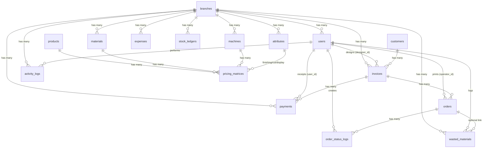

# POS Schema Redesign & Replication-Ready Rebuild Walkthrough

This document outlines the print-shop POS rebuild, transitioning from the legacy auto-increment schema to a UUIDv7 relational structure. All 54 tests are fully green.

---

## 1. Database Schema Map (UUIDv7 & Relational)

Primary and foreign keys are UUIDv7 (via Laravel's `HasUuids` trait) to prevent conflicts during multi-branch synchronization.

### Relationship Diagram



### Core Table Catalog

For detailed field-level specifications, constraints, and validation parameters, refer to the [schema_details.md](file:///home/arukast/Projects/localDev/projects/pos_alja/.agents/plan/schema_details.md) reference sheet.

| Table | Description | Primary Key | Key Foreign Keys |
| :--- | :--- | :--- | :--- |
| **`branches`** | Physical shop branches. | UUID | - |
| **`users`** | Shop employees. Roles: `owner`, `manager`, `cashier`, `designer`, `production`. | UUID | `branch_id` |
| **`customers`** | Customers (`Reguler` / `Mitra`). | UUID | - |
| **`products`** | Catalog items (pricing type: `unit` or `area`). | UUID | - |
| **`materials`** | Raw inventory tracks (Paper, banners, etc.) with stock levels. | UUID | `branch_id` |
| **`pricing_matrices`** | Price engine tier matching based on options and quantity thresholds. | UUID | `product_id`, `material_id`, `machine_id`, `finishing_id`, `cut_id`, `display_id` |
| **`invoices`** | Main sale metadata (discount, AR, deadline, status). | UUID | `branch_id`, `customer_id`, `designer_id` |
| **`orders`** | Print jobs/lines under an invoice. | UUID | `invoice_id`, `pricing_matrix_id`, `operator_id` |
| **`payments`** | Tracks transaction logs (down payments, settlements). | UUID | `branch_id`, `invoice_id`, `user_id` |
| **`expenses`** | Cashier drawer payouts. | UUID | `branch_id` |
| **`wasted_materials`** | Logs failed prints and waste reasons. | UUID | `branch_id`, `material_id`, `machine_id`, `order_id`, `designer_id`, `operator_id` |
| **`stock_ledgers`** | Audit trail cards for inventory. | UUID | `branch_id`, `material_id` |
| **`order_status_logs`** | Order state history (Pending $\rightarrow$ Printing $\rightarrow$ Completed). | UUID | `order_id`, `user_id` |
| **`activity_logs`** | System-wide audit log trail. | UUID | `branch_id`, `user_id` |

---

## 2. Core Business Logic & Operation Rules

### Cashier Payments & Balance Recalculation
- **Recalculation**: Invoices compute balance from the `payments` log instead of raw fields.
  $$\text{accounts\_receivable} = \max(0, \text{grand\_total} - \sum(\text{payments.amount}))$$
- **Invoice Status**: `0` = Unpaid, `1` = DP Paid (balance > 0), `2` = Fully Paid (balance <= 0).
- **Payment Log**: Writes to `payments` with cash/transfer/QRIS details.

### Designer Order Intake
- **Numbering**: Dynamic prefix `INV-[BranchPrefix]-[YYYYMMDD]-[4-digit Seq]` (e.g. `INV-MN-20260627-0001`).
- **Tiered Pricing**: Selects pricing matrix with max `min_qty` $\le$ quantity.
- **Manual Override**: Sets `is_manual_price = true` to allow custom input price/cost.

### Production Job Progression
- **Handshake & Status**: Moves order to printing/completed, logging state changes, and sets operator ID.
- **Deduction**: Deducts stock via `InventoryService` (area-based uses `quantity * width * length`, unit-based uses `quantity`).

> [!IMPORTANT]
> **Financial Metric Columns**:
> - **Invoice level**: `grand_total` (Revenue/Omset), `total_cost` (HPP), `total_profit` (Profit/Laba).
> - **Order level**: `subtotal`, `cost`, `profit`.
> - **Material Waste**: `WastedMaterial` model and `wasted_materials` table.

---

## 3. Refactoring & Implementation Summary

| Refactoring Step | Key Files Modified | Core Implementation Changes |
| :--- | :--- | :--- |
| **Step 0: Inventory Service** | [InventoryService.php](file:///home/arukast/Projects/localDev/projects/pos_alja/app/Services/InventoryService.php) | Changed parameter signatures to `string` (UUID). Removed `(int)` casts. Dynamic branch lookup fallback. |
| **Step 1: Cashier Dashboard** | [Cashier.php](file:///home/arukast/Projects/localDev/projects/pos_alja/app/Livewire/Dashboards/Cashier.php)<br>[cashier.blade.php](file:///home/arukast/Projects/localDev/projects/pos_alja/resources/views/livewire/dashboards/cashier.blade.php)<br>[receipt.blade.php](file:///home/arukast/Projects/localDev/projects/pos_alja/resources/views/orders/receipt.blade.php) | Converted state IDs to UUID strings. Implemented payment logs on checkout. Recalculated invoice balances dynamically. |
| **Step 2: Production Dashboard** | [Production.php](file:///home/arukast/Projects/localDev/projects/pos_alja/app/Livewire/Dashboards/Production.php)<br>[production.blade.php](file:///home/arukast/Projects/localDev/projects/pos_alja/resources/views/livewire/dashboards/production.blade.php) | Updated order transitions to write history logs. Deducted inventory on print job start. Audited waste log by designer and operator UUIDs. |
| **Step 3: Owner Dashboard** | [Owner.php](file:///home/arukast/Projects/localDev/projects/pos_alja/app/Livewire/Dashboards/Owner.php)<br>[owner.blade.php](file:///home/arukast/Projects/localDev/projects/pos_alja/resources/views/livewire/dashboards/owner.blade.php) | Switched metrics to aggregate actual payments. Refactored the designer leaderboard query to group by users UUID. Added System Audit Trail. |
| **Step 4: Manager Dashboard** | [Manager.php](file:///home/arukast/Projects/localDev/projects/pos_alja/app/Livewire/Dashboards/Manager.php)<br>[manager.blade.php](file:///home/arukast/Projects/localDev/projects/pos_alja/resources/views/livewire/dashboards/manager.blade.php) | Updated restocking validation rules to accept UUID strings. Corrected logs queries to order by `created_at` timestamp. |
| **Step 5: Test & Layout Cleanups** | [UserManagement.php](file:///home/arukast/Projects/localDev/projects/pos_alja/app/Livewire/Admin/UserManagement.php)<br>[0001_01_01_000000_create_users_table.php](file:///home/arukast/Projects/localDev/projects/pos_alja/database/migrations/0001_01_01_000000_create_users_table.php)<br>Blade components & Test classes | Changed Laravel `sessions` `user_id` to UUID type in users migration. Cleaned up view components to declare merged attributes within `@php` blocks to avoid Prettier formatting compiler errors. |

---

## 4. Verification & Verification Results

### Automated Test Runs
Execute the suite inside the container:
```bash
docker exec -it -w /var/www/html/pos_alja local-php83 php artisan test
```

**Results**: All **54 tests passed** successfully (198 assertions). Legacy migration tests are safely skipped.

### Manual Verification
1. **Re-seed**: `php artisan migrate:fresh --seed` (verifies PostgreSQL schema compatibility).
2. **Order Flow**: Intake order $\rightarrow$ cashier DP payment log $\rightarrow$ production print start (stock deduction) & completion $\rightarrow$ final cash settlement.

---

## Phase 1 — CSS Design System (Completed)

We have rebuilt the CSS design system in `resources/css/app.css` to support both light and dark themes using Tailwind CSS v4 variables, and cleaned up legacy styles.

### Changes Made

- **Theme Surface Tokens**: Registered light mode surface tokens inside `@theme` in [app.css](file:///home/arukast/Projects/localDev/projects/pos_alja/resources/css/app.css):
  - `--color-light-bg: #F8F9FA`
  - `--color-light-surface: #FFFFFF`
  - `--color-light-surface-2: #F1F3F5`
  - `--color-light-border: #E5E7EB`
  - `--color-light-text: #111827`
  - `--color-light-muted: #6B7280`
- **Removed Helper Classes**: Cleaned up the file by removing obsolete custom CSS classes that can be expressed as Tailwind CSS v4 utility classes:
  - `:root` wrapper with duplicate `--brand-*` definitions.
  - `.brand-stripe`, `.brand-dot`, and `.brand-dot-*` colors.
  - `.brand-glass`, `.brand-focus-ring`, gradients, and `.hover-lift`.
- **Dynamic Scrollbars & Selection**: Refactored `::selection` and scrollbars to dynamically adapt to light/dark themes and reference `@theme` properties.
- **Dynamic Accent Stripes**: Refactored `.brand-stripe-bar` to reference dynamic `@theme` variables so it responds correctly to runtime branding color overrides.
