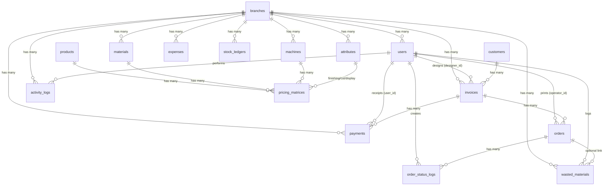

# POS Schema Redesign & Replication-Ready Rebuild Walkthrough

This document serves as the complete knowledge transfer and blueprint for the print-shop POS rebuild. The database migrations and seeders have been successfully executed and seeded on the PostgreSQL database with UUIDv7 key structures.

---

## 1. Database Schema Map (UUIDv7 & Relational)

All primary keys (`id`) and foreign keys (`_id`) are UUIDs. Models use Laravel's `HasUuids` trait for automated ordered UUID (UUIDv7) generation. This ensures offline-ready capabilities (Strategy 2) by preventing ID collisions between branch servers and the central database.

### Relationship Diagram



### Table Definitions & Column Details

| Table | Column Name | Type | Key | Nullable | Description / Rules |
| :--- | :--- | :--- | :---: | :---: | :--- |
| **`branches`** | `id`<br>`name`<br>`address`<br>`phone` | UUID<br>VARCHAR<br>VARCHAR<br>VARCHAR | PK<br>-<br>-<br>- | No<br>No<br>Yes<br>Yes | Physical print shop branches.<br>Supports soft deletes. |
| **`users`** | `id`<br>`name`<br>`username`<br>`email`<br>`password`<br>`role`<br>`branch_id` | UUID<br>VARCHAR<br>VARCHAR<br>VARCHAR<br>VARCHAR<br>VARCHAR<br>UUID | PK<br>-<br>UQ<br>-<br>-<br>-<br>FK | No<br>No<br>No<br>Yes<br>No<br>No<br>Yes | System users.<br>Roles: `owner`, `manager`, `cashier`, `designer`, `production`. Nullable branch for owners. |
| **`customers`** | `id`<br>`name`<br>`phone`<br>`address`<br>`email`<br>`type` | UUID<br>VARCHAR<br>VARCHAR<br>TEXT<br>VARCHAR<br>VARCHAR | PK<br>-<br>-<br>-<br>-<br>- | No<br>No<br>Yes<br>Yes<br>Yes<br>No | Customers.<br>Types: `Reguler` vs `Mitra`. |
| **`products`** | `id`<br>`name`<br>`pricing_type` | UUID<br>VARCHAR<br>VARCHAR | PK<br>-<br>- | No<br>No<br>No | Catalog items.<br>Pricing type: `unit` (flat) vs `area` (width * length). |
| **`materials`** | `id`<br>`branch_id`<br>`name`<br>`category`<br>`type`<br>`dimensions`<br>`cost`<br>`price`<br>`initial_stock`<br>`added_stock`<br>`current_stock`<br>`sold_stock`<br>`wasted_stock`<br>`remaining_stock`<br>`min_stock` | UUID<br>UUID<br>VARCHAR<br>VARCHAR<br>VARCHAR<br>VARCHAR<br>INT<br>INT<br>DECIMAL<br>DECIMAL<br>DECIMAL<br>DECIMAL<br>DECIMAL<br>DECIMAL<br>DECIMAL | PK<br>FK<br>-<br>-<br>-<br>-<br>-<br>-<br>-<br>-<br>-<br>-<br>-<br>-<br>- | No<br>Yes<br>No<br>No<br>Yes<br>Yes<br>No<br>No<br>No<br>No<br>No<br>No<br>No<br>No<br>No | Raw paper, banners, stempel, etc.<br>Category maps options. Stock tracked as Decimals.<br>Alert triggered if `remaining_stock <= min_stock`. |
| **`machines`** | `id`<br>`branch_id`<br>`name` | UUID<br>UUID<br>VARCHAR | PK<br>FK<br>- | No<br>Yes<br>No | Machine catalog scoped to branches.<br>Supports soft deletes. |
| **`attributes`** | `id`<br>`branch_id`<br>`name`<br>`type` | UUID<br>UUID<br>VARCHAR<br>VARCHAR | PK<br>FK<br>-<br>- | No<br>Yes<br>No<br>No | Consolidated finishers, cuts, displays.<br>Types: `finishing`, `cut`, `display`. Scoped to branch. |
| **`pricing_matrices`** | `id`<br>`branch_id`<br>`product_id`<br>`material_id`<br>`machine_id`<br>`finishing_id`<br>`cut_id`<br>`display_id`<br>`dimensions`<br>`price`<br>`cost`<br>`profit`<br>`min_qty`<br>`sides`<br>`finishing_sides`<br>`customer_type` | UUID<br>UUID<br>UUID<br>UUID<br>UUID<br>UUID<br>UUID<br>UUID<br>VARCHAR<br>INT<br>INT<br>INT<br>INT<br>INT<br>INT<br>VARCHAR | PK<br>FK<br>FK<br>FK<br>FK<br>FK<br>FK<br>FK<br>-<br>-<br>-<br>-<br>-<br>-<br>-<br>- | No<br>Yes<br>No<br>No<br>Yes<br>Yes<br>Yes<br>Yes<br>Yes<br>No<br>No<br>No<br>No<br>No<br>No<br>No | Price mapping table.<br>Min Qty enables bulk pricing brackets (tiered discounts). Customer type: `Reguler` vs `Mitra`. |
| **`invoices`** | `id`<br>`invoice_number`<br>`branch_id`<br>`created_date`<br>`payment_date`<br>`dp_date`<br>`customer_id`<br>`designer_id`<br>`status`<br>`discount`<br>`dp_amount`<br>`accounts_receivable`<br>`grand_total`<br>`total_cost`<br>`total_profit`<br>`deadline`<br>`pickup_status`<br>`pickup_date`<br>`source` | UUID<br>VARCHAR<br>UUID<br>DATE<br>DATE<br>DATE<br>UUID<br>UUID<br>INT<br>INT<br>INT<br>INT<br>INT<br>INT<br>INT<br>VARCHAR<br>INT<br>DATE<br>INT | PK<br>UQ<br>FK<br>-<br>-<br>-<br>FK<br>FK<br>-<br>-<br>-<br>-<br>-<br>-<br>-<br>-<br>-<br>-<br>- | No<br>No<br>Yes<br>No<br>Yes<br>Yes<br>No<br>Yes<br>No<br>No<br>No<br>No<br>No<br>No<br>No<br>Yes<br>No<br>Yes<br>No | Main order metadata.<br>Status: `0` (Unpaid), `1` (DP Paid), `2` (Fully Paid).<br>Pickup: `0` (Not Picked Up), `1` (Picked Up). |
| **`orders`** | `id`<br>`invoice_id`<br>`pricing_matrix_id`<br>`operator_id`<br>`file_name`<br>`file_path`<br>`preview_path`<br>`notes`<br>`area`<br>`quantity`<br>`unit_price`<br>`subtotal`<br>`cost`<br>`profit`<br>`ordered_at`<br>`status`<br>`pickup_status`<br>`pickup_date`<br>`is_manual_price` | UUID<br>UUID<br>UUID<br>UUID<br>VARCHAR<br>VARCHAR<br>VARCHAR<br>TEXT<br>DECIMAL<br>DECIMAL<br>INT<br>INT<br>INT<br>INT<br>DATE<br>INT<br>INT<br>DATE<br>BOOLEAN | PK<br>FK<br>FK<br>FK<br>-<br>-<br>-<br>-<br>-<br>-<br>-<br>-<br>-<br>-<br>-<br>-<br>-<br>-<br>- | No<br>No<br>Yes<br>Yes<br>Yes<br>Yes<br>Yes<br>Yes<br>No<br>No<br>No<br>No<br>No<br>No<br>No<br>No<br>No<br>Yes<br>No | Order items/lines within an invoice.<br>Status: `0` (Pending), `1` (Printing), `2` (Completed). |
| **`payments`** | `id`<br>`branch_id`<br>`invoice_id`<br>`user_id`<br>`amount`<br>`payment_method`<br>`type`<br>`cashier_name` | UUID<br>UUID<br>UUID<br>UUID<br>INT<br>VARCHAR<br>VARCHAR<br>VARCHAR | PK<br>FK<br>FK<br>FK<br>-<br>-<br>-<br>- | No<br>No<br>No<br>Yes<br>No<br>No<br>No<br>No | Multi-installment payments tracking.<br>Type: `down_payment`, `settlement`, `partial`. Cashier name cached for audits. |
| **`expenses`** | `id`<br>`branch_id`<br>`incurred_at`<br>`amount`<br>`description`<br>`cashier_name`<br>`type`<br>`category` | UUID<br>UUID<br>DATE<br>INT<br>TEXT<br>VARCHAR<br>VARCHAR<br>VARCHAR | PK<br>FK<br>-<br>-<br>-<br>-<br>-<br>- | No<br>Yes<br>No<br>No<br>Yes<br>Yes<br>No<br>No | Drawer operational expenses.<br>Type: `modal` (cash injection) vs `laba` (operating expense). Categories: `Supplies`, `Maintenance`, etc. |
| **`wasted_materials`** | `id`<br>`branch_id`<br>`logged_at`<br>`material_id`<br>`machine_id`<br>`order_id`<br>`designer_id`<br>`operator_id`<br>`quantity`<br>`dimensions`<br>`notes` | UUID<br>UUID<br>DATE<br>UUID<br>UUID<br>UUID<br>UUID<br>UUID<br>DECIMAL<br>VARCHAR<br>TEXT | PK<br>FK<br>-<br>FK<br>FK<br>FK<br>FK<br>FK<br>-<br>-<br>- | No<br>Yes<br>No<br>No<br>Yes<br>Yes<br>Yes<br>Yes<br>No<br>Yes<br>Yes | Tracks waste/failed prints.<br>Includes references to designers and operators. |
| **`stock_ledgers`** | `id`<br>`branch_id`<br>`material_id`<br>`logged_at`<br>`initial_stock`<br>`added_stock`<br>`used_stock`<br>`wasted_stock`<br>`remaining_stock`<br>`notes` | UUID<br>UUID<br>UUID<br>DATE<br>DECIMAL<br>DECIMAL<br>DECIMAL<br>DECIMAL<br>DECIMAL<br>TEXT | PK<br>FK<br>FK<br>-<br>-<br>-<br>-<br>-<br>-<br>- | No<br>Yes<br>No<br>No<br>No<br>No<br>No<br>No<br>No<br>Yes | History card logging stock updates. |
| **`order_status_logs`** | `id`<br>`order_id`<br>`status`<br>`user_id`<br>`user_name`<br>`notes` | UUID<br>UUID<br>INT<br>UUID<br>VARCHAR<br>VARCHAR | PK<br>FK<br>-<br>FK<br>-<br>- | No<br>No<br>No<br>Yes<br>No<br>Yes | History of status transitions on orders. |
| **`activity_logs`** | `id`<br>`branch_id`<br>`user_id`<br>`username`<br>`role`<br>`action`<br>`description`<br>`model_type`<br>`model_id`<br>`payload` | UUID<br>UUID<br>UUID<br>VARCHAR<br>VARCHAR<br>VARCHAR<br>VARCHAR<br>VARCHAR<br>UUID<br>JSON | PK<br>FK<br>FK<br>-<br>-<br>-<br>-<br>Yes<br>Yes<br>Yes | Global audit log. |

---

## 2. Core Business Logic & Validation Rules

### A. Cashier Payment & Balance Recalculation
* Invoices **never** store payment status flags or amounts directly. All transactions write to the `payments` table.
* **Accounts Receivable (AR) Formula**:
  $$\text{total\_paid} = \sum(\text{payments.amount where invoice\_id} = \text{invoice.id})$$
  $$\text{accounts\_receivable} = \max(0, \text{grand\_total} - \text{total\_paid})$$
* **Invoice Status Transitions**:
  * `status = 0` (Unpaid) if $\text{total\_paid} = 0$.
  * `status = 1` (Down Payment Paid) if $\text{total\_paid} > 0$ and $\text{accounts\_receivable} > 0$.
  * `status = 2` (Fully Paid) if $\text{accounts\_receivable} \le 0$.
* When status moves to `1`, `dp_date` is stamped. When status moves to `2`, `payment_date` is stamped.

### B. Designer Order Intake
* **Replication-Ready Invoice Numbering**: Numbers must use prefix: `INV-[BranchPrefix]-[YYYYMMDD]-[4-digit Sequence]` (e.g. `INV-MN-20260627-0001`). Branch prefix is parsed dynamically from the branch name's first characters (e.g. "Main Branch" $\rightarrow$ "MN").
* **Bulk Tiered Discount Matching**: Pricing matrices fetch the row with the largest `min_qty` $\le$ ordered quantity (e.g. ordering 120 units will match a row with `min_qty = 100` instead of `min_qty = 1`).
* **Manual Overrides**: Setting `is_manual_price = true` stores manual price and cost numbers, bypassing the pricing matrices entirely.
* **Initial Logs**: Order creation inserts an initial record into both `order_status_logs` and `activity_logs`.

### C. Production Job Progression
* **Operator Handshake**: Starting or completing an order sets `orders.operator_id = auth()->user()->id`.
* **State Logging**: Every state change (Pending $\rightarrow$ Printing $\rightarrow$ Completed) logs a transition in `order_status_logs`.
* **Dynamic Inventory Deduction**: When production starts (`status = 1`), decrement stock using the formula:
  * For area-based products: $\text{quantity} \times \text{area}$ (where $\text{area} = \text{width} \times \text{length}$).
  * For unit-based products: $\text{quantity}$.
* **Waste Logging**: Failed print waste logs are mapped to the designer and operator in charge to audit designer vs operator output efficiency.

---

## 3. Modular Step-by-Step Refactoring Guide

You are tasked with refactoring the remaining services, dashboards, and test suites to integrate with the new UUID-based schema. Follow these steps in order.

### Step 0: Refactor `InventoryService` for UUIDs
The current service at [InventoryService.php](file:///home/arukast/Projects/localDev/projects/pos_alja/app/Services/InventoryService.php) contains static integer typehints and integer casting `(int)` which will fail/truncate UUIDs.

**Refactor Checklist:**
* Update parameter types from `int` to `string` in method signatures.
* Remove `(int)` casts on `material_id` and `machine_id` in `logWaste` and `deductStockOnPrint`.
* Ensure `stock_ledgers` inserts write UUIDs as strings.

**Code Blueprint:**
```php
public function logWaste(array $params): WastedMaterial
{
    return DB::transaction(function () use ($params) {
        $materialId = $params['material_id']; // Keep as UUID string
        $quantity = (float) $params['quantity'];
        $machineId = !empty($params['machine_id']) ? $params['machine_id'] : null;
        ...
```

---

### Step 1: Refactor Cashier Dashboard
* **Target File:** `app/Livewire/Dashboards/Cashier.php` and [cashier.blade.php](file:///home/arukast/Projects/localDev/projects/pos_alja/resources/views/livewire/dashboards/cashier.blade.php).
* **Refactor Checklist:**
  1. Change `public ?int $selectedInvoiceId` to `public ?string $selectedInvoiceId`.
  2. Change signatures of `selectInvoice(int $id)` and `markAsPickedUp(int $invoiceId)` to accept `string` type arguments.
  3. Rewrite DP registration inside `processCheckout()`. Instead of modifying cashier columns on the `invoices` table directly, create a payment record and trigger recalculation:
     ```php
     $payment = Payment::create([
         'branch_id' => $invoice->branch_id,
         'invoice_id' => $invoice->id,
         'user_id' => auth()->user()->id,
         'amount' => (int) $this->inputAmount,
         'payment_method' => $this->inputMethod,
         'type' => 'down_payment',
         'cashier_name' => auth()->user()->name,
     ]);
     $invoice->recalculatePayments();
     ```
  4. Settle payments using the same payment logging architecture with type `settlement`. Save any discount applied directly to the invoice (`invoice->discount` and adjust `invoice->grand_total`), then recalculate:
     ```php
     $invoice->discount += $discount;
     $invoice->grand_total = max(0, $invoice->grand_total - $discount);
     $invoice->total_profit = max(0, $invoice->total_profit - $discount);
     $invoice->save();

     Payment::create([
         'branch_id' => $invoice->branch_id,
         'invoice_id' => $invoice->id,
         'user_id' => auth()->user()->id,
         'amount' => $amountToPay,
         'payment_method' => $this->inputMethod,
         'type' => 'settlement',
         'cashier_name' => auth()->user()->name,
     ]);
     $invoice->recalculatePayments();
     ```
  5. Scoping: All metrics in `render()` (`$dpCollectedToday`, `$settlementsToday`) must query the `payments` table instead of invoice cashier columns.
     ```php
     $dpCollectedToday = Payment::where('branch_id', $branchId)
         ->where('type', 'down_payment')
         ->whereDate('created_at', now()->toDateString())
         ->sum('amount');
     $settlementsToday = Payment::where('branch_id', $branchId)
         ->where('type', 'settlement')
         ->whereDate('created_at', now()->toDateString())
         ->sum('amount');
     ```

---

### Step 2: Refactor Production Dashboard
* **Target File:** `app/Livewire/Dashboards/Production.php` and [production.blade.php](file:///home/arukast/Projects/localDev/projects/pos_alja/resources/views/livewire/dashboards/production.blade.php).
* **Refactor Checklist:**
  1. Change signature of `startOrderProduction(int $orderId)` and `completeOrderProduction(int $orderId)` to accept `string` type arguments.
  2. Change typehint for `materialId` in validation rule of `logWaste` from `integer` to `string` (UUID).
  3. When starting production, query the pricing matrix UUID dynamically to deduct stocks:
     ```php
     $order->status = 1;
     $order->save();
     
     if ($order->pricing_matrix_id) {
         $matrix = DB::table('pricing_matrices')->where('id', $order->pricing_matrix_id)->first();
         if ($matrix && $matrix->material_id) {
             // Deduct stock using InventoryService
             ...
         }
     }
     ```
  4. Write log events: When status is changed in `startOrderProduction` or `completeOrderProduction`, append history logs:
     ```php
     OrderStatusLog::create([
         'order_id' => $order->id,
         'status' => $newStatus,
         'user_id' => auth()->user()->id,
         'user_name' => auth()->user()->name,
         'notes' => $newStatus === 1 ? 'Production started' : 'Production completed',
     ]);
     ```
     Also, update `orders.operator_id = auth()->user()->id` upon completion or starting.

---

### Step 3: Refactor Owner Dashboard
* **Target File:** `app/Livewire/Dashboards/Owner.php` and [owner.blade.php](file:///home/arukast/Projects/localDev/projects/pos_alja/resources/views/livewire/dashboards/owner.blade.php).
* **Refactor Checklist:**
  1. Remove integer casts on `$branchId` (e.g. `(int) $branchId` becomes string UUID parameter checking).
  2. Scoping: Summarize financial metrics by querying the `payments` table for actual incoming cash flow instead of relying on invoice `grand_total` sums directly.
     * Total Revenue = `sum(payments.amount)` in the given range.
     * Cash Distribution = Grouped by payment methods (`Cash`, `Transfer`, `QRIS`).
  3. Update Designer Leaderboard: Query `invoices` grouped by `designer_id` (a UUID foreign key). Join the `users` table to display names.
     ```php
     $leaders = Invoice::query()
         ->join('users', 'invoices.designer_id', '=', 'users.id')
         ->select('users.name', DB::raw('count(invoices.id) as orders_count'), DB::raw('sum(invoices.grand_total) as total_value'))
         ->whereBetween('invoices.created_date', [$startDate, $endDate])
         ->groupBy('users.id', 'users.name')
         ->orderBy('total_value', 'desc')
         ->get();
     ```
  4. Add an Audit Trail view: Render the `activity_logs` in a paginated list on the dashboard layout.

---

### Step 4: Refactor Manager Dashboard
* **Target File:** `app/Livewire/Dashboards/Manager.php` and [manager.blade.php](file:///home/arukast/Projects/localDev/projects/pos_alja/resources/views/livewire/dashboards/manager.blade.php).
* **Refactor Checklist:**
  1. Update validation rule for restocking: Change `selectedMaterialId` from `integer` to `string` (UUID).
  2. Fix stock ledgers join query in `render()` to handle UUID matching:
     ```php
     $stockLogs = DB::table('stock_ledgers')
         ->join('materials', 'stock_ledgers.material_id', '=', 'materials.id')
         ->where('materials.branch_id', $branchId)
         ->select('stock_ledgers.*', 'materials.name as material_name', 'materials.category as material_category')
         ->orderBy('stock_ledgers.created_at', 'desc') // Order by timestamp instead of auto-incrementing id
         ->limit(8)
         ->get();
     ```
  3. Stock Alerts: Low-stock threshold checks: Flag materials in the table with red warnings where `remaining_stock <= min_stock`.

---

### Step 5: Adjust Test Suite for UUID Assertions
The test suite utilizes SQLite in-memory databases. We must adjust test seeders and assertions.

* **CashieringTest (`tests/Feature/CashieringTest.php`)**:
  * Set mock branch UUID using string (e.g. `Branch::create(['id' => (string) Str::uuid(), 'name' => 'Main Branch'])` or let Eloquent auto-generate it).
  * Assert against the `payments` table instead of old invoice columns:
    ```php
    $this->assertDatabaseHas('payments', [
        'invoice_id' => $invoice->id,
        'amount' => 40000,
        'type' => 'down_payment',
        'payment_method' => 'Transfer',
    ]);
    ```
* **InventoryManagementTest (`tests/Feature/InventoryManagementTest.php`)**:
  * Set `selectedMaterialId` as a valid UUID string.
  * Adjust database assertions.
* **LegacyMigrationTest (`tests/Feature/LegacyMigrationTest.php`)**:
  * Since legacy data migration is disabled/skipped, ensure this test is marked with `$this->markTestSkipped('Legacy migration disabled in redesign.');` or updated appropriately.

---

## 4. Refactoring Implementation (June 2026)

### Step 0: InventoryService Refactoring
- Updated method parameter type hints from `int` to `string` in [InventoryService.php](file:///home/arukast/Projects/localDev/projects/pos_alja/app/Services/InventoryService.php).
- Removed integer casts `(int)` from `material_id` and `machine_id` keys in `logWaste()` and `deductStockOnPrint()`.
- Replaced hardcoded `branch_id` default fallbacks of `1` with `Branch::value('id')` to support UUIDs across SQLite and PostgreSQL.

### Step 1: Cashier Dashboard Refactoring
- Refactored [Cashier.php](file:///home/arukast/Projects/localDev/projects/pos_alja/app/Livewire/Dashboards/Cashier.php) to handle UUID fields for `selectedInvoiceId` and method inputs.
- Rewrote the checkout processing logic to insert payment logs inside the `payments` table and trigger `$invoice->recalculatePayments()`.
- Updated cashier statistics (`dpCollectedToday`, `settlementsToday`) to query the `payments` table.
- Updated [cashier.blade.php](file:///home/arukast/Projects/localDev/projects/pos_alja/resources/views/livewire/dashboards/cashier.blade.php) and [receipt.blade.php](file:///home/arukast/Projects/localDev/projects/pos_alja/resources/views/orders/receipt.blade.php) to display `invoice_number` instead of formatted auto-increment IDs.
- Quoted all wire click variables for UUID arguments in Blade templates.
- Refactored [CashieringTest.php](file:///home/arukast/Projects/localDev/projects/pos_alja/tests/Feature/CashieringTest.php) to seed branch UUIDs and verify assertions against the `payments` table.

---

## 5. Verification Plan

Verify the correct operation using the following steps:

1. **Database Reset**:
   ```bash
   docker exec -it -w /var/www/html/pos_alja local-php83 php artisan migrate:fresh --seed
   ```
   Ensure migrations and seeders execute without error.
2. **Run Tests**:
   ```bash
   docker exec -it -w /var/www/html/pos_alja local-php83 php artisan test --filter=CashieringTest
   docker exec -it -w /var/www/html/pos_alja local-php83 php artisan test --filter=ProductionDashboardTest
   ```
   All test cases must pass successfully.
3. **Manual Flow Check**:
   - Log in as cashier. Settle down payments and print receipt. Verify receipt uses payments relation values and displays without errors.

### Step 2: Production Dashboard Refactoring (June 2026)
- Refactored [Production.php](file:///home/arukast/Projects/localDev/projects/pos_alja/app/Livewire/Dashboards/Production.php) component to handle UUID strings for order IDs, designer IDs, and operator IDs.
- Updated `startOrderProduction` and `completeOrderProduction` to store status transitions in `order_status_logs`, update the `orders.operator_id = auth()->user()->id`, and dynamically query `pricing_matrices` and `products` to calculate and deduct correct inventory amounts (area-based vs unit-based).
- Refactored [production.blade.php](file:///home/arukast/Projects/localDev/projects/pos_alja/resources/views/livewire/dashboards/production.blade.php) view to pass quoted UUIDs, use the designer dropdown with `designerId` UUID values, and display designer/operator names using Eloquent relations on `wasted_materials` instead of string values.
- Updated `InventoryService` `logWaste` method to accept and write `designer_id` and `operator_id` keys to ensure data integrity with the PostgreSQL schema.
- Added a full suite of automated tests in [ProductionDashboardTest.php](file:///home/arukast/Projects/localDev/projects/pos_alja/tests/Feature/ProductionDashboardTest.php) testing rendering, status transition logs, operator assignments, stock deductions (both area and unit-based), and waste logging.

### Step 3: Owner Dashboard Refactoring (June 2026)
- Refactored [Owner.php](file:///home/arukast/Projects/localDev/projects/pos_alja/app/Livewire/Dashboards/Owner.php) to use `Livewire\WithPagination`, handle UUID branch parameters without integer casting, and query the `payments` table for actual incoming cash flow and cash distribution breakdown (`Cash`, `Transfer`, `QRIS`).
- Updated the net profit calculation (`revenue - cost`) and the profit trend line sparkline coordinates calculation.
- Refactored the designer leaderboard query to group by `users.id`, `users.name` and join `users` on `invoices.designer_id = users.id` to show designer performance.
- Added paginated System Audit Trail logs from the `activity_logs` table.
- Updated [owner.blade.php](file:///home/arukast/Projects/localDev/projects/pos_alja/resources/views/livewire/dashboards/owner.blade.php) to show payment distribution metrics, add the Audit Trail tab button, and display the audit trail logs with pagination links.

### Step 4: Manager Dashboard Refactoring (June 2026)
- Refactored [Manager.php](file:///home/arukast/Projects/localDev/projects/pos_alja/app/Livewire/Dashboards/Manager.php) restocking validation rules to accept UUID strings and query dynamic branch UUID fallbacks.
- Corrected stock ledger history and recent expenses queries to order records by `created_at` timestamp instead of auto-incrementing integer IDs.
- Updated [manager.blade.php](file:///home/arukast/Projects/localDev/projects/pos_alja/resources/views/livewire/dashboards/manager.blade.php) low stock threshold validation to check against `min_stock` dynamically instead of a hardcoded value of `10.0`.

### Test Suite Updates (June 2026)
- Updated [UserManagement.php](file:///home/arukast/Projects/localDev/projects/pos_alja/app/Livewire/Admin/UserManagement.php) component parameters, types, and primary owner checks to be compatible with UUID-based schemas.
- Refactored [InventoryManagementTest.php](file:///home/arukast/Projects/localDev/projects/pos_alja/tests/Feature/InventoryManagementTest.php), [UserManagementTest.php](file:///home/arukast/Projects/localDev/projects/pos_alja/tests/Feature/UserManagementTest.php), and [BranchAuthorizationAndScopingTest.php](file:///home/arukast/Projects/localDev/projects/pos_alja/tests/Feature/BranchAuthorizationAndScopingTest.php) to seed branches without hardcoding integer IDs and dynamically resolve branch UUIDs.
- **Step 5 Rebuild & Cleanups**:
  - Refactored [LegacyMigrationTest.php](file:///home/arukast/Projects/localDev/projects/pos_alja/tests/Feature/LegacyMigrationTest.php) to mark legacy migration tests as skipped unconditionally.
  - Refactored [BranchAuthorizationAndScopingTest.php](file:///home/arukast/Projects/localDev/projects/pos_alja/tests/Feature/BranchAuthorizationAndScopingTest.php) to clean up deprecated database columns (`dp_paid`, `settlement_amount`, `customer_service`) from assertions and creation logs.
  - Refactored unit tests [InventoryServiceTest.php](file:///home/arukast/Projects/localDev/projects/pos_alja/tests/Unit/InventoryServiceTest.php) and [PricingServiceTest.php](file:///home/arukast/Projects/localDev/projects/pos_alja/tests/Unit/PricingServiceTest.php) to utilize proper UUID strings and the new consolidated database attributes schema, avoiding any foreign key constraints violations.
  - Fixed syntax errors inside multiple Blade view components by refactoring them to declare merged attributes within `@php` blocks. This prevents Prettier/lint-staged from introducing split arrow operators (`->`) in HTML tag attributes during pre-commit hooks:
    - [dropdown-link.blade.php](file:///home/arukast/Projects/localDev/projects/pos_alja/resources/views/components/dropdown-link.blade.php) (declared `$mergedAttributes` in `@php` block).
    - [text-input.blade.php](file:///home/arukast/Projects/localDev/projects/pos_alja/resources/views/components/text-input.blade.php) (declared `$mergedAttributes` in `@php` block).
    - [primary-button.blade.php](file:///home/arukast/Projects/localDev/projects/pos_alja/resources/views/components/primary-button.blade.php) (declared `$mergedAttributes` in `@php` block).
    - [brand-logo.blade.php](file:///home/arukast/Projects/localDev/projects/pos_alja/resources/views/components/brand-logo.blade.php) (declared `$mergedAttributes` in `@php` block).
    - [brand-dots.blade.php](file:///home/arukast/Projects/localDev/projects/pos_alja/resources/views/components/brand-dots.blade.php) (declared `$mergedAttributes` in `@php` block).
    - [brand-stripe.blade.php](file:///home/arukast/Projects/localDev/projects/pos_alja/resources/views/components/brand-stripe.blade.php) (declared `$mergedAttributes` in `@php` block).
    - [update-profile-information-form.blade.php](file:///home/arukast/Projects/localDev/projects/pos_alja/resources/views/livewire/profile/update-profile-information-form.blade.php) (resolved split `@if` directive blocks).


