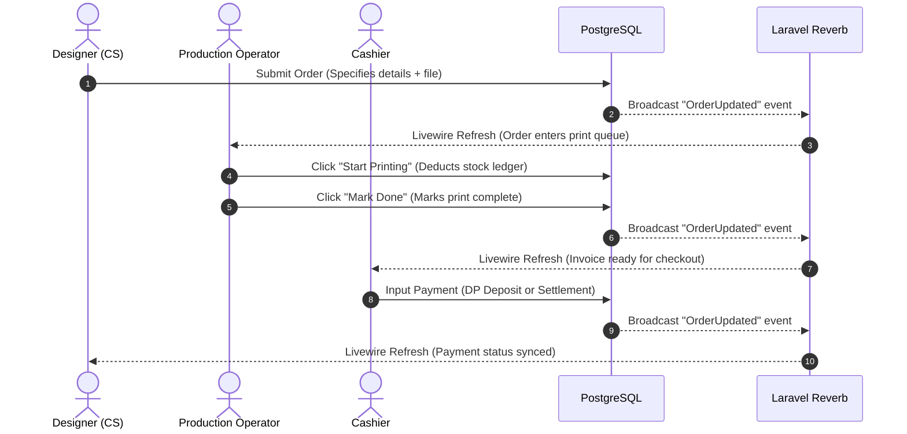

# ALJA Digiprint - Print Shop POS Rebuild

A modern, high-performance, reactive Point-of-Sale (POS) system built with Laravel 11, PostgreSQL, Livewire 3, Tailwind CSS, and Laravel Reverb (WebSockets). 

This project is a complete rebuild of the legacy CodeIgniter/Procedural PHP POS system (`pos_dp`) to optimize speed, security, and real-time operations for ALJA Digiprint.

---

## Glossary (Legacy to Modern)

To support transition while maintaining international coding standards, the new codebase translates legacy Indonesian names to clean English POS domains.

| Legacy Indonesian Term | Modern English Equivalent | Codebase Reference | Description |
| :--- | :--- | :--- | :--- |
| **Omset** | Gross Revenue | `grand_total` | Total revenue before deductions |
| **HPP (Harga Pokok)** | Cost of Goods Sold (COGS) | `cost` | Base cost of materials/consumables |
| **Laba** | Net Profit | `profit` | Revenue minus HPP (`grand_total - cost`) |
| **Saldo** | Net Balance | `amount` / `balance` | Final cash/account balance |
| **Pengeluaran** | Expense | `Expense` model | Cash drawer operational/capital costs |
| **Bahan Gagal** | Wasted Material | `WastedMaterial` model | Logged print failure sheets/meters |
| **bm** | Manager | `manager` role | Branch management & inventory restocking |
| **owner** | Owner | `owner` role | Performance metrics & financial reports |
| **kasir** | Cashier | `cashier` role | Down-payments (DP) & checkouts |
| **setting** | Designer / CS | `designer` role | Intakes files & calculates matrix pricing |
| **produksi** | Production Operator | `production` role | Operates printers, logs waste & starts print jobs |
| **kostumer** | Customer | `Customer` model | Dynamic client profiles |

---

## System Architecture & Event Flow

The system coordinates operations across 5 roles in real-time. When a state changes (e.g., order submitted or printed), the UI instantly reloads across screens using WebSockets (Laravel Reverb).



---

## Unified Routing Reference

* **Authentication:** `/login` - Universal portal routing users based on their active role.
* **Unified Dashboard:** `/dashboard` - Renders the user's specific dashboard based on their permission middleware.
* **Work Order / Job Ticket:** `/orders/{invoice}/ticket` - High-contrast design spec sheet optimized for thermal/standard printing.
* **Cashier Receipt:** `/orders/{invoice}/receipt` - 80mm-width receipt formatted specifically for thermal receipt printers.

---

## Installation & Environment Setup

Select the installation guide that fits your environment.

### Option A: General Local Setup (Without Docker)

Use this if you are running PHP, PostgreSQL, and Node.js directly on your local operating system.

#### Prerequisites
* PHP 8.2 or 8.3
* PostgreSQL
* Node.js (v18+) & npm
* Composer

#### Steps
1. **Clone & Configure Env:**
   Copy the example environment file and configure your database and Reverb variables:
   ```bash
   cp .env.example .env
   ```
   Modify `.env` to match your local PostgreSQL credentials:
   ```env
   DB_CONNECTION=pgsql
   DB_HOST=127.0.0.1
   DB_PORT=5432
   DB_DATABASE=pos_alja
   DB_USERNAME=your_username
   DB_PASSWORD=your_password
   ```

2. **Install Backend Dependencies:**
   ```bash
   composer install
   php artisan key:generate
   ```

3. **Database Migration & Importing Legacy Data:**
   Configure `LEGACY_DB_*` connection keys in `.env` if importing from a legacy database, then run:
   ```bash
   php artisan migrate
   php artisan db:migrate-legacy
   ```

4. **Install Frontend Assets & Build:**
   ```bash
   npm install
   npm run build
   ```

5. **Start Servers:**
   Start the local development server, Vite dev server, and WebSocket listener in separate terminals:
   ```bash
   # Run Laravel application
   php artisan serve

   # Run WebSockets (Reverb) server
   php artisan reverb:start
   ```

---

### Option B: Docker Development Stack Setup

Use this if you are running within the provided local Docker Compose environment.

#### Steps
1. **Host File Mapping:**
   Add the local domain routing to your host machine's `/etc/hosts` file:
   ```bash
   echo "127.0.0.1 pos_alja.php83.test" | sudo tee -a /etc/hosts
   ```

2. **Launch Docker Services:**
   Navigate to the root directory containing the `docker-compose.yml` file and start the services:
   ```bash
   sudo docker compose up -d
   ```

3. **Initialize Database and Run Migrations:**
   ```bash
   # Run PostgreSQL database migrations
   sudo docker exec -w /var/www/html/pos_alja local-php83 php artisan migrate:fresh

   # Run legacy migration script (imports users, materials, history, etc.)
   sudo docker exec -w /var/www/html/pos_alja local-php83 php artisan db:migrate-legacy
   ```

4. **Compile Assets (On Host):**
   Run asset building on the host system to bake in WebSocket configuration parameters:
   ```bash
   npm install
   npm run build
   ```

5. **Start WebSockets (Reverb):**
   ```bash
   sudo docker exec -d -w /var/www/html/pos_alja local-php83 php artisan reverb:start
   ```

---

## Default User Accounts

During the migration, all legacy users were imported and assigned a temporary default password.

* **Default Password:** `password123`

| Role | Username | Email | Name |
| :--- | :--- | :--- | :--- |
| **Owner** | `owner` | `owner@example.com` | Owner User |
| **Manager** | `bm` | `manager@example.com` | Manager User |
| **Cashier** | `kasir` | `cashier@example.com` | Cashier User |
| **Designer (CS)** | `desain` | `designer@example.com` | Designer User |
| **Production** | `produksi` | `production@example.com` | Production User |

---

## Post-Setup User Guide & Core Workflows

Once the installation is complete, you can follow this end-to-end guide to test and verify the printing workflows.

### 1. Intake a Customer Order (Designer / CS Role)
1. Log in at `/login` using the username `desain` and password `password123`.
2. Under the **Customer Selection** panel:
   * Search for an existing customer by typing a name, or
   * Click **New Customer** to register a client on the fly.
3. In the **Order Parameters** card, select a Product Category (e.g., Large Format). The input form adjusts dynamically.
4. Input details (Machine, Material, Side, Dimensions, and Quantity). The pricing engine updates the price, estimated cost (HPP), and profit parameters in real time.
5. Click **Add to Cart**. You can append multiple print jobs to the draft.
6. Click **Submit Order**. The database writes the Invoice and associated Orders in a transaction, dispatching a WebSocket broadcast to the production operators.

### 2. Process Printing Jobs (Production Operator Role)
1. Log in using the username `produksi` and password `password123`.
2. Locate the active print jobs list. You will notice the order submitted by the Designer appears immediately without reloading the page.
3. Click **Start Printing**. The system decreases the current stock level of the specified paper or banner roll dynamically.
4. If a print job fails (e.g., paper jam, bad coloring):
   * Fill out the **Log Failed Print** form.
   * Input the material, machine, and wasted quantity. The system automatically records the waste and deducts the inventory ledger.
5. Once printing succeeds, click **Mark Done**. The invoice updates and instantly alerts the cashier.

### 3. Settle Payment (Cashier Role)
1. Log in using the username `kasir` and password `password123`.
2. Under the **Active Invoices** queue, you will find the unpaid invoice.
3. If the customer pays a deposit first:
   * Click **Register DP** (Down Payment).
   * Input the DP amount and payment method (Cash/Transfer).
   * Click **Print Receipt** to open the 80mm receipt browser print window.
4. Once the prints are ready for pickup:
   * Click **Checkout / Settle**.
   * Input the payment received. The change is calculated automatically.
   * Settle the invoice, changing its state to Paid.

### 4. Review Analytics (Owner Role)
1. Log in using the username `owner` and password `password123`.
2. View real-time graphs showing today's, weekly, or monthly gross revenue (Omset), cost of materials (HPP), and net profits (Laba).
3. Analyze individual Designer/Production operator performance logs and branch balance trends.

---

## Maintenance & Troubleshooting

### Resetting and Re-Importing the Database
If you need to reset all transactional data and perform a clean re-migration of historical database records:
```bash
# General Setup
php artisan migrate:fresh --seed
php artisan db:migrate-legacy

# Docker Setup
sudo docker exec -w /var/www/html/pos_alja local-php83 php artisan migrate:fresh --seed
sudo docker exec -w /var/www/html/pos_alja local-php83 php artisan db:migrate-legacy
```

### Checking WebSockets Connectivity
If real-time dashboard updates are not syncing:
1. Ensure the Reverb port `8084` is accessible on the host machine.
2. Verify that the `.env` settings align:
   ```env
   REVERB_PORT=8084
   VITE_REVERB_PORT=8084
   ```
3. Check the Reverb container console log:
   ```bash
   sudo docker compose -f /home/arukast/Projects/localDev/docker-compose.yml logs php83
   ```

### Clearing Application Cache
If dashboard layout updates or translations are not visible:
```bash
php artisan optimize:clear
```

---

## Running Automated Tests

Run the test suite inside the PHP container to verify overall software integrity:
```bash
sudo docker exec -it -w /var/www/html/pos_alja local-php83 php artisan test
```
All 35 tests (140 assertions) covering pricing matrix calculations, authorization scopes, cashiering payments, and inventory ledgers must pass.
