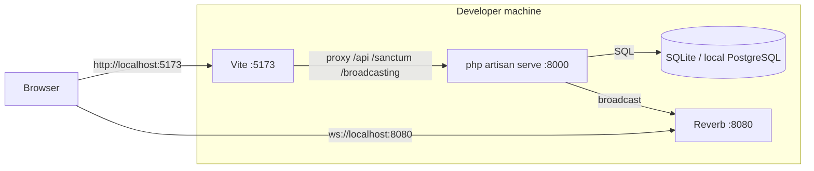
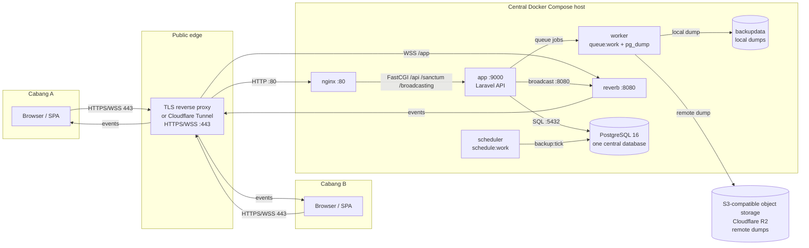

# Deployment

## 1. Runtime

- PHP 8.5 FPM with `pdo_pgsql`, `bcmath`, `intl`, `gd`, `zip`, `pcntl`, and `opcache`.
- PostgreSQL 16.
- `postgresql-client-16` from the PGDG apt repository, so `pg_dump` and `pg_restore` match the server major version. Debian bookworm's default client is 15, which refuses a PostgreSQL 16 server.
- A queue `worker` and a `scheduler` run the same app image as `app`. Scheduled backups need the scheduler, and every queued run needs the worker.
- Nginx serves `frontend/dist` and proxies `/api`, `/sanctum`, `/broadcasting`, and `/up` to PHP-FPM, with 600-second FastCGI timeouts on `/api` and `/sanctum` for large backup downloads. An exact location serves `/site.webmanifest` with `application/manifest+json`; `try_files $uri =404` keeps a missing manifest a 404, and the generic `location /` still provides the SPA fallback for client routes.
- Laravel Reverb runs on container port 8080 and host port 8084.

## 2. Deployment Modes

There are two deployment modes. They share one codebase; only the runtime and edge differ.

### 2.1 Local Development



Use this mode for development and local demos. It runs on one machine, does not use TLS, and does not integrate two branches. Native development defaults to SQLite; the backup dumper refuses a non-`pgsql` connection, so real backups require the Docker/PostgreSQL runtime.

### 2.2 Online Multi-Branch (Primary)



This is the primary deployment for integration between Cabang A and Cabang B:

1. Both branches use only a browser; there is no application server at each branch.
2. One central PostgreSQL stores both branches; `branch_id` isolates data.
3. Owner sees all branches; manager, cashier, designer, and production are branch-scoped.
4. SPA, API, and CSRF traffic go through the HTTPS edge to Nginx.
5. Reverb events go through the same edge as WSS on `443`, not `ws://host:8084`.
6. The backup arrows are implemented PB-10 flows: the `worker` writes the requested local dump to the `backupdata` volume and uploads the remote copy to S3-compatible object storage, with Cloudflare R2 recommended.

### 2.3 Optional Edge

| Edge option | Public IP | Inbound ports | TLS/WSS | Notes |
| :--- | :--- | :--- | :--- | :--- |
| VPS + Caddy/Nginx + Let's Encrypt | Yes | 443 | Yes | Most self-contained; proxy `/api`, `/sanctum`, `/broadcasting` and `/app` WebSocket to the app/Reverb |
| Cloudflare Tunnel | No | None | Cloudflare edge | `cloudflared` makes outbound connections; route `app.example.com` to `nginx:80` and `ws.example.com` to `reverb:8080` |
| Local development | No | None | No | Browser, Vite, PHP, and Reverb on one machine; not for two-branch integration |

Cloudflare Tunnel notes:

1. Use a named tunnel, not Quick Tunnel `trycloudflare.com`, for a stable deployment.
2. Store the tunnel token as a secret; never commit it.
3. Set `APP_URL`, `SANCTUM_STATEFUL_DOMAINS`, `SESSION_SECURE_COOKIE`, and `TRUSTED_PROXIES` for the public hostnames.
4. Rebuild the SPA with `VITE_REVERB_HOST=ws.example.com`, `VITE_REVERB_PORT=443`, and `VITE_REVERB_SCHEME=https`.
5. Do not put Cloudflare Access in front of the API without testing Sanctum cookies and CSRF.

## 3. Required Environment

Set these in the production `.env` before starting Compose:

| Variable | Purpose |
| :--- | :--- |
| `APP_ENV=production` | Production mode |
| `APP_DEBUG=false` | Never expose stack traces |
| `APP_KEY` | Laravel application key |
| `APP_URL` | Public HTTPS URL |
| `APP_LOCALE=id`, `APP_FALLBACK_LOCALE=en` | Indonesian messages; `en` supplies fallback keys |
| `DB_CONNECTION=pgsql`, `DB_HOST=db`, `DB_PORT=5432` | PostgreSQL connection |
| `DB_DATABASE`, `DB_USERNAME`, `DB_PASSWORD` | Database credentials |
| `SESSION_DRIVER=database`, `SESSION_SECURE_COOKIE=true` | HTTPS session cookie |
| `SESSION_DOMAIN`, `SANCTUM_STATEFUL_DOMAINS` | Same-origin SPA domains |
| `BROADCAST_CONNECTION=reverb` | Realtime driver |
| `REVERB_APP_ID`, `REVERB_APP_KEY`, `REVERB_APP_SECRET` | Reverb credentials |
| `REVERB_HOST`, `REVERB_PORT`, `REVERB_SCHEME` | Server-side Reverb target |
| `VITE_REVERB_APP_KEY`, `VITE_REVERB_HOST`, `VITE_REVERB_PORT`, `VITE_REVERB_SCHEME` | SPA build-time Reverb values |
| `AWS_ACCESS_KEY_ID`, `AWS_SECRET_ACCESS_KEY` | R2/S3 token (operator-only; never shown to the owner UI) |
| `AWS_DEFAULT_REGION` | `auto` for R2; confirm with the operator |
| `AWS_ENDPOINT` | R2/S3 endpoint URL |
| `AWS_BACKUP_BUCKET` | Private backup bucket. Leave the key absent to fall back to `AWS_BUCKET`, or set it explicitly; an empty `AWS_BACKUP_BUCKET=` suppresses the fallback and remote backup counts as unconfigured |
| `AWS_BACKUP_PREFIX` | Object key prefix, default `pos-alja-backups` |
| `AWS_USE_PATH_STYLE_ENDPOINT` | `false` for R2 unless the operator requires path-style |
| `BACKUP_REMOTE_ENABLED` | Seeds `backup_settings.remote_enabled` on first access; the owner UI is authoritative afterwards |
| `BACKUP_LOCAL_AT=02:00`, `BACKUP_REMOTE_AT=02:30` | Seed times, application timezone |
| `BACKUP_TIMEOUT=600` | `pg_dump` and job timeout, seconds |
| `BACKUP_REMOTE_QUOTA_MB=10240` | Quota used for the usage percentage and warnings |
| `BACKUP_PG_DUMP` | Optional `pg_dump` binary override; empty means `pg_dump` on `PATH` |
| `TRUSTED_PROXIES` | Exact proxy CIDRs, never `*` unless the proxy is fully trusted |

The SPA is built during the Docker image build. Rebuild the `nginx` target whenever the `VITE_REVERB_*` values change.

`config/app.php` defaults `locale` to `id`, but a production `.env` with `APP_LOCALE=en` overrides that default and silently re-enables English API messages even though the SPA copy stays Indonesian.

## 4. Docker Compose

```bash
docker compose up -d --build
docker compose exec app php artisan migrate --force
```

Services:

- `app`: PHP-FPM, Laravel API.
- `nginx`: static SPA plus API proxy; `fastcgi_read_timeout` and `fastcgi_send_timeout` are 600s on `/api` and `/sanctum` only, so large backup downloads are not cut at the default 60s.
- `db`: PostgreSQL with a named volume.
- `reverb`: Reverb WebSocket server.
- `worker`: same image as `app`, command `php artisan queue:work --sleep=3 --tries=1 --timeout=600`, mounts `backupdata`.
- `scheduler`: same image as `app`, command `php artisan schedule:work`; it only dispatches `backup:tick`, so it does not mount `backupdata`.

Named volumes: `pgdata` for PostgreSQL and `backupdata` mounted at `/var/www/html/storage/app/backups` on `app` and `worker`. `app`, `worker`, and `scheduler` share the same Compose environment anchor (`APP_ENV`, `DB_CONNECTION=pgsql`, `DB_HOST=db`, `SESSION_DRIVER=database`, `CACHE_STORE=database`, `QUEUE_CONNECTION=database`, `BROADCAST_CONNECTION=reverb`, etc.), not only `env_file: .env`.

`DB_QUEUE_RETRY_AFTER=900` is set in the Compose environment. It must stay above the job timeout (`BACKUP_TIMEOUT`, default 600) so a long dump is not retried while it is still running. `RunBackup` has `$tries = 1`; a failed job is not retried automatically.

The Compose file reads `.env` through `env_file`. `DB_PASSWORD` is required; there is no default. Do not run `docker compose config` on a production `.env`, because it prints interpolated secrets; use `docker compose config --services` or `--quiet` for validation.

## 5. Native Development

```bash
./init.sh
php artisan serve
php artisan reverb:start --host=0.0.0.0 --port=8080
npm --prefix frontend run dev
```

The SPA runs on `http://localhost:5173`; Vite proxies `/api`, `/sanctum`, and `/broadcasting` to `http://127.0.0.1:8000`.

## 6. CI

`.github/workflows/ci.yml` runs on `main`, `staging`, and pull requests:

- Backend: Composer install, tests, Pint `--test`, PHPStan, Composer audit on PHP 8.5.
- Frontend: Node 26, typecheck, lint, Vitest, production build.

CI does not auto-commit formatting changes.

## 7. Backups

PB-10 implements FR26. There are three independent run types, all recorded in `backups` and audited:

1. **Manual by the owner.** `POST /api/v1/backups` returns `202` and queues the job; the dump never runs in the request. Destination is `both` (local + R2) when remote backup is enabled and configured, `local` when remote is disabled, and `422` with no row when remote is enabled but unconfigured.
2. **Scheduled local.** `backup:tick` queues a local run when the owner-set local time is due and local backup is enabled.
3. **Scheduled remote (R2/S3).** `backup:tick` queues a remote-only run when the owner-set remote time is due and remote backup is enabled.

### 7.1 Scheduling And Settings

- `routes/console.php` schedules `backup:tick` every minute with `withoutOverlapping(5)`: the mutex expires after five minutes, not the framework default 24 hours.
- The tick reads `backup_settings` every run, so owner time/retention changes apply on the next tick without a scheduler restart. A missed time catches up on the next tick after downtime; `last_local_date`/`last_remote_date` stop duplicate daily runs.
- Defaults seed from `config/backup.php` on first access: local enabled at `02:00`, remote at `02:30` (application timezone, `Asia/Jakarta`), remote disabled by `BACKUP_REMOTE_ENABLED=false`. After the row exists, the database is the source of truth and env values are initial defaults only.
- The owner edits enable flags, times, and retention at `/owner/backups`. R2 credentials are never editable there; the operator sets them in `.env`.

### 7.2 Retention And Quota

- Retention is GFS per destination, applied only to the destinations written by that run.
- Default windows: local 30/12/12/3 and remote 7/4/12/3 (daily/weekly/monthly/yearly). The owner may change them within 7-90, 4-52, 6-24, and 1-10.
- Selection keeps the newest file overall, the newest file in the current and previous daily/weekly/monthly/yearly periods, and every pinned filename. Everything else in the destination tree `YYYY/MM/DD/*.dump` is deleted; the matching `local_path` or `remote_path` is set to `null` and the history row remains.
- Pinned files are exempt from deletion, still count toward usage, and can still be downloaded. Unpinning makes a file eligible on the next successful run.
- A retention window below 1 fails closed (the prune throws) rather than deleting everything; the failure is recorded in `meta.retention_error` and does not change a successful dump/upload status.
- Lowering retention is irreversible on the next successful run; raising it cannot restore deleted files.
- R2 quota defaults to 10 GB (`BACKUP_REMOTE_QUOTA_MB=10240`). `remote_usage_percent = remote_usage_bytes / remote_quota_bytes * 100`, computed from tracked rows. The page warns at 80% (amber) and 100% (red); the app never deletes archives or rewrites retention to meet the quota.

### 7.3 Image And Compose

- The app image adds the PGDG repository and `postgresql-client-16`, then creates `storage/app/backups` and `storage/app/backup-tmp` before the `www-data` chown. `pg_dump` and `pg_restore` must be on `PATH` for `www-data`.
- `worker` runs `php artisan queue:work --sleep=3 --tries=1 --timeout=600` and mounts the `backupdata` volume at `/var/www/html/storage/app/backups`. A backup is queued, never inline; without a worker the row stays `queued`.
- `scheduler` runs `php artisan schedule:work` and does not mount the volume.
- `DB_QUEUE_RETRY_AFTER=900` must exceed the job timeout (`BACKUP_TIMEOUT=600`).
- nginx sets `fastcgi_read_timeout 600s` and `fastcgi_send_timeout 600s` on the `/api` and `/sanctum` locations only; `/broadcasting`, `/up`, and static files keep nginx defaults. A large local or R2 download is not cut at 60 seconds.
- Remote-only runs dump to `storage/app/backup-tmp` and delete the temporary file after upload; `both` dumps once to the local volume and uploads that file. Retention never sees temp files.

### 7.4 Required Environment

The backup and R2 variables are listed once in the required-environment table in section 3. This section adds only the production requirements: keep the bucket private, enable R2 server-side encryption, use TLS, and scope the token to the backup bucket. Client-side encryption is deferred; the dump is not encrypted by the app. `.env.example` ships `AWS_DEFAULT_REGION=us-east-1`; R2 needs `auto`, so confirm that value and `AWS_USE_PATH_STYLE_ENDPOINT` with the operator.

### 7.5 Restore Procedure

No restore API or UI exists. Restore is an operator procedure. Never restore over the application database.

1. Create a scratch database in the running PostgreSQL:

   ```bash
   docker compose exec -e PGPASSWORD=<password> worker createdb -h db -U <user> <scratch_db>
   ```

2. For a local volume backup, restore the dump into the scratch database:

   ```bash
   docker compose exec -e PGPASSWORD=<password> worker pg_restore --clean --if-exists --no-owner -h db -U <user> -d <scratch_db> /var/www/html/storage/app/backups/YYYY/MM/DD/<file>.dump
   ```

3. For an R2 backup, download the object first (an S3 client or `rclone copy` from `<bucket>/<prefix>/YYYY/MM/DD/<file>.dump` on the host), copy it into the worker with `docker compose cp ./<file>.dump worker:/tmp/<file>.dump`, then run the same `pg_restore` with `/tmp/<file>.dump`.

4. Verify the restored copy and drop the scratch database:

   ```bash
   docker compose exec -e DB_DATABASE=<scratch_db> worker php artisan migrate:status
   docker compose exec -e PGPASSWORD=<password> worker psql -h db -U <user> -d <scratch_db> -c "select count(*) from invoices;"
   docker compose exec -e PGPASSWORD=<password> worker psql -h db -U <user> -d <scratch_db> -c "select count(*) from payments;"
   docker compose exec -e PGPASSWORD=<password> worker dropdb -h db -U <user> <scratch_db>
   ```

5. Record the drill in this section and in the session handoff.

| Drill owner | Date | Dump file | Local/R2 | Result |
| :--- | :--- | :--- | :--- | :--- |
| Not run | - | - | - | RPO/RTO unclaimed |

Drill status: **not verified.** This environment has no Docker CLI, no PostgreSQL 16 server, and no `pg_dump`/`psql`, so no restore was executed and no RPO (<= 24 h) or RTO (<= 4 h) evidence exists. The test suite runs on SQLite with a fake dumper and `Storage::fake('backups-s3')`. A live R2 upload is also unverified.

### 7.6 Known Limitations

- The dump covers PostgreSQL only. Uploaded files and object-storage assets are not backed up.
- No client-side encryption, no point-in-time recovery, and no WAL archiving.
- No in-app restore and no backup of the backup.
- No stale-run cleanup or automatic retry. A killed worker leaves a `running` row; the page labels it `Mungkin macet` after 30 minutes. A queued row with no worker stays `queued`.
- The first real dump size is unknown, so whether the lean R2 set fits the free tier is unmeasured. The defaults are 7/4/12/3 on R2 and 30/12/12/3 locally.
- The `change()` migration (`backups.filename` nullable), the Docker image with `postgresql-client-16`, and the nginx config are unverified in this environment (no Docker, no `pg_dump`, no nginx binary).
- UI smoke and 390/768/1440 screenshots are recorded in `.ai-docs/screens/pb10/`; dark mode remains unverified.

### 7.1 Irreversible Drop Migrations

The Unit A drop migrations (`2026_11_27_000003_drop_product_category_discounts_table.php` and `2026_11_27_000004_drop_attribute_types_table.php`) are irreversible. Their `down()` methods recreate empty tables only; dropped rows cannot be recovered.

Before `php artisan migrate --force` on any database that may contain rows in `product_category_discounts` or `attribute_types`, take and verify a backup: at minimum `pg_dump -Fc -t product_category_discounts -t attribute_types <database>` (a full database dump is also acceptable), confirm it restores, and get Owner approval to proceed. If either table is non-empty and no verified backup exists, stop.

## 8. Deployment Checklist

1. Set production `.env` values, including HTTPS session and Sanctum domains.
2. Build and start Compose.
3. Run migrations.
4. Confirm `/up` returns 200.
5. Run `php artisan tinker --execute="echo app()->getLocale();"`; it must print `id`.
6. Log in through the SPA; verify CSRF, cookies, and one flow per role.
7. Confirm Reverb connects and `OrderUpdated` arrives on the private channel.
8. Confirm the SPA is served from `frontend/dist` and API paths never return the SPA shell.
9. Confirm the `worker` and `scheduler` services are running; `docker compose exec scheduler php artisan schedule:list` must show `backup:tick` every minute with `withoutOverlapping`.
10. Open `/owner/backups`; save settings, run one manual backup, confirm it leaves `queued`, and download the file. Inspect `backups` and the `BACKUP` audit row.
11. Run the restore drill in section 7.5 and record the result; until then RPO/RTO stay unclaimed.
12. Record any skipped verification in the change description.
