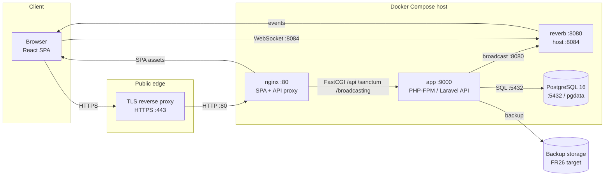

# Deployment

## 1. Runtime

- PHP 8.5 FPM with `pdo_pgsql`, `bcmath`, `intl`, `gd`, `zip`, `pcntl`, and `opcache`.
- PostgreSQL 16.
- Nginx serves `frontend/dist` and proxies `/api`, `/sanctum`, `/broadcasting`, and `/up` to PHP-FPM.
- Laravel Reverb runs on container port 8080 and host port 8084.

## 2. Deployment Diagram



How to read the diagram:

1. The browser loads the React SPA from Nginx through the HTTPS edge.
2. API, Sanctum, CSRF, and broadcasting-auth calls go through Nginx to the Laravel app on `app:9000`.
3. The app reads and writes PostgreSQL on the internal `:5432`; the database is not exposed to the host.
4. The app sends realtime events to Reverb. The browser connects directly to Reverb on host `:8084`, while `/broadcasting/auth` goes through Nginx to the app.
5. The backup arrow points to FR26 target storage. It is solid because it is part of the target topology, not because backup is already implemented.

Deployment notes:

1. Nginx listens on HTTP `80`. In production, TLS terminates at the edge; set `APP_URL` to HTTPS, secure cookies, and exact `TRUSTED_PROXIES`.
2. PostgreSQL persists through the `pgdata` volume.
3. Compose currently has no queue worker or scheduler service. `QUEUE_CONNECTION=database`; add a worker before relying on queued jobs, and a scheduler before FR26 scheduled backup.
4. CI is not part of the runtime diagram. GitHub Actions runs tests and builds only; deployment remains manual: `docker compose up -d --build`, then `docker compose exec app php artisan migrate --force`.
5. `/up` is the health endpoint used by the reverse proxy or uptime monitor.

## 3. Required Environment

Set these in the production `.env` before starting Compose:

| Variable | Purpose |
| :--- | :--- |
| `APP_ENV=production` | Production mode |
| `APP_DEBUG=false` | Never expose stack traces |
| `APP_KEY` | Laravel application key |
| `APP_URL` | Public HTTPS URL |
| `APP_LOCALE=id`, `APP_FALLBACK_LOCALE=en` | Indonesian messages; `en` supplies fallback keys |
| `DB_CONNECTION=pgsql`, `DB_HOST=db`, `DB_PORT=5432` | PostgreSQL connection |
| `DB_DATABASE`, `DB_USERNAME`, `DB_PASSWORD` | Database credentials |
| `SESSION_DRIVER=database`, `SESSION_SECURE_COOKIE=true` | HTTPS session cookie |
| `SESSION_DOMAIN`, `SANCTUM_STATEFUL_DOMAINS` | Same-origin SPA domains |
| `BROADCAST_CONNECTION=reverb` | Realtime driver |
| `REVERB_APP_ID`, `REVERB_APP_KEY`, `REVERB_APP_SECRET` | Reverb credentials |
| `REVERB_HOST`, `REVERB_PORT`, `REVERB_SCHEME` | Server-side Reverb target |
| `VITE_REVERB_APP_KEY`, `VITE_REVERB_HOST`, `VITE_REVERB_PORT`, `VITE_REVERB_SCHEME` | SPA build-time Reverb values |
| `TRUSTED_PROXIES` | Exact proxy CIDRs, never `*` unless the proxy is fully trusted |

The SPA is built during the Docker image build. Rebuild the `nginx` target whenever the `VITE_REVERB_*` values change.

`config/app.php` defaults `locale` to `id`, but a production `.env` with `APP_LOCALE=en` overrides that default and silently re-enables English API messages even though the SPA copy stays Indonesian.

## 4. Docker Compose

```bash
docker compose up -d --build
docker compose exec app php artisan migrate --force
```

Services:

- `app`: PHP-FPM, Laravel API.
- `nginx`: static SPA plus API proxy.
- `db`: PostgreSQL with a named volume.
- `reverb`: Reverb WebSocket server.

The Compose file reads `.env` through `env_file`. `DB_PASSWORD` is required; there is no default. Run `docker compose config` with your production `.env` before starting.

## 5. Native Development

```bash
./init.sh
php artisan serve
php artisan reverb:start --host=0.0.0.0 --port=8080
npm --prefix frontend run dev
```

The SPA runs on `http://localhost:5173`; Vite proxies `/api`, `/sanctum`, and `/broadcasting` to `http://127.0.0.1:8000`.

## 6. CI

`.github/workflows/ci.yml` runs on `main`, `staging`, and pull requests:

- Backend: Composer install, tests, Pint `--test`, PHPStan, Composer audit on PHP 8.5.
- Frontend: Node 26, typecheck, lint, Vitest, production build.

CI does not auto-commit formatting changes.

## 7. Backups

FR26 (scheduled database backup) is not implemented. Until that sprint, use the PostgreSQL provider's snapshot schedule or a cron job running `pg_dump` outside this repository. Do not claim backup coverage from this refactor.

## 8. Deployment Checklist

1. Set production `.env` values, including HTTPS session and Sanctum domains.
2. Build and start Compose.
3. Run migrations.
4. Confirm `/up` returns 200.
5. Run `php artisan tinker --execute="echo app()->getLocale();"`; it must print `id`.
6. Log in through the SPA; verify CSRF, cookies, and one flow per role.
7. Confirm Reverb connects and `OrderUpdated` arrives on the private channel.
8. Confirm the SPA is served from `frontend/dist` and API paths never return the SPA shell.
9. Record any skipped verification in the change description.
