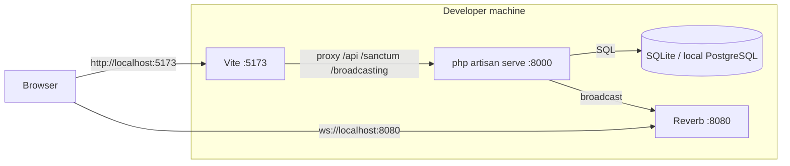
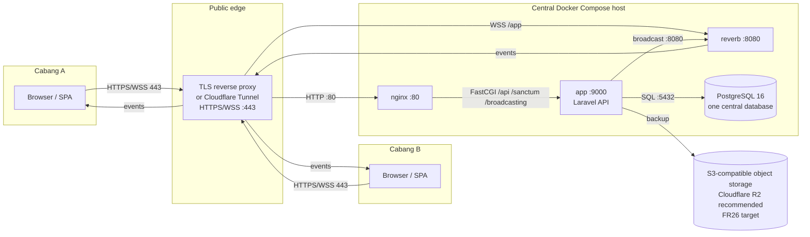

# Deployment

## 1. Runtime

- PHP 8.5 FPM with `pdo_pgsql`, `bcmath`, `intl`, `gd`, `zip`, `pcntl`, and `opcache`.
- PostgreSQL 16.
- Nginx serves `frontend/dist` and proxies `/api`, `/sanctum`, `/broadcasting`, and `/up` to PHP-FPM.
- Laravel Reverb runs on container port 8080 and host port 8084.

## 2. Deployment Modes

There are two deployment modes. They share one codebase; only the runtime and edge differ.

### 2.1 Local Development



Use this mode for development and local demos. It runs on one machine, does not use TLS, and does not integrate two branches.

### 2.2 Online Multi-Branch (Primary)



This is the primary deployment for integration between Cabang A and Cabang B:

1. Both branches use only a browser; there is no application server at each branch.
2. One central PostgreSQL stores both branches; `branch_id` isolates data.
3. Owner sees all branches; manager, cashier, designer, and production are branch-scoped.
4. SPA, API, and CSRF traffic go through the HTTPS edge to Nginx.
5. Reverb events go through the same edge as WSS on `443`, not `ws://host:8084`.
6. The backup arrow points to S3-compatible object storage, with Cloudflare R2 recommended. It is solid because it is part of the target topology; FR26 is still target.

### 2.3 Optional Edge

| Edge option | Public IP | Inbound ports | TLS/WSS | Notes |
| :--- | :--- | :--- | :--- | :--- |
| VPS + Caddy/Nginx + Let's Encrypt | Yes | 443 | Yes | Most self-contained; proxy `/api`, `/sanctum`, `/broadcasting` and `/app` WebSocket to the app/Reverb |
| Cloudflare Tunnel | No | None | Cloudflare edge | `cloudflared` makes outbound connections; route `app.example.com` to `nginx:80` and `ws.example.com` to `reverb:8080` |
| Local development | No | None | No | Browser, Vite, PHP, and Reverb on one machine; not for two-branch integration |

Cloudflare Tunnel notes:

1. Use a named tunnel, not Quick Tunnel `trycloudflare.com`, for a stable deployment.
2. Store the tunnel token as a secret; never commit it.
3. Set `APP_URL`, `SANCTUM_STATEFUL_DOMAINS`, `SESSION_SECURE_COOKIE`, and `TRUSTED_PROXIES` for the public hostnames.
4. Rebuild the SPA with `VITE_REVERB_HOST=ws.example.com`, `VITE_REVERB_PORT=443`, and `VITE_REVERB_SCHEME=https`.
5. Do not put Cloudflare Access in front of the API without testing Sanctum cookies and CSRF.

## 3. Required Environment

Set these in the production `.env` before starting Compose:

| Variable | Purpose |
| :--- | :--- |
| `APP_ENV=production` | Production mode |
| `APP_DEBUG=false` | Never expose stack traces |
| `APP_KEY` | Laravel application key |
| `APP_URL` | Public HTTPS URL |
| `APP_LOCALE=id`, `APP_FALLBACK_LOCALE=en` | Indonesian messages; `en` supplies fallback keys |
| `DB_CONNECTION=pgsql`, `DB_HOST=db`, `DB_PORT=5432` | PostgreSQL connection |
| `DB_DATABASE`, `DB_USERNAME`, `DB_PASSWORD` | Database credentials |
| `SESSION_DRIVER=database`, `SESSION_SECURE_COOKIE=true` | HTTPS session cookie |
| `SESSION_DOMAIN`, `SANCTUM_STATEFUL_DOMAINS` | Same-origin SPA domains |
| `BROADCAST_CONNECTION=reverb` | Realtime driver |
| `REVERB_APP_ID`, `REVERB_APP_KEY`, `REVERB_APP_SECRET` | Reverb credentials |
| `REVERB_HOST`, `REVERB_PORT`, `REVERB_SCHEME` | Server-side Reverb target |
| `VITE_REVERB_APP_KEY`, `VITE_REVERB_HOST`, `VITE_REVERB_PORT`, `VITE_REVERB_SCHEME` | SPA build-time Reverb values |
| `TRUSTED_PROXIES` | Exact proxy CIDRs, never `*` unless the proxy is fully trusted |

The SPA is built during the Docker image build. Rebuild the `nginx` target whenever the `VITE_REVERB_*` values change.

`config/app.php` defaults `locale` to `id`, but a production `.env` with `APP_LOCALE=en` overrides that default and silently re-enables English API messages even though the SPA copy stays Indonesian.

## 4. Docker Compose

```bash
docker compose up -d --build
docker compose exec app php artisan migrate --force
```

Services:

- `app`: PHP-FPM, Laravel API.
- `nginx`: static SPA plus API proxy.
- `db`: PostgreSQL with a named volume.
- `reverb`: Reverb WebSocket server.

The Compose file reads `.env` through `env_file`. `DB_PASSWORD` is required; there is no default. Run `docker compose config` with your production `.env` before starting.

## 5. Native Development

```bash
./init.sh
php artisan serve
php artisan reverb:start --host=0.0.0.0 --port=8080
npm --prefix frontend run dev
```

The SPA runs on `http://localhost:5173`; Vite proxies `/api`, `/sanctum`, and `/broadcasting` to `http://127.0.0.1:8000`.

## 6. CI

`.github/workflows/ci.yml` runs on `main`, `staging`, and pull requests:

- Backend: Composer install, tests, Pint `--test`, PHPStan, Composer audit on PHP 8.5.
- Frontend: Node 26, typecheck, lint, Vitest, production build.

CI does not auto-commit formatting changes.

## 7. Backups

FR26 (manual and scheduled database backup) is not implemented yet. The target storage is **S3-compatible object storage**, with **Cloudflare R2 recommended** because it is S3-compatible, has no egress fee, and fits the Cloudflare Tunnel edge.

Target flow:

```text
cron / systemd timer or Laravel scheduler
  -> pg_dump -Fc
  -> encrypt with age or rclone crypt
  -> rclone copy to r2:pos-alja-backups/YYYY/MM/DD/
  -> apply lifecycle retention
  -> record success/failure and audit log
```

Requirements:

1. Keep the bucket private and scope the R2 token to the backup bucket only.
2. Encrypt before upload; store the encryption key outside the bucket.
3. Retention: daily 7 days, weekly 4 weeks, monthly 12 months.
4. Target RPO <= 24 hours and RTO <= 4 hours, per NFR6.
5. Run a restore drill: download, decrypt, `pg_restore`, and verify invoice, payment, and stock counts.
6. Host-level `rclone` needs no PHP dependency. An app-driven backup needs an S3 adapter dependency and explicit approval.
7. Google Drive via `rclone` remains a fallback, but R2 is preferred for automated backups.
8. Do not claim backup coverage until FR26 is implemented and the restore drill passes.

### 7.1 Irreversible Drop Migrations

The Unit A drop migrations (`2026_11_27_000003_drop_product_category_discounts_table.php` and `2026_11_27_000004_drop_attribute_types_table.php`) are irreversible. Their `down()` methods recreate empty tables only; dropped rows cannot be recovered.

Before `php artisan migrate --force` on any database that may contain rows in `product_category_discounts` or `attribute_types`, take and verify a backup: at minimum `pg_dump -Fc -t product_category_discounts -t attribute_types <database>` (a full database dump is also acceptable), confirm it restores, and get Owner approval to proceed. If either table is non-empty and no verified backup exists, stop.

## 8. Deployment Checklist

1. Set production `.env` values, including HTTPS session and Sanctum domains.
2. Build and start Compose.
3. Run migrations.
4. Confirm `/up` returns 200.
5. Run `php artisan tinker --execute="echo app()->getLocale();"`; it must print `id`.
6. Log in through the SPA; verify CSRF, cookies, and one flow per role.
7. Confirm Reverb connects and `OrderUpdated` arrives on the private channel.
8. Confirm the SPA is served from `frontend/dist` and API paths never return the SPA shell.
9. Record any skipped verification in the change description.
