# Entity Relationship Diagram

- **Database:** PostgreSQL in production, SQLite in the automated test suite.
- **Keys:** All primary keys are UUID strings. Foreign keys are UUID strings.
- **Table naming:** Eloquent default pluralization, except `material_branch_stock`, which uses a singular table name.
- **Soft deletes:** Present on `branches`, `users`, `customers`, `products`, `materials`, `attributes`, and `pricing`.
- **Target schema:** This diagram shows the target schema after Sprint Review 1. PB-05/PB-07 inventory purchasing, stock-ledger traceability, material units, the machine-table drop, production failure, and the Unit A catalog cleanup are implemented; remaining target changes are tracked in `docs/requirements/implementation-gaps.md`.
- **Current transitional tables:** `PRICING` and `ATTRIBUTE_PRICING` exist in the current build and are the price source; the target pricing redesign replaces them (note 4).
- **Machine tables:** `machines` and `machine_pricing` are dropped by `2026_11_25_000002_drop_machines_tables.php`; their rows are unrecoverable. `pricing` and `attribute_pricing` remain and are the current price source.
- **API-first status:** The React refactor did not add domain tables. Sanctum adds `personal_access_tokens`; the purchase and stock-ledger tables and columns are implemented as described here, while the remaining business tables follow this target.

```mermaid
erDiagram
    BRANCHES |o--o{ USERS : "assigns staff"
    BRANCHES ||--o{ MATERIAL_BRANCH_STOCK : "holds stock"
    BRANCHES |o--o{ ATTRIBUTES : "owns"
    BRANCHES |o--o{ PRICING : "owns"
    BRANCHES |o--o{ INVOICES : "issues"
    BRANCHES ||--o{ PAYMENTS : "receives"
    BRANCHES ||--o{ EXPENSES : "incurs"
    BRANCHES |o--o{ WASTED_MATERIALS : "logs"
    BRANCHES |o--o{ STOCK_LEDGERS : "records"
    BRANCHES |o--o{ ACTIVITY_LOGS : "audits"
    BRANCHES ||--o{ PURCHASES : "records"

    CUSTOMERS ||--o{ INVOICES : "places"

    PRODUCT_CATEGORIES |o--o{ PRODUCTS : "groups"
    PRODUCT_CATEGORIES ||--o{ MATERIALS : "groups"

    PRODUCTS ||--o{ ORDERS : "ordered as"
    PRODUCTS ||--o{ PRICING : "priced as"
    PRODUCTS ||--o{ MATERIAL_PRODUCT : "maps"
    MATERIALS ||--o{ ORDERS : "uses"
    MATERIALS ||--o{ PRICING : "priced as"
    MATERIALS ||--o{ MATERIAL_PRODUCT : "compatible with"
    MATERIALS ||--o{ MATERIAL_BRANCH_STOCK : "stocked at"
    MATERIALS ||--o{ STOCK_LEDGERS : "moves"
    MATERIALS ||--o{ WASTED_MATERIALS : "wasted"
    MATERIALS ||--o{ PURCHASE_ITEMS : "purchased as"

    ATTRIBUTES ||--o{ ORDER_ATTRIBUTES : "selected as"
    ATTRIBUTES ||--o{ ATTRIBUTE_PRICING : "modifies"
    PRICING ||--o{ ATTRIBUTE_PRICING : "modifiers"
    PRICING |o--o{ ORDERS : "quoted by"

    INVOICES ||--o{ ORDERS : "contains"
    INVOICES ||--o{ PAYMENTS : "settled by"
    ORDERS ||--o{ ORDER_ATTRIBUTES : "has"
    ORDERS ||--o{ ORDER_STATUS_LOGS : "status history"
    ORDERS |o--o{ WASTED_MATERIALS : "optional link"
    PURCHASES ||--o{ PURCHASE_ITEMS : "contains"

    USERS |o--o{ INVOICES : "designer"
    USERS |o--o{ ORDERS : "operator"
    USERS |o--o{ ORDERS : "approves design"
    USERS |o--o{ PAYMENTS : "cashier"
    USERS |o--o{ ORDER_STATUS_LOGS : "actor"
    USERS |o--o{ STOCK_LEDGERS : "records"
    USERS ||--o{ PURCHASES : "actor"
    USERS |o--o{ WASTED_MATERIALS : "designer"
    USERS |o--o{ WASTED_MATERIALS : "operator"
    USERS |o--o{ EXPENSES : "records"
    USERS |o--o{ ACTIVITY_LOGS : "actor"

    BRANCHES {
        uuid id PK
        string name
        string code UK
        string address
        string phone
        boolean is_active
        decimal reseller_discount_percent
        json settings
        timestamp deleted_at
    }

    USERS {
        uuid id PK
        string name
        string username UK
        string email
        timestamp email_verified_at
        string password
        string role
        uuid branch_id FK
        string phone
        text address
        timestamp deleted_at
    }

    CUSTOMERS {
        uuid id PK
        string name
        string phone
        text address
        string email
        string institution
        string type
        timestamp deleted_at
    }

    PRODUCT_CATEGORIES {
        uuid id PK
        string name
        string description
        boolean is_active
        string calculation_archetype
        json allowed_attribute_types
    }

    PRODUCTS {
        uuid id PK
        uuid product_category_id FK
        string name
        string pricing_type
        boolean is_active
        timestamp deleted_at
    }

    MATERIAL_PRODUCT {
        uuid product_id FK
        uuid material_id FK
        timestamp created_at
        timestamp updated_at
    }

    PRICING["PRICING (current, transitional)"] {
        uuid id PK
        uuid branch_id FK
        uuid product_id FK
        uuid material_id FK
        string customer_type
        integer min_qty
        decimal price
        decimal cost
        decimal profit
        timestamp deleted_at
    }

    ATTRIBUTE_PRICING["ATTRIBUTE_PRICING (current, transitional)"] {
        uuid id PK
        uuid branch_id FK
        uuid pricing_id FK
        uuid attribute_id FK
        decimal price
        decimal cost
        decimal profit
    }

    MATERIALS {
        uuid id PK
        uuid product_category_id FK
        string name
        string type
        string unit
        string dimensions
        decimal cost
        decimal price
        timestamp deleted_at
    }

    MATERIAL_BRANCH_STOCK {
        uuid id PK
        uuid material_id FK
        uuid branch_id FK
        decimal current_stock
        decimal min_stock
    }

    ATTRIBUTES {
        uuid id PK
        uuid branch_id FK
        string name
        string type
        decimal price
        decimal cost
        boolean is_active
        timestamp deleted_at
    }

    INVOICES {
        uuid id PK
        string invoice_number UK
        uuid branch_id FK
        timestamp created_date
        timestamp payment_date
        timestamp dp_date
        uuid customer_id FK
        uuid designer_id FK
        integer status
        decimal discount
        decimal dp_amount
        decimal accounts_receivable
        decimal grand_total
        decimal total_cost
        decimal total_profit
        timestamp deadline
        integer pickup_status
        timestamp pickup_date
        integer source
    }

    ORDERS {
        uuid id PK
        uuid invoice_id FK
        uuid pricing_id FK
        uuid product_id FK
        uuid material_id FK
        uuid operator_id FK
        string file_name
        string file_path
        string preview_path
        text notes
        decimal area
        decimal quantity
        decimal unit_price
        string customer_type
        decimal reseller_discount_percent
        decimal discount_amount
        decimal subtotal
        decimal cost
        decimal profit
        timestamp ordered_at
        integer status
        integer design_status
        timestamp design_approved_at
        uuid design_approved_by FK
        integer priority
        integer pickup_status
        timestamp pickup_date
        boolean is_manual_price
    }

    ORDER_ATTRIBUTES {
        uuid id PK
        uuid order_id FK
        uuid attribute_id FK
        string type
        decimal price
        decimal cost
    }

    PAYMENTS {
        uuid id PK
        uuid branch_id FK
        uuid invoice_id FK
        uuid user_id FK
        decimal amount
        string payment_method
        string type
        string cashier_name
    }

    EXPENSES {
        uuid id PK
        uuid branch_id FK
        uuid user_id FK
        timestamp incurred_at
        decimal amount
        text description
        string recorded_by_name
        string type
        string category
    }

    WASTED_MATERIALS {
        uuid id PK
        uuid branch_id FK
        timestamp logged_at
        uuid material_id FK
        uuid order_id FK
        uuid designer_id FK
        uuid operator_id FK
        decimal quantity
        string dimensions
        text notes
    }

    STOCK_LEDGERS {
        uuid id PK
        uuid branch_id FK
        uuid material_id FK
        uuid user_id FK
        string type
        string reason
        string reference_type
        uuid reference_id
        timestamp logged_at
        decimal initial_stock
        decimal added_stock
        decimal used_stock
        decimal wasted_stock
        decimal remaining_stock
        text notes
    }

    PURCHASES {
        uuid id PK
        uuid branch_id FK
        uuid user_id FK
        timestamp purchased_at
        string supplier
        decimal total_amount
        text notes
        string idempotency_key
    }

    PURCHASE_ITEMS {
        uuid id PK
        uuid purchase_id FK
        uuid material_id FK
        decimal quantity
        decimal unit_cost
        decimal subtotal
    }

    ORDER_STATUS_LOGS {
        uuid id PK
        uuid order_id FK
        integer status
        uuid user_id FK
        string user_name
        string notes
    }

    ACTIVITY_LOGS {
        uuid id PK
        uuid branch_id FK
        uuid user_id FK
        string username
        string role
        string action
        string description
        string model_type
        uuid model_id
        json payload
    }
```

---

## Relationship Notes

1. **`attributes.type` has no reference table.** It stores `finishing` or `display`; legacy `cut` rows remain. Referential integrity is by request validation, not by key.
2. **`material_branch_stock` is the only stock junction with a unique `(material_id, branch_id)` constraint.** `material_product` has a composite primary key `(product_id, material_id)`.
3. **`orders` is a line item of `invoices`.** The invoice carries the financial roll-up (`grand_total`, `total_cost`, `total_profit`), while each order carries its own `unit_price`, `subtotal`, `cost`, and `profit`.
4. **`pricing` remains the current price source.** `orders.pricing_id` selects a row by product, material, customer type, and `min_qty`; `attribute_pricing` supplies the finishing/display modifiers. The `/pricing` endpoints remain, along with `/manager/pricing` (`Matriks Harga`). `branches.reseller_discount_percent` (`0–100`, default `0`, mirrored in `branches.settings.reseller_discount_percent` and editable on `/owner/branches`) is the reseller discount source. `DELETE /pricing/{pricing}` is a soft delete: quote lookups exclude deleted rows, invoice history resolves product and material names through trashed pricing rows with `withTrashed()`, and no restore endpoint exists. The target replaces `pricing` and `attribute_pricing` with material price + finishing/display price + reseller discount + product-level quantity tiers (Unit B design). No order-level tier column is specified.
5. **`order_attributes` is target-only.** No table exists; finishing/display selections are persisted on `orders.selected_attributes` as the attribute IDs used for pricing modifiers, without a per-attribute price/cost snapshot. The target keeps at most one row per `(order_id, type)` with a price/cost snapshot.
6. **`orders.operator_id`** is the production operator who started or completed the job; it is null until production starts.
7. **`invoices.designer_id`** is the user who submitted the order.
8. **`payments.user_id`** is the cashier; `payments.cashier_name` is a denormalized audit copy.
9. **`expenses.user_id`** is the Owner or Branch Manager who recorded the expense; `recorded_by_name` is the audit copy. `expenses.category` is a fixed dropdown, not free text.
10. **`activity_logs.model_id` is a UUID without a foreign key**, allowing the log to reference any model type.
11. **`branch_id` is nullable on** `users`, `attributes`, `pricing`, `attribute_pricing`, `invoices`, `wasted_materials`, `stock_ledgers`, and `activity_logs`. A null value means "global" or "unassigned", depending on the table; owner accounts are the main case for a null user branch.
12. **Soft-deleted rows are not shown separately.** The `deleted_at` column is included only on tables that use `SoftDeletes`; deleted rows remain in the table.
13. **`product_categories` rows are never deleted.** `is_active` is the retire mechanism: deactivating a category leaves its products and materials untouched. `calculation_archetype` and `allowed_attribute_types` remain dead columns but are still present in the table.
14. **Target and implemented additions.** The following columns and tables are part of the target schema:
    - `branches.reseller_discount_percent` for Reseller pricing; implemented by `2026_11_25_000002_add_reseller_discount_percent_to_branches_table.php`.
    - `products.is_active` for catalog filtering; implemented by `2026_11_23_000000_add_is_active_and_indexes_to_products_table.php`.
    - `product_categories.calculation_archetype` made nullable (default `per_piece`) and `allowed_attribute_types` deprecated from Category API/UI, with `products.pricing_type` backfilled to `area` for legacy `surface_area` categories by `2026_11_27_000000_drop_category_archetype_and_allowed_types.php`.
    - `material_product` pivot for compatible materials per product (backfilled from `pricing`) by `2026_11_27_000001_create_material_product_table.php`.
    - `product_categories.description` and `is_active`, with `product_category_discounts` dropped, by `2026_11_27_000002_add_description_and_is_active_to_product_categories_table.php` and `2026_11_27_000003_drop_product_category_discounts_table.php`.
    - `attribute_types` dropped by `2026_11_27_000004_drop_attribute_types_table.php`; `attributes.type` stays a string validated as `finishing` or `display`, while legacy `cut` rows remain.
    - `materials.unit` for `m2`, `pcs`, `lembar`, `roll`, `kg`, `liter`, and `batang`; implemented by `2026_11_25_000001_add_unit_to_materials_table.php` with default `pcs` and a name/category/archetype backfill.
    - `attributes.price`, `attributes.cost`, and `attributes.is_active`; implemented by `2026_11_25_000001_add_price_cost_is_active_to_attributes_table.php`.
    - `orders.product_id`, `material_id`, `customer_type`, `reseller_discount_percent`, `discount_amount`, `design_status`, `design_approved_at`, `design_approved_by`, and `priority`.
    - `customers.institution` for customer classification; implemented by `2026_11_25_000000_add_institution_to_customers_table.php`.
    - The transitional order quote-input columns `width`, `length`, and `selected_attributes` are added by `2026_11_26_100000_add_order_edit_specifications.php` and persisted by invoice create/update so pre-production edits can reprice from the saved specifications.
    - `order_attributes` for finishing/display snapshots.
    - `expenses.user_id` and `recorded_by_name`.
    - `stock_ledgers.user_id`, `type`, `reason`, `reference_type`, and `reference_id`; implemented by `2026_11_24_000001_add_traceability_to_stock_ledgers_table.php`.
    - `purchases` and `purchase_items` for raw-material purchases; implemented by `2026_11_24_000002_create_purchases_table.php` and `2026_11_24_000003_create_purchase_items_table.php`. `purchases.user_id` is the actor (Owner or Branch Manager), and `purchases.idempotency_key` is unique per branch.
15. **The machine master is gone.** `wasted_materials.machine_id` was dropped by `2026_11_24_000004_drop_machine_id_from_wasted_materials_table.php`; the `machines` and `machine_pricing` tables and their endpoints were dropped by `2026_11_25_000002_drop_machines_tables.php`. The rows are unrecoverable, and `down()` recreates empty tables only. The `pricing` and `attribute_pricing` tables remain. `wasted_materials.order_id` stays nullable for legacy rows, but the API requires it for all new waste.
16. **Order priority is target-only.** There is no `priority` column; the implemented queue orders by `created_at`, then `id`. The target semantics are higher `priority` first, then `deadline ASC (nulls last)`, `priority DESC`, `created_at ASC`, with default priority 0.
17. **Design status semantics.** `0 = pending`, `1 = in_design`, `2 = approved`. Approval stores the actor and timestamp. The Designer may move forward; Owner and Branch Manager may override a backward transition.
18. **Stock ledger type semantics.** Types: `initial`, `purchase`, `usage`, `usage_reversal`, `waste`, `adjustment`, `restock`. `reason` is mandatory for `adjustment`; `reference_type` and `reference_id` point to the purchase (`purchase`) or order (`usage`, `usage_reversal`, `waste`) that caused the movement; `user_id` is the actor. `usage_reversal` is written when a processing order fails and adds back the net usage per `(material_id, branch_id)`. Legacy rows may have a null type, actor, and reference after the best-effort backfill.
19. **Invoice print is a view, not a table.** There is no ticket table and no separate work-order document. The target invoice print reads `invoices`, `orders`, and `order_attributes`; the current build persists `orders.selected_attributes` and has no `order_attributes` table.
20. **`materials.unit` is implemented** with exactly seven values (`m2`, `pcs`, `lembar`, `roll`, `kg`, `liter`, `batang`), default `pcs`, and `m2` displayed as `m²`. The unit drives production deduction: `m2` uses `area * quantity`; every other unit uses `quantity`. `materials.type` remains an optional descriptive label.

---

## Status Code Reference

| Column | Value | Meaning |
| :--- | :--- | :--- |
| `invoices.status` | 0 | Unpaid / pending down payment |
| `invoices.status` | 1 | Down payment paid |
| `invoices.status` | 2 | Fully paid |
| `invoices.pickup_status` | 0 | Not picked up |
| `invoices.pickup_status` | 1 | Picked up |
| `orders.status` | 0 | Queued / not processed (Antre Produksi) |
| `orders.status` | 1 | Processing / printing (Diproses) |
| `orders.status` | 2 | Completed (Selesai) |
| `orders.status` | 3 | Failed (Gagal); net usage reversed, reopen returns to 0 |
| `orders.design_status` | 0 | Pending |
| `orders.design_status` | 1 | In design (Proses Desain) |
| `orders.design_status` | 2 | Design approved (Disetujui) |
| `customers.type` | `Reguler` | Regular customer; no reseller discount |
| `customers.type` | `Reseller` | Reseller customer; branch reseller discount applies |
| `orders.customer_type` | `Reguler` / `Reseller` | Snapshot of the customer type used for the quote |
| `branches.reseller_discount_percent` | `0–100` | Reseller discount percentage (default `0.00`; mirrored in `branches.settings.reseller_discount_percent`) |
| `payments.type` | `down_payment` | Down payment |
| `payments.type` | `settlement` | Balance settlement |
| `payments.type` | `partial` | Reserved by schema; not written by `PaymentService` |
| `expenses.type` | `modal` | Capital / drawer float label |
| `expenses.type` | `laba` | Operating expense label |
| `expenses.category` | `Bahan Baku` | Raw-material expense |
| `expenses.category` | `Gaji` | Payroll |
| `expenses.category` | `Sewa` | Rent |
| `expenses.category` | `Listrik & Air` | Utilities |
| `expenses.category` | `Maintenance` | Equipment and building maintenance |
| `expenses.category` | `Transport` | Delivery and transport |
| `expenses.category` | `Marketing` | Promotion |
| `expenses.category` | `Operasional` | General operations |
| `expenses.category` | `Lain-lain` | Other |
| `stock_ledgers.type` | `initial` | Initial stock registration |
| `stock_ledgers.type` | `purchase` | Raw-material purchase |
| `stock_ledgers.type` | `usage` | Material used by an order |
| `stock_ledgers.type` | `usage_reversal` | Net usage returned when a processing order fails |
| `stock_ledgers.type` | `waste` | Failed print / waste |
| `stock_ledgers.type` | `adjustment` | Owner/Manager stock correction with reason |
| `stock_ledgers.type` | `restock` | Manual stock addition |

Both expense types are summed into `expenses_total` and subtracted from `net_profit`; `type` is a label, not a filter.

---

## Key Constraints

| Table | Constraint |
| :--- | :--- |
| `branches` | `code` unique |
| `users` | `username` unique |
| `material_branch_stock` | `(material_id, branch_id)` unique |
| `invoices` | `invoice_number` unique |
| `order_attributes` | `(order_id, type)` unique; one finishing and one display per order |
| `purchases` / `purchase_items` | `purchases` has a unique `(branch_id, idempotency_key)`; `purchase_items.purchase_id` cascades and `material_id` restricts |
| Foreign keys | `cascadeOnDelete` on most owned children; `nullOnDelete` on actor references, `orders.design_approved_by`, `orders.operator_id`, and `wasted_materials.order_id`; NO ACTION/RESTRICT on `invoices.customer_id`, `wasted_materials.material_id`, `stock_ledgers.material_id`, `orders.product_id`/`material_id`, `purchases.branch_id`/`user_id`, and `purchase_items.material_id` |

---

## Diagram Maintenance

Update this diagram whenever a migration adds, removes, or renames a table or a foreign key. Do not edit merged migrations; add a new migration and reflect the result here.
