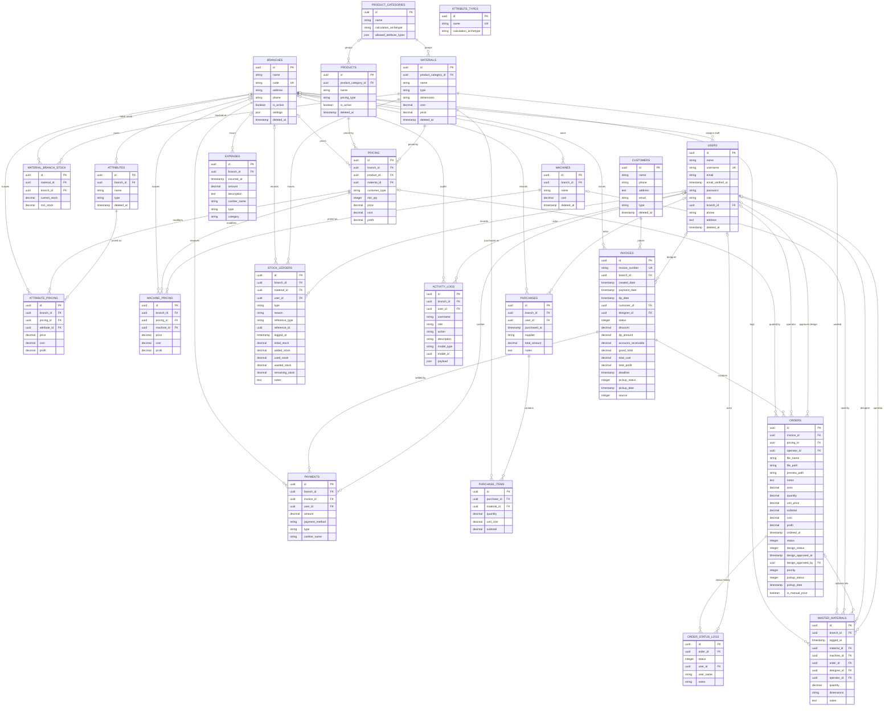

# Entity Relationship Diagram

- **Database:** PostgreSQL in production, SQLite in the automated test suite.
- **Keys:** All primary keys are UUID strings. Foreign keys are UUID strings.
- **Table naming:** Eloquent default pluralization, except `pricing`, `material_branch_stock`, `attribute_pricing`, and `machine_pricing`, which use singular table names.
- **Soft deletes:** Present on `branches`, `users`, `customers`, `products`, `materials`, `machines`, and `attributes`. `pricing` has a `deleted_at` column in the migration, but the model does not use `SoftDeletes`; the column is unused.
- **Target schema:** This diagram shows the target schema. Target additions are listed in the notes below.
- **API-first status:** The React refactor did not add domain tables. Sanctum adds `personal_access_tokens`; all business tables remain as documented. The API and SPA read/write the same schema.

---

## Relationship Notes

1. **`attribute_types` is a reference table without foreign keys.** `attributes.type` stores the type name (`finishing`, `cut`, `display`, or a custom type created through the category screen), and `product_categories.allowed_attribute_types` stores an array of type names. Referential integrity is by convention, not by key.
2. **`material_branch_stock` is the only junction with a unique `(material_id, branch_id)` constraint.** `attribute_pricing` and `machine_pricing` are also junction tables, each linking a `pricing` row to one modifier and carrying price, cost, and profit.
3. **`orders` is a line item of `invoices`.** The invoice carries the financial roll-up (`grand_total`, `total_cost`, `total_profit`), while each order carries its own `unit_price`, `subtotal`, `cost`, and `profit`.
4. **`pricing` is the matrix header.** `attribute_pricing` and `machine_pricing` are additive modifiers keyed by `pricing_id`. `orders.pricing_id` records which matrix row produced the quote. Pricing deletion is a hard delete, and `orders.pricing_id` is `nullOnDelete`, so deleting a pricing row breaks that historical link.
5. **`orders.operator_id`** is the production operator who started or completed the job; it is null until production starts.
6. **`invoices.designer_id`** is the user who submitted the order.
7. **`payments.user_id`** is the cashier; `payments.cashier_name` is a denormalized audit copy.
8. **`expenses` has no user foreign key**, only `cashier_name` and `branch_id`.
9. **`activity_logs.model_id` is a UUID without a foreign key**, allowing the log to reference any model type.
10. **`branch_id` is nullable on** `users`, `machines`, `attributes`, `pricing`, `attribute_pricing`, `machine_pricing`, `invoices`, `expenses`, `wasted_materials`, `stock_ledgers`, and `activity_logs`. A null value means "global" or "unassigned", depending on the table; owner accounts are the main case for a null user branch.
11. **Soft-deleted rows are not shown separately.** The `deleted_at` column is included only on tables that use `SoftDeletes`; deleted rows remain in the table. The migration defines `pricing.deleted_at`, but the model does not use `SoftDeletes`, so pricing rows are hard deleted and the column stays null.
12. **`product_categories` deletion cascades, subject to NO ACTION references.** It is a hard delete, and `products.product_category_id` plus `materials.product_category_id` use `cascadeOnDelete`. The delete removes dependent products, materials, and pricing rows when no NO ACTION reference blocks it; `wasted_materials.material_id` and `stock_ledgers.material_id` can reject the delete when history exists.
13. **Target additions.** The following columns and tables are part of the target schema:
    - `orders.design_status`, `design_approved_at`, `design_approved_by`, and `priority`.
    - `stock_ledgers.user_id`, `type`, `reason`, `reference_type`, and `reference_id`.
    - `purchases` and `purchase_items` for raw-material purchases. `purchases.user_id` is the actor (Owner or Branch Manager).
14. **Order priority semantics.** Higher `priority` sorts first; the queue sorts by `deadline ASC (nulls last)`, then `priority DESC`, then `created_at ASC`. Default priority is 0.
15. **Design status semantics.** `0 = pending`, `1 = in_design`, `2 = approved`. Approval stores the actor and timestamp. The transition is forward-only unless a manager or owner override is added.
16. **Stock ledger type semantics.** Types: `initial`, `purchase`, `usage`, `waste`, `adjustment`, `restock`. `reason` is mandatory for `adjustment`; `reference_type` and `reference_id` point to the purchase or order that caused the movement.

---

## Status Code Reference

| Column | Value | Meaning |
| :--- | :--- | :--- |
| `invoices.status` | 0 | Unpaid / pending down payment |
| `invoices.status` | 1 | Down payment paid |
| `invoices.status` | 2 | Fully paid |
| `invoices.pickup_status` | 0 | Not picked up |
| `invoices.pickup_status` | 1 | Picked up |
| `orders.status` | 0 | Queued / not processed (Antre Produksi) |
| `orders.status` | 1 | Processing / printing (Diproses) |
| `orders.status` | 2 | Completed (Selesai) |
| `orders.design_status` | 0 | Pending |
| `orders.design_status` | 1 | In design (Proses Desain) |
| `orders.design_status` | 2 | Design approved (Disetujui) |
| `payments.type` | `down_payment` | Down payment |
| `payments.type` | `settlement` | Balance settlement |
| `payments.type` | `partial` | Reserved by schema; not written by `PaymentService` |
| `expenses.type` | `modal` | Capital / drawer float label |
| `expenses.type` | `laba` | Operating expense label |
| `stock_ledgers.type` | `initial` | Initial stock registration |
| `stock_ledgers.type` | `purchase` | Raw-material purchase |
| `stock_ledgers.type` | `usage` | Material used by an order |
| `stock_ledgers.type` | `waste` | Failed print / waste |
| `stock_ledgers.type` | `adjustment` | Manager stock correction with reason |
| `stock_ledgers.type` | `restock` | Manual stock addition |

Both expense types are summed into `expenses_total` and subtracted from `net_profit`; `type` is a label, not a filter.

---

## Key Constraints

| Table | Constraint |
| :--- | :--- |
| `branches` | `code` unique |
| `users` | `username` unique |
| `material_branch_stock` | `(material_id, branch_id)` unique |
| `invoices` | `invoice_number` unique |
| `attribute_types` | `name` unique |
| `pricing` | No unique constraint on `(branch_id, product_id, material_id, customer_type, min_qty)`; duplicates are possible |
| `purchases` / `purchase_items` | Target; no unique constraint yet. Add a purchase number or idempotency key before implementation |
| Foreign keys | `cascadeOnDelete` on most owned children; `nullOnDelete` on actor references, `orders.pricing_id`, `users.branch_id`, `wasted_materials.machine_id`, and `wasted_materials.order_id`; NO ACTION/RESTRICT on `invoices.customer_id`, `wasted_materials.material_id`, and `stock_ledgers.material_id` |

---

## Diagram Maintenance

Update this diagram whenever a migration adds, removes, or renames a table or a foreign key. Do not edit merged migrations; add a new migration and reflect the result here.
