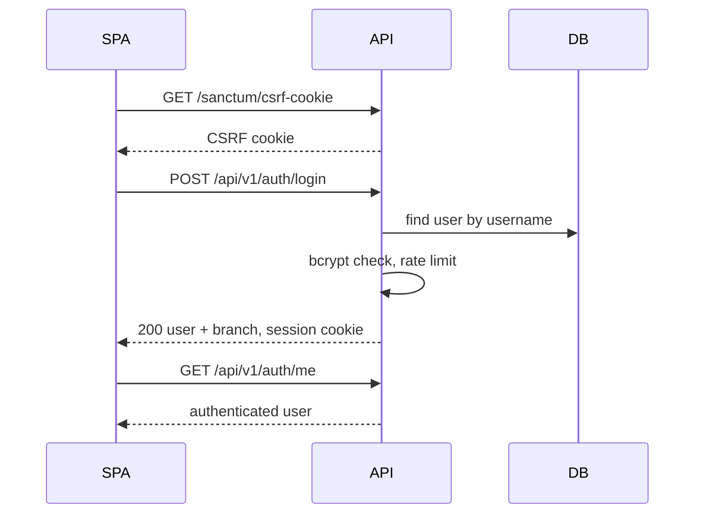
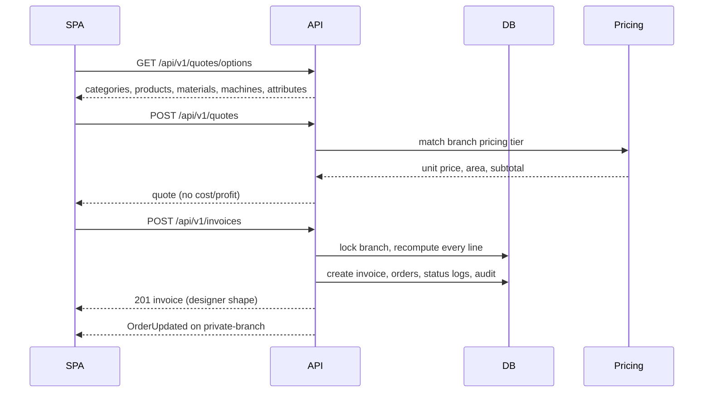
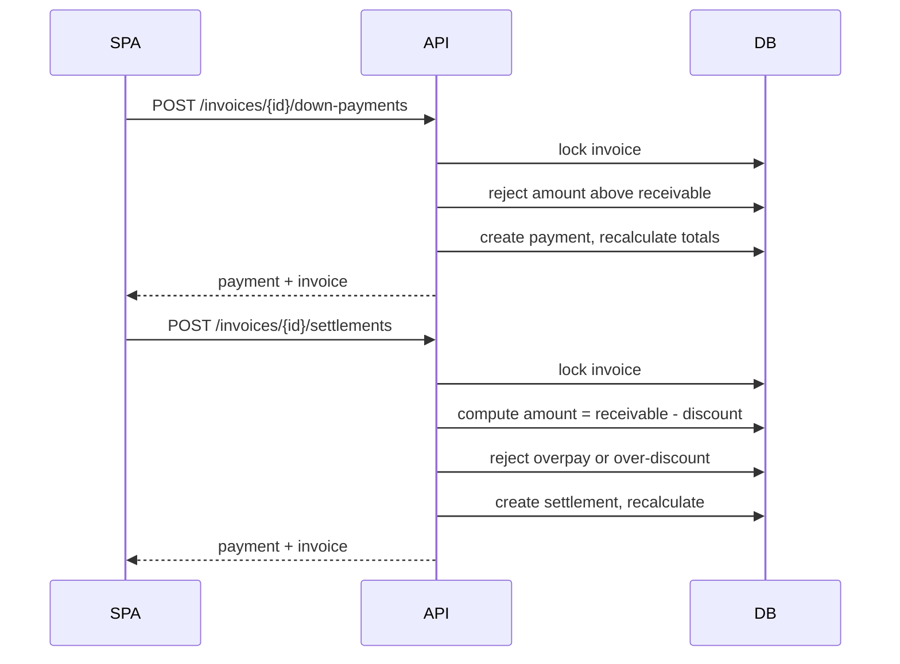
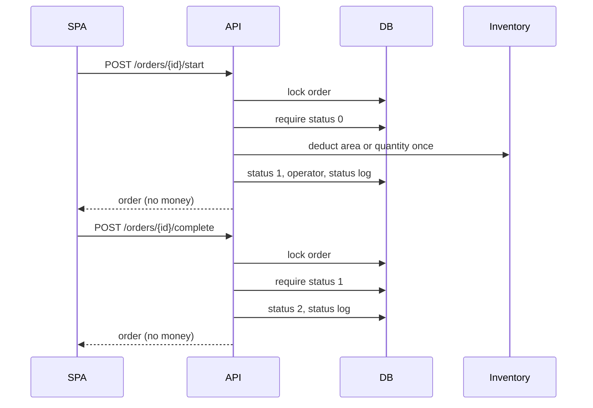
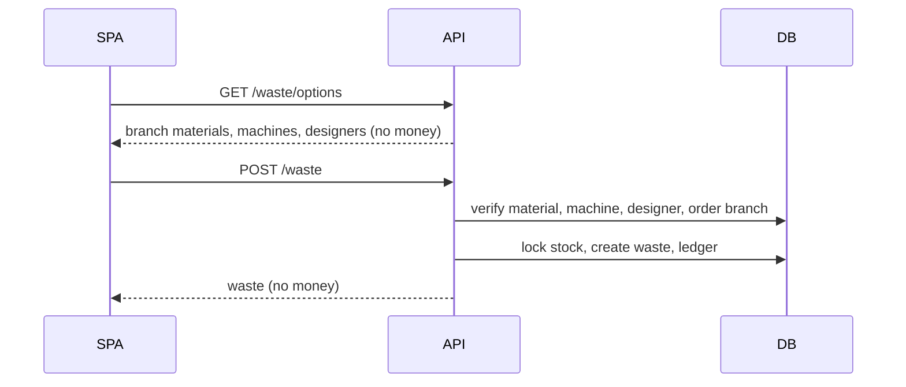
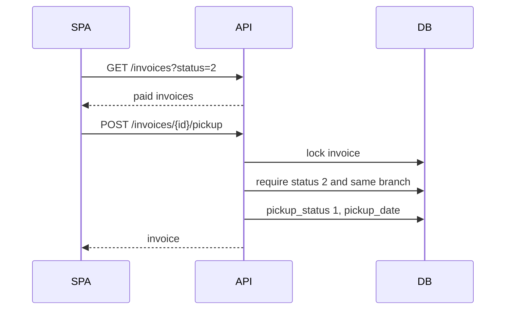
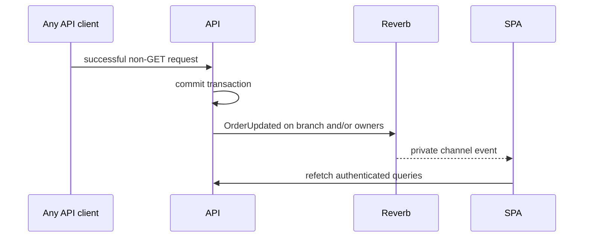
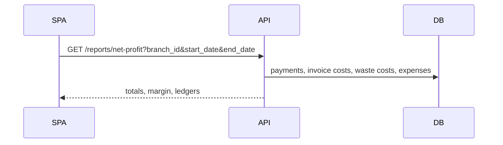

# Sequence Diagrams

All flows use the React SPA as the only frontend. The SPA calls `/api/v1` with Sanctum cookies and CSRF. Branch and record checks happen server-side.

## 1. Login

## 2. Create Invoice

## 3. Down Payment And Settlement

## 4. Production

## 5. Waste Logging

## 6. Pickup

## 7. Realtime Invalidation

## 8. Owner Reporting

## 9. Authorization Rules

Every request shown above:

1. Requires an authenticated session except login.
2. Is scoped to the actor's branch unless the actor is the owner.
3. Returns 403 for another branch and 422 for invalid business input.
4. Omits cost, profit, discount, receivable, and payment fields from production responses.
