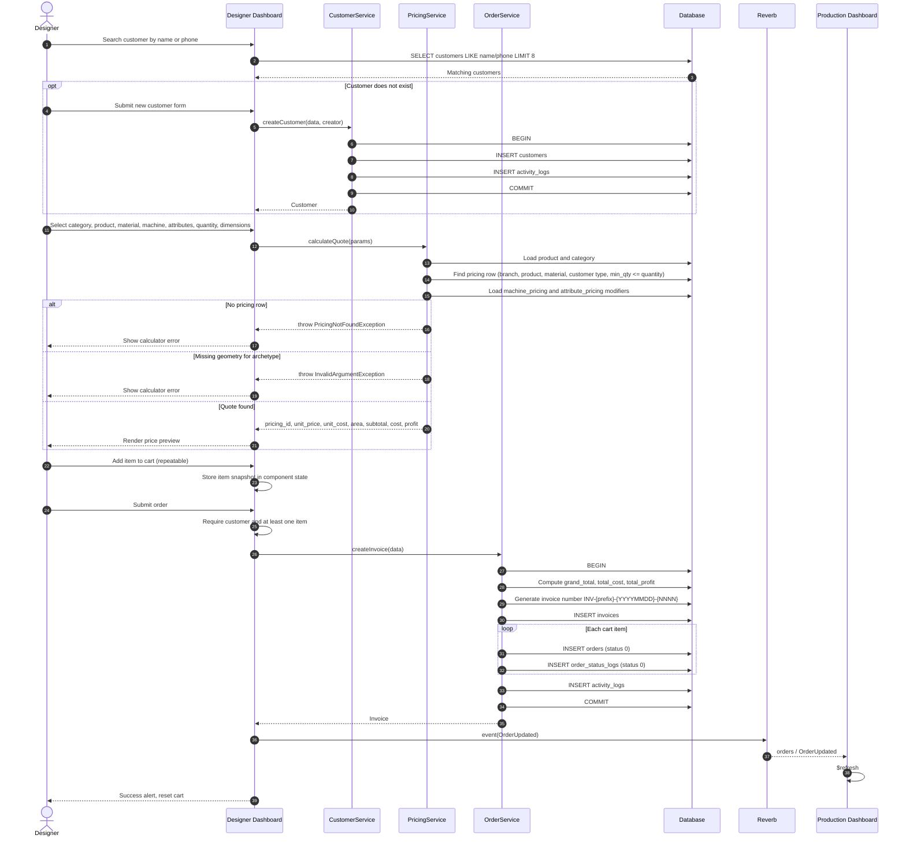
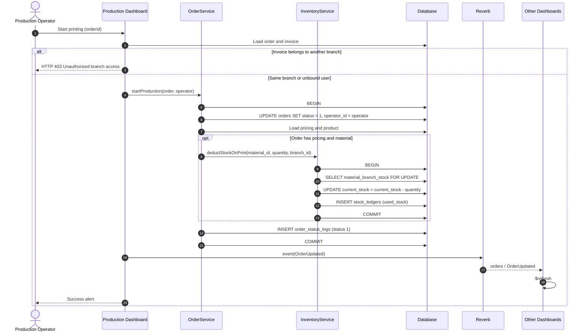
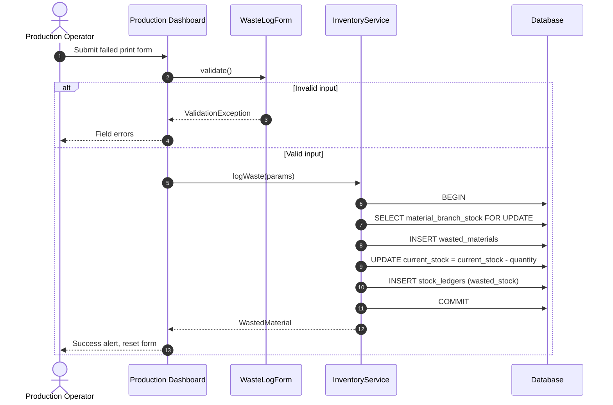
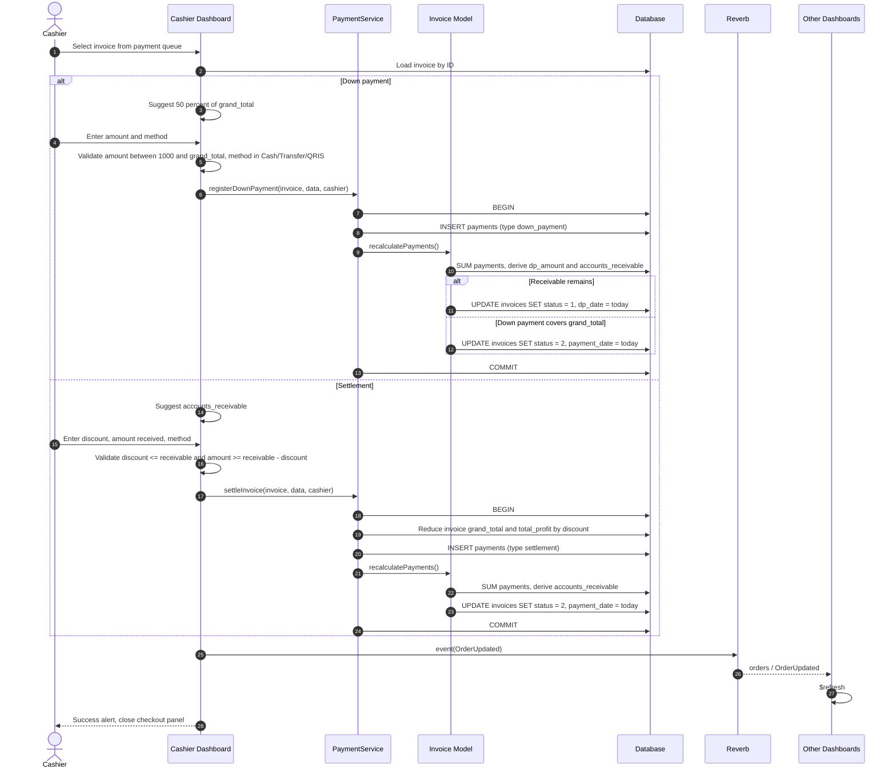
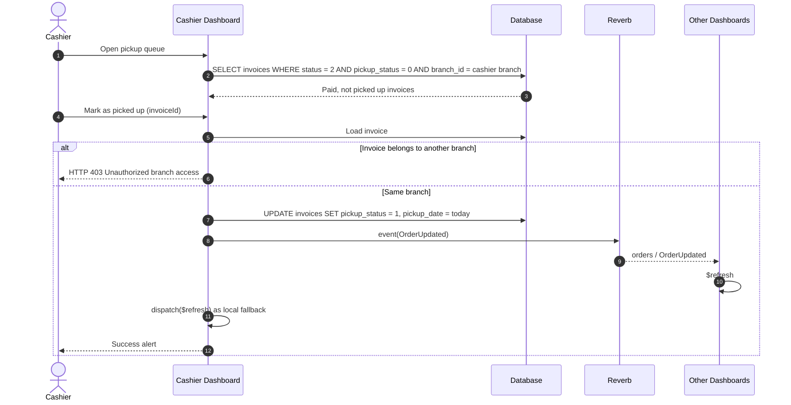
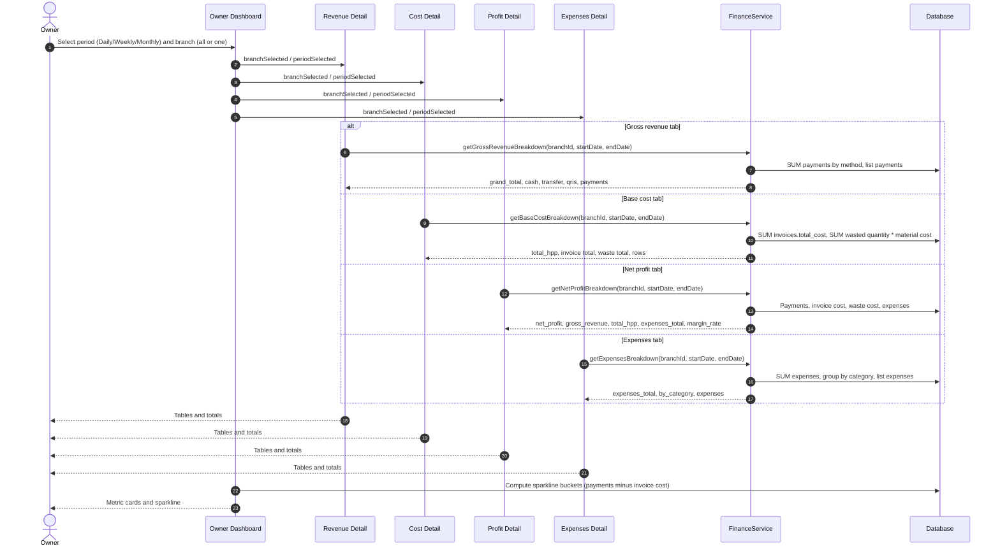
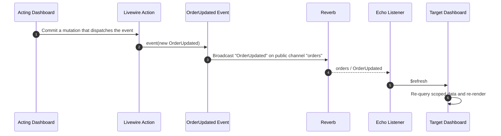
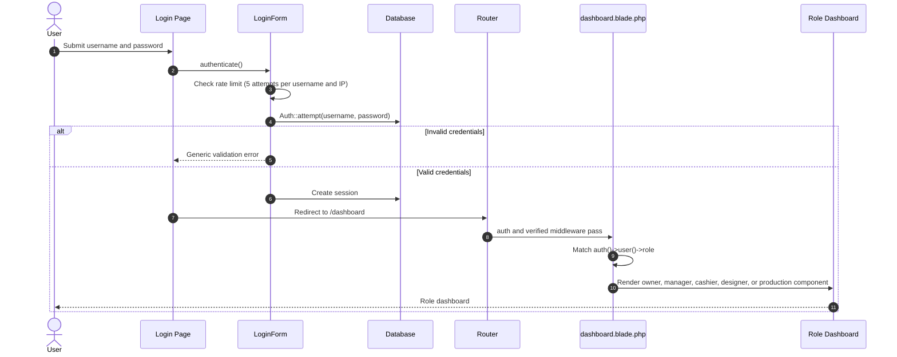

# Sequence Diagrams

- **Scope:** The principal end-to-end workflows implemented in the application.
- **Notation:** Mermaid `sequenceDiagram`. Participants are application roles, Livewire components, service classes, the database, and Reverb.
- **Source of truth:** `app/Livewire`, `app/Services`, `app/Models`, `app/Events`, `routes/web.php`.

---

## 1. Designer Order Intake

Covers customer selection or creation, quote calculation, cart assembly, invoice submission, and the broadcast that refreshes the production queue.

Notes:

- The invoice number sequence is `count(invoices for branch and date) + 1`; it is not protected by a lock.
- `file_name` is stored; no binary file is uploaded by this flow.
- Manual price override replaces the calculated unit price and cost for a cart line before submission.

---

## 2. Production Start and Stock Deduction

Deduction quantity:

- Product `pricing_type = area`: `order.area * order.quantity`
- Otherwise: `order.quantity`

Implementation note: the deduction happens at production start, not at completion.

---

## 3. Waste Logging

Implementation note: this flow does not dispatch `OrderUpdated`. Other dashboards do not refresh until their next request.

---

## 4. Down Payment and Settlement

Status transitions:

| Before | Event | After |
| :--- | :--- | :--- |
| 0 Unpaid | Down payment smaller than the receivable | 1 Down payment |
| 0 Unpaid | Down payment equal to `grand_total` | 2 Paid |
| 1 Down payment | Remaining balance settled | 2 Paid |
| 0 Unpaid | Full settlement in one payment | 2 Paid |

Implementation note: `selectInvoice()` and `processCheckout()` load the invoice by primary key without an explicit branch assertion. The queue is branch-scoped.

---

## 5. Customer Pickup

---

## 6. Owner Financial Analytics

Implementation note: the owner headline cards compute `payments - invoice cost`. They do not subtract waste cost or expenses. The Net Profit Detail tab uses the full `FinanceService` calculation.

---

## 7. Real-Time Refresh

Contract:

- Channel: `orders` (public, no authorization callback)
- Event name: `OrderUpdated`
- Payload: empty object
- Broadcast driver: Laravel Reverb (`ShouldBroadcastNow`)
- Client listener: `protected $listeners = ['echo:orders,OrderUpdated' => '$refresh'];` on `Owner`, `Manager`, `Cashier`, and `Production`, plus `MachineManagement`, `MaterialManagement`, `CategoryManagement`, and the four owner detail components
- `Designer`, `BranchManagement`, and `UserManagement` do not register the listener.

Not every mutation dispatches the event. The following do not: waste logging, cashier expense logging, designer customer creation, manager stock restocking, attribute edits, and pricing create/update/delete via `savePricing`/`deletePricing`. `clonePricingTiers` does dispatch.

---

## 8. Authentication and Role Dispatch

---

## Diagram Maintenance

Add a sequence diagram when a new cross-component workflow is introduced or when a service contract changes enough that the existing diagram would mislead. Keep each diagram at the level of service calls and database effects, not private helper methods.
