# Sequence Diagrams (Target)

These are target flows for the API-first React SPA after Sprint Review 1. Every request except login uses Sanctum cookies and CSRF; branch and record checks happen server-side. Implementation status is tracked in `docs/requirements/implementation-gaps.md`, not in this file.

## 1. Authentication And Access

### 1.1 Login And Session Bootstrap

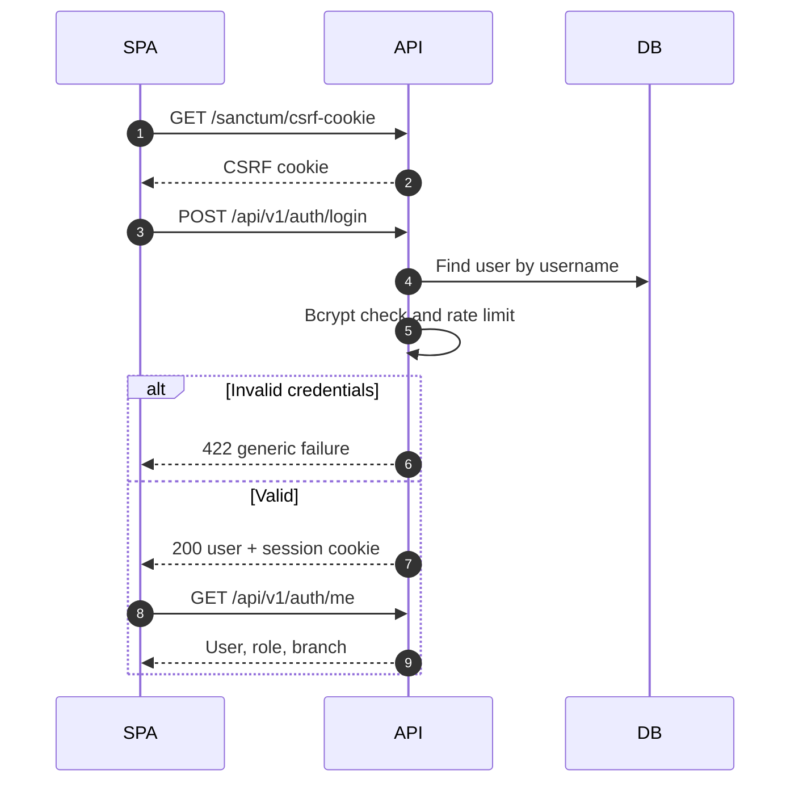

### 1.2 User Administration And Branch-Scoped RBAC

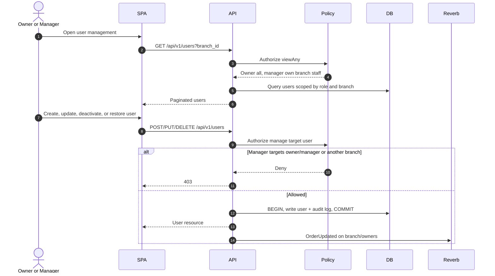

## 2. Catalog

### 2.1 Product Search, Filter, And Pagination

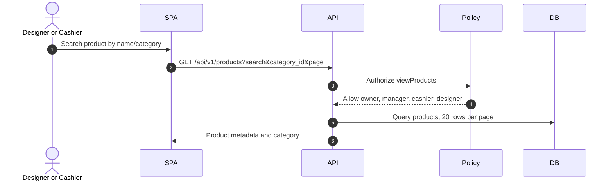

### 2.2 Product, Category, Material, And Discount Administration

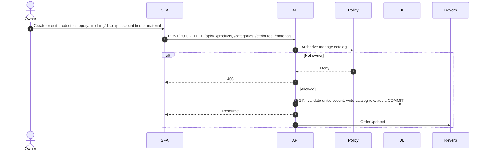

## 3. Sales And Orders

### 3.1 Create Invoice

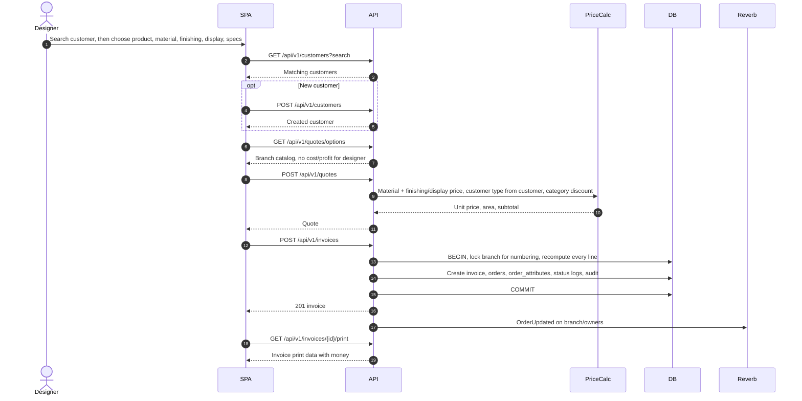

### 3.2 Update Order Before Production

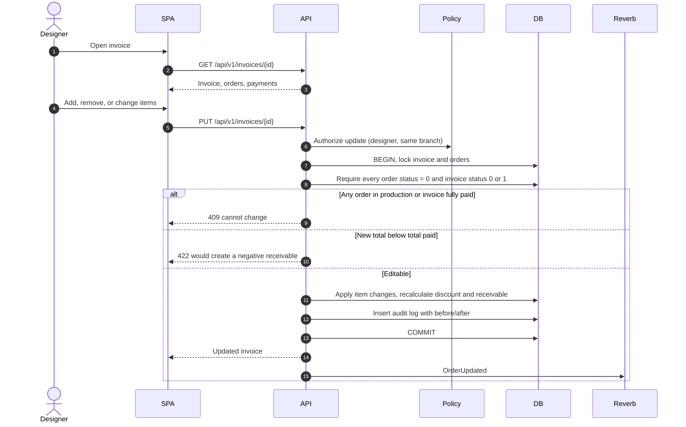

### 3.3 Update Design Status

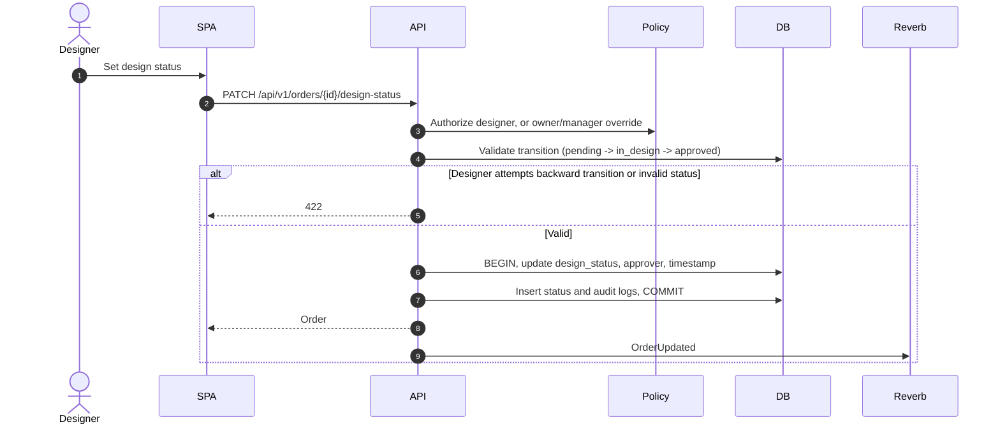

## 4. Payments And Pickup

### 4.1 Down Payment And Multiple DP

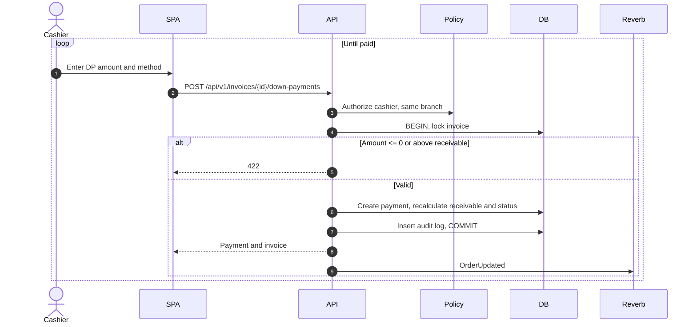

### 4.2 Settlement And Receipt

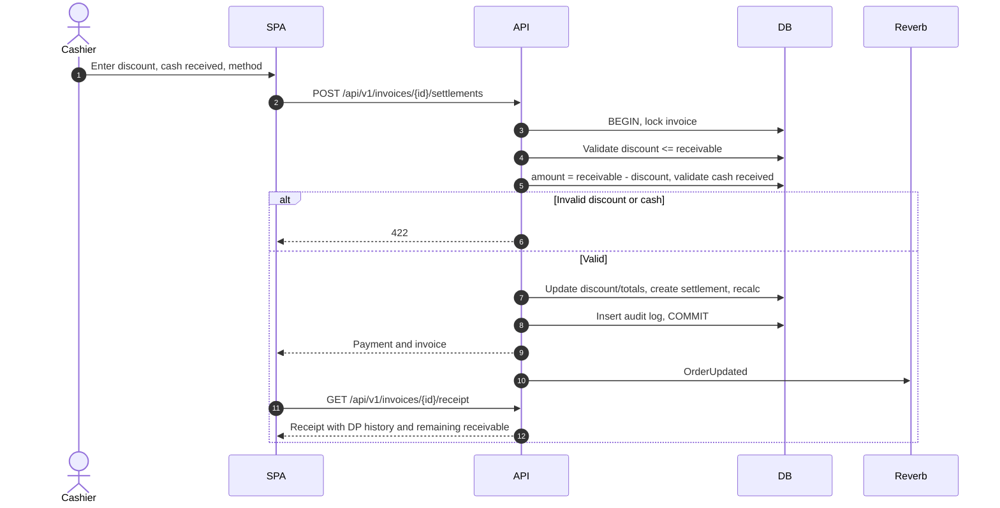

### 4.3 Pickup With Order Propagation

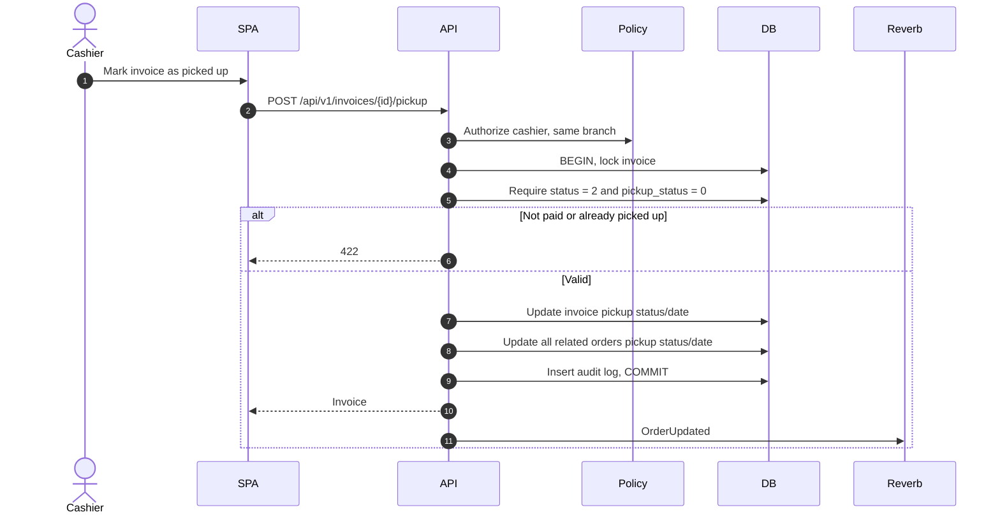

## 5. Inventory

### 5.1 Record Raw-Material Purchase

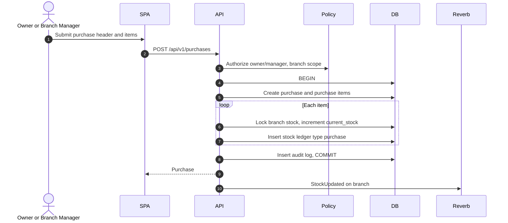

### 5.2 Stock View And Low-Stock Warning

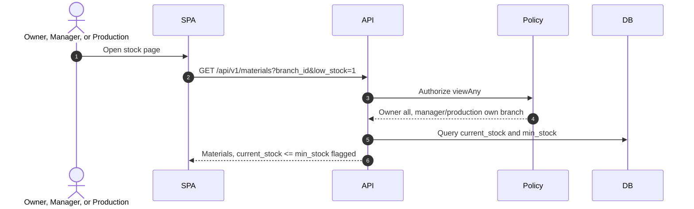

### 5.3 Stock Adjustment With Reason

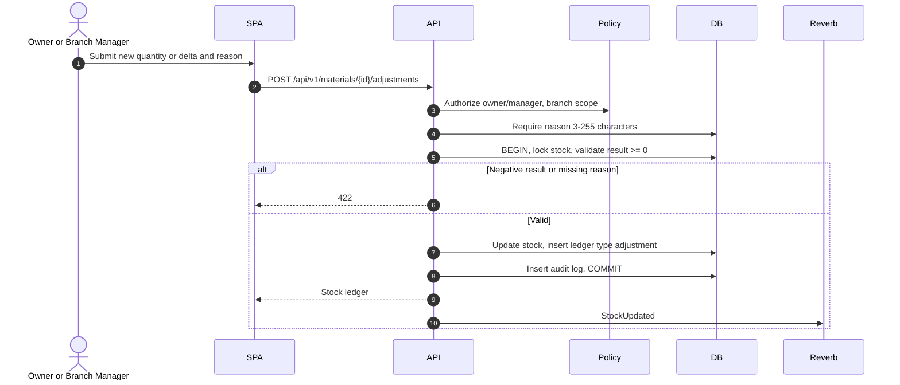

### 5.4 Waste Logging From The Production Queue

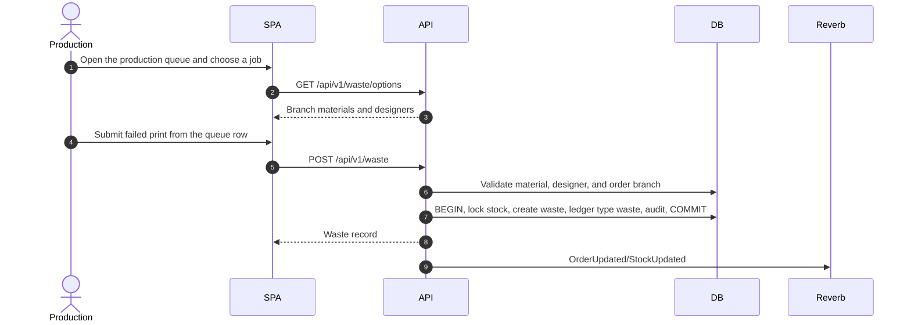

## 6. Production

### 6.1 Production Queue Read

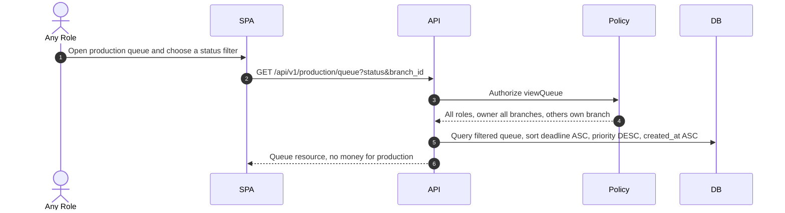

### 6.2 Start, Usage, And Complete Production

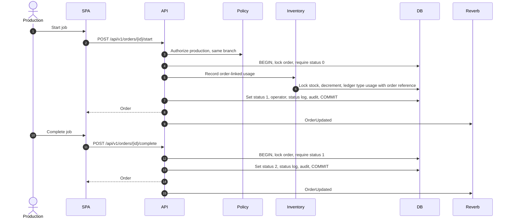

### 6.3 Realtime Invalidation

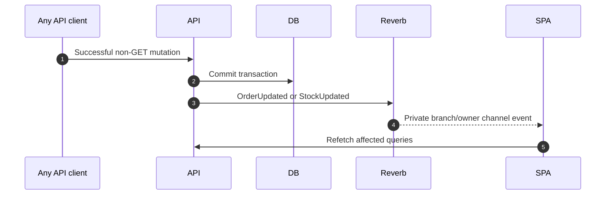

## 7. Reporting And System

### 7.1 Dashboard And Periodic Reports

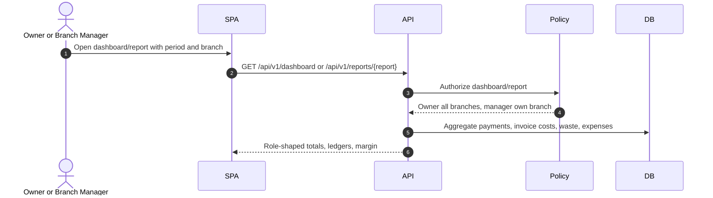

### 7.2 Export Report

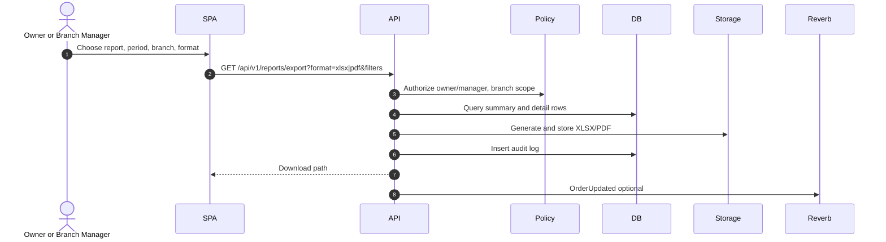

### 7.3 Audit Log Write And Read

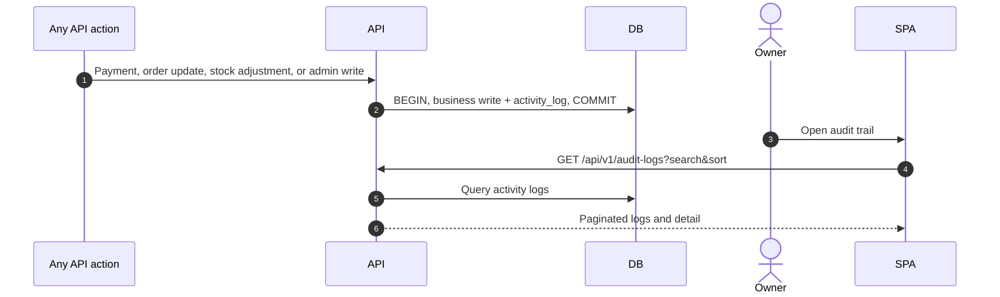

### 7.4 Manual And Scheduled Backup

```mermaid
sequenceDiagram
    autonumber
    actor O as Owner
    participant SPA
    participant API
    participant Policy
    participant DB
    participant FS as External Storage
    participant SCH as Scheduler

    alt Manual
        O->>SPA: Run backup
        SPA->>API: POST /api/v1/backups
        API->>Policy: Authorize owner
    else Scheduled
        SCH->>API: Trigger scheduled backup
    end
    API->>DB: Dump schema and data
    API->>FS: Store encrypted backup
    API->>DB: Insert backup audit log
    API-->>SPA: Success or failure
```

## 8. Authorization Rules

Every request shown above:

1. Requires an authenticated session except login.
2. Is scoped to the actor's branch unless the actor is the owner.
3. Returns 403 for another branch and 422 for invalid business input.
4. Omits price, cost, profit, discount, receivable, and payment fields from production responses.
5. Denies invoice and receipt print to production; production uses the queue only.
6. Uses private Reverb channels for branch events; the owner channel is separate.
7. Runs multi-table mutations inside one database transaction with `lockForUpdate()` on invoices, orders, and stock rows.
