# Sequence Diagrams (Target)

These are target flows for the API-first React SPA after Sprint Review 1. Every request except login uses Sanctum cookies and CSRF; branch and record checks happen server-side. Implementation status is tracked in `docs/requirements/implementation-gaps.md`, not in this file.

## 1. Authentication And Access

### 1.1 Login And Session Bootstrap

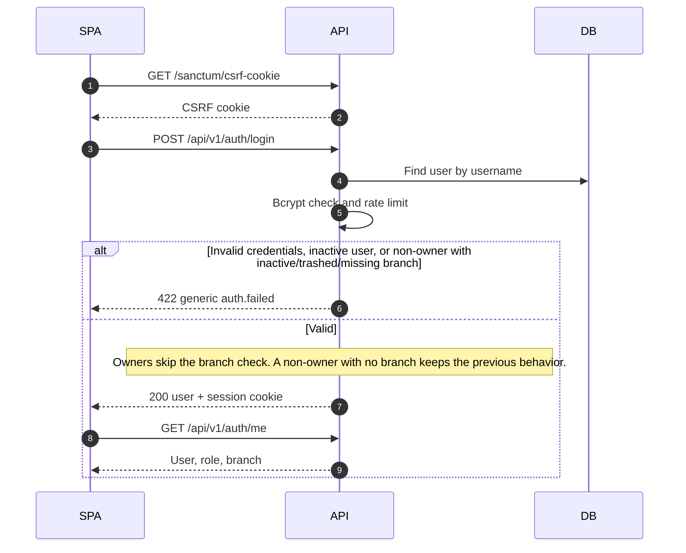

### 1.2 User Administration And Branch-Scoped RBAC

```mermaid
sequenceDiagram
    autonumber
    actor A as Owner or Manager
    participant SPA
    participant API
    participant Policy
    participant DB
    participant R as Reverb

    A->>SPA: Open user management
    SPA->>API: GET /api/v1/users
    API->>Policy: Authorize viewAny
    Policy-->>API: Owner all, manager own branch staff
    API->>DB: Query users scoped by role and branch
    API-->>SPA: Paginated users

    A->>SPA: Create user
    SPA->>API: POST /api/v1/users
    alt Manager requests an owner/manager role for a staff target or assigns another branch
        API-->>SPA: 422 validation
    else Allowed
        API->>DB: BEGIN, write user + audit log, COMMIT
        API-->>SPA: User resource
        API->>R: OrderUpdated on branch/owners
    end

    A->>SPA: Update user or toggle active status
    alt Update
        SPA->>API: PUT /api/v1/users/{user}
    else Toggle status
        SPA->>API: PATCH /api/v1/users/{user}/status
    end
    API->>Policy: Authorize manage target user
    alt Manager targets a current owner/manager or a cross-branch target
        Policy-->>API: Deny
        API-->>SPA: 403
    else Actor targets self on toggle status
        API-->>SPA: 422 self-toggle message
    else Role demotion would remove the last active owner
        API->>DB: BEGIN; lock active owners
        API-->>SPA: 422 Pemilik aktif terakhir...
    else Allowed
        Note over API,DB: A guarded change that succeeds also locks active owners inside the service transaction before commit.
        API->>DB: BEGIN, write user + audit log, COMMIT
        API-->>SPA: User resource
        API->>R: OrderUpdated on branch/owners
    end

    Note over A,API: The status route cannot emit the last-owner guard: a sole owner targeting themselves gets the self-toggle 422, and any other target implies a second active owner. The same guard returns 422 on profile deactivation and `DELETE /users/{user}`; role demotion is the guarded branch above. DELETE /users/{user} and restore are owner-only administrative APIs with no SPA action.
```

### 1.3 Immediate Access Revocation

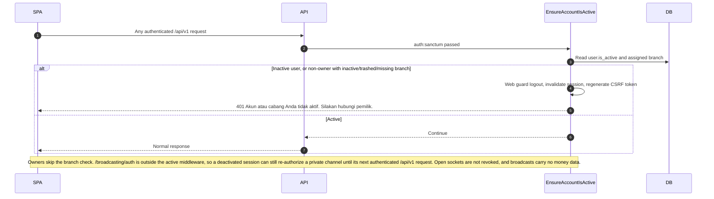

## 2. Catalog

### 2.1 Product Search, Filter, And Pagination

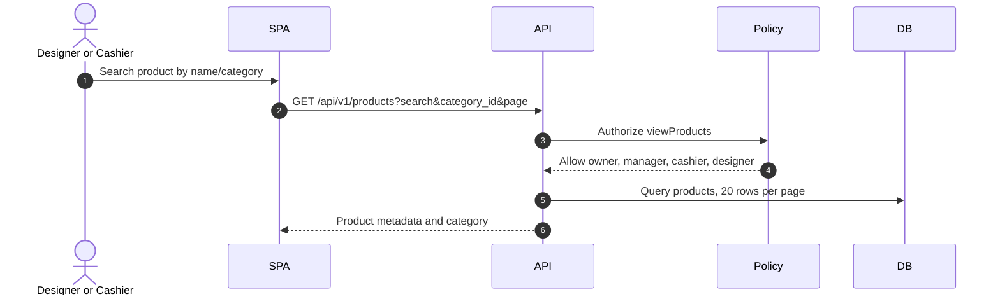

### 2.2 Product, Category, Attribute, And Material Administration

```mermaid
sequenceDiagram
    autonumber
    actor A as Owner
    actor M as Manager
    participant SPA
    participant API
    participant Policy
    participant DB
    participant R as Reverb

    alt Owner
        A->>SPA: Create or edit product (with inline tiers), category, material, attribute type, or a global/branch attribute option
        SPA->>API: POST/PUT /api/v1/products with tiers[], /categories, /attribute-types, /attributes, /materials
        SPA->>API: PATCH /api/v1/materials/{id}/min-stock
        API->>Policy: Authorize CatalogPolicy::manageCategories, manageProducts, createAttribute/updateAttribute, AttributeTypePolicy::create/update, manageProductQuantityDiscounts, or MaterialPolicy::update/setMinimumStock
    else Manager
        M->>SPA: Edit own-branch attribute option or branch minimum stock; open read-only product modal with tiers
        SPA->>API: POST/PUT /api/v1/attributes or PATCH /api/v1/materials/{id}/min-stock; GET /api/v1/products
        API->>Policy: Authorize CatalogPolicy::createAttribute/updateAttribute, viewProductQuantityDiscounts, or MaterialPolicy::setMinimumStock for own branch
    end
    alt Denied
        Policy-->>API: Deny
        API-->>SPA: 403
    else Allowed
        API->>DB: BEGIN, validate (nested tiers, dotted 422 keys), write catalog row or is_active flag, sync tiers (delete omitted, update retained, insert new), audit product writes including tiers, COMMIT
        API-->>SPA: Resource
        API->>R: OrderUpdated
    end
```

Categories, products, and attributes are retired with `is_active`; category and attribute delete routes return 404. Managers can manage only own-branch attributes and edit only their own branch's minimum stock; global attributes are read-only. Product quantity tiers are global, unique per `(product_id, min_qty)`, Owner-written and Manager-read; the pricing matrix and category tiers are gone, and all prices compute from material and attribute rows plus the tier and reseller discounts. Tiers are now edited inside the product modal; on PUT an absent or empty `tiers` array clears all rows, and the standalone tier pages are gone in favour of redirects to the products pages (the tier REST endpoints remain).

### 2.3 Product Compatibility Write And Read

```mermaid
sequenceDiagram
    autonumber
    actor A as Owner
    actor M as Manager
    actor D as Designer
    participant SPA
    participant API
    participant Policy
    participant DB
    participant R as Reverb

    A->>SPA: Edit product flags, allowed types, compatible attributes, materials, and inline quantity tiers
    SPA->>API: POST/PUT /api/v1/products with tiers[]
    API->>Policy: Authorize manageProducts
    alt Not owner
        Policy-->>API: Deny
        API-->>SPA: 403
    else Owner
        API->>API: Validate new type IDs active and new attributes active, in an active allowed type
        Note over API: IDs already mapped to the product remain valid when inactive; uses_attributes=false keeps the pivots
        API->>DB: BEGIN, update product, sync material_product, attribute_type_product, attribute_product and quantityDiscounts (delete before update/insert), PUT records audit before/after including tiers (POST create records a flat snapshot with tiers), COMMIT
        API-->>SPA: ProductResource with flags, ID arrays, display-only name arrays, and tiers for Owner/Manager/Designer only
        API->>R: OrderUpdated
        Note over SPA: Product create/update also invalidates ['quote-options']
    end

    M->>SPA: Open read-only /manager/products and click Lihat
    SPA->>API: GET /api/v1/products
    API->>DB: Eager-load category, materials, attributeTypes, compatibleAttributes.typeInfo, quantityDiscounts
    API-->>SPA: Semua bahan/Semua tipe/Semua atribut or names from the resource arrays, plus tiers; every modal field disabled

    D->>SPA: Open designer quote options
    SPA->>API: GET /api/v1/quotes/options
    API->>DB: Eager-load the same product relations (tiers gated by role)
    API-->>SPA: Product flags, ID arrays, name arrays for filtering; API still enforces compatibility
```

On both read paths, an empty type or attribute mapping means all active types/attributes. Every `ProductResource` producer must eager-load both pivots; a missing load produces empty arrays and silently means all, and a missing `quantityDiscounts` load would make an edit form silently delete all tiers. The display-only name arrays are not authoritative for writes or quote filtering. Cashier and Production receive no `tiers` key.

## 3. Sales And Orders

### 3.1 Create Invoice

```mermaid
sequenceDiagram
    autonumber
    actor D as Designer
    participant SPA
    participant API
    participant PriceCalc
    participant DB
    participant R as Reverb

    D->>SPA: Search customer, then choose product, material, one attribute per active type, specs
    SPA->>API: GET /api/v1/customers?search&page
    API-->>SPA: Paginated matching customers with institutions[]
    opt Add or edit a customer
        D->>SPA: Open shared /customers management page
        SPA->>API: POST /api/v1/customers or PUT /api/v1/customers/{id}
        API-->>SPA: Saved customer; return to the order flow
    end
    SPA->>SPA: Choose institution in the “Institusi pesanan” select from the customer's labels
    SPA->>API: GET /api/v1/quotes/options
    API-->>SPA: Branch catalog, no cost/profit for designer
    SPA->>API: POST /api/v1/quotes
    API->>PriceCalc: Enforce active types and one attribute per type; material + selected attribute price, customer type, branch reseller discount
    PriceCalc-->>API: Unit price, area, subtotal
    API-->>SPA: Quote
    SPA->>API: POST /api/v1/invoices (institution = chosen customer label)
    API->>DB: BEGIN, lock branch for numbering, recompute every line
    API->>API: Validate institution against customer.institutions; default to first label when omitted
    API->>DB: Create invoice (institution snapshot), orders (with selected_attributes), status logs, audit
    API->>DB: COMMIT
    API-->>SPA: 201 invoice
    API->>R: OrderUpdated on branch/owners
    SPA->>API: GET /api/v1/invoices/{id}/print
    API-->>SPA: Invoice print data with money
```

The institution shown on the invoice comes from the `invoices.institution` snapshot, never from the customer's live labels, so a later `PUT /api/v1/customers/{customer}` does not change past invoices. A label outside the customer's `institutions` list is rejected with 422 on `institution` before the invoice transaction commits.

### 3.2 Update Order Before Production

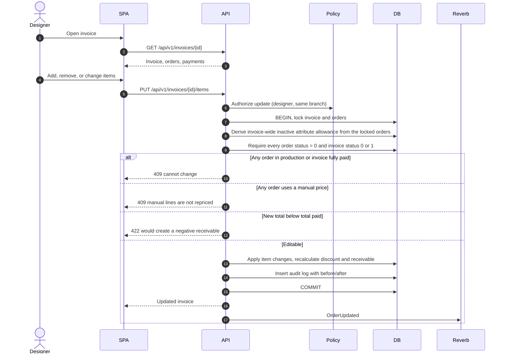

### 3.3 Update Design Status

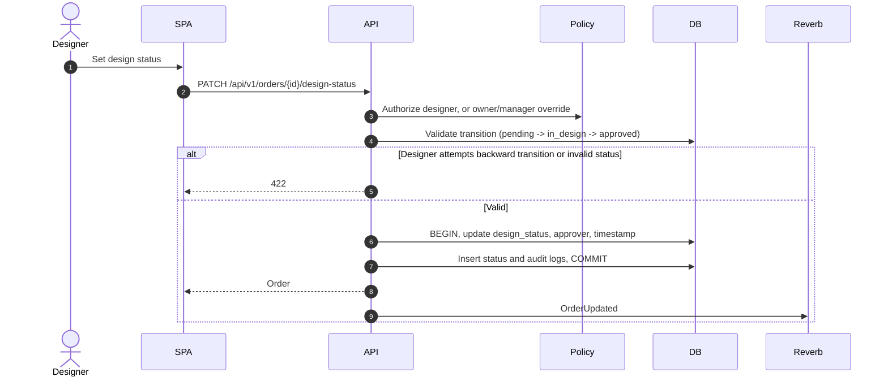

### 3.4 No-Material Quote And Invoice Create

```mermaid
sequenceDiagram
    autonumber
    actor D as Designer
    participant SPA
    participant API
    participant PriceCalc
    participant DB
    participant R as Reverb

    D->>SPA: Choose a product with requires_material=false
    SPA->>SPA: Hide the Bahan select; attribute selects follow uses_attributes and the product mappings
    SPA->>API: POST /api/v1/quotes {product_id, material_id: null, quantity, selected_attributes?}
    API->>DB: QuoteRequest: material_id nullable; reject a material for a no-material product
    alt Material required but absent, or supplied for a no-material product
        API-->>SPA: 422 material_id
    else Attributes supplied for uses_attributes=false product
        API-->>SPA: 422 selected_attributes
    else Valid
        API->>API: Skip MaterialAvailability because material_id is null
        API->>PriceCalc: CalculateQuote enforces product/material/type/attribute capability and one attribute per type
        PriceCalc->>DB: Load product, material price/cost, active attributes, branch reseller percent, product tiers
        PriceCalc-->>API: base = material + attribute prices; Reseller base discount; area factor; highest eligible tier
        API-->>SPA: Quote with unit_price, area, quantity, subtotal; no cost/profit, no pricing identity
    end

    SPA->>API: POST /api/v1/invoices {items:[{product_id, material_id, quantity, selected_attributes?}]}
    API->>DB: BEGIN, lock branch numbering, check each product/material/attribute capability
    alt Null material on a material-required product, or incompatible mapped material
        API-->>SPA: 422 items.{index}.material_id
    else Capability attribute violation
        API-->>SPA: 422 items.{index}.selected_attributes
    else Valid
        API->>API: Skip availability for null material; active product, quantity, branch and customer type still apply
        API->>PriceCalc: QuotePricingService::calculate() once per line
        API->>DB: Write invoice and orders with product_id, material_id, customer_type, reseller/tier percents, discount_amount, money snapshots, and selected_attributes; status logs, audit, COMMIT
        API-->>SPA: 201 invoice
        API->>R: OrderUpdated
    end
```

A null material skips only stock availability. Active product, positive quantity, branch reseller percent, tier eligibility, one-attribute-per-type, and catalog checks still apply, and all money is recomputed by `QuotePricingService` on the server and snapshotted per order line.

### 3.5 Invoice Edit Grandfather Decision

```mermaid
sequenceDiagram
    autonumber
    actor D as Designer
    participant SPA
    participant API
    participant DB
    participant R as Reverb

    D->>SPA: Open an unpaid, pre-production invoice and change items
    SPA->>API: PUT /api/v1/invoices/{id}/items with each item's id, product_id, material_id, and selected_attributes
    API->>DB: BEGIN, lock invoice and existing orders
    API->>DB: Derive inactive material/attribute allowances from the locked orders
    loop Each submitted line
        API->>API: Compare locked product_id, material_id, and normalized selected_attributes set
        alt Whole line unchanged
            Note over API: Grandfathered; skip product capability checks and keep the allowances
        else New line or any signature part changed
            API->>API: Enforce product requirement, material compatibility, allowed types, compatible attributes, uses_attributes
            alt Incompatible
                API-->>SPA: 422 items.{index}.product_id, items.{index}.material_id, or items.{index}.selected_attributes
            end
        end
    end
    API->>PriceCalc: Recompute each changed line and snapshot its discount/money values
    API->>DB: Recalculate totals and receivable; preserve payments; audit before/after; COMMIT
    API-->>SPA: Updated invoice
    API->>R: OrderUpdated
```

The signature is the order's own `product_id` + `material_id` + the lowercased, de-duplicated, sorted `selected_attributes` set, all derived from locked orders. No client flag, reordered list, or changed identity widens it; a new line that reuses an old product/material pair is still enforced. Production no longer depends on a pricing row: it reads `order.material` from this snapshot.

## 4. Payments And Pickup

### 4.1 Down Payment And Multiple DP

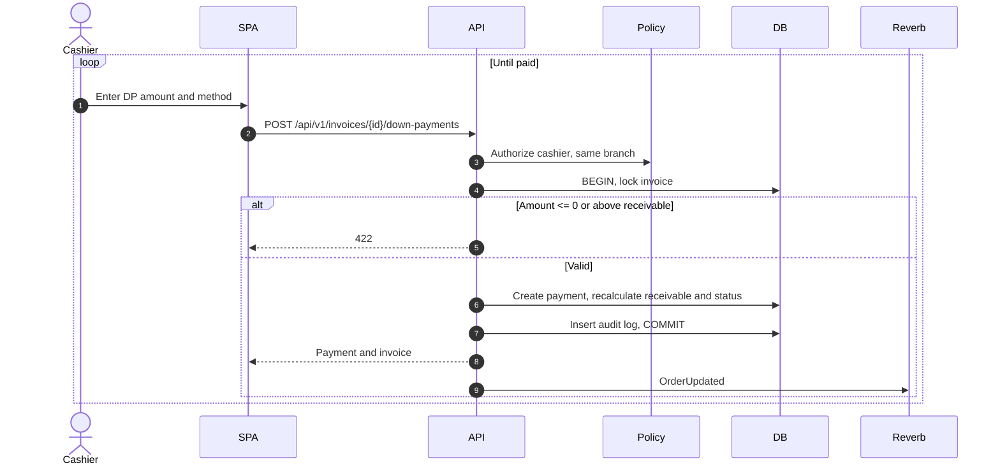

### 4.2 Settlement And Receipt

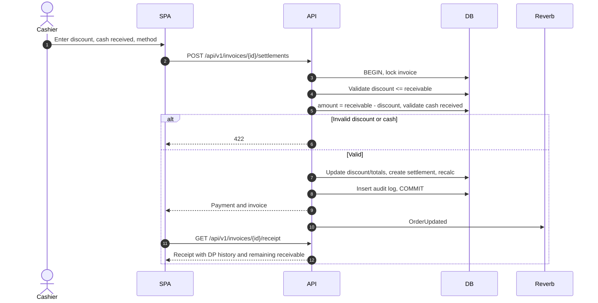

### 4.3 Pickup With Order Propagation

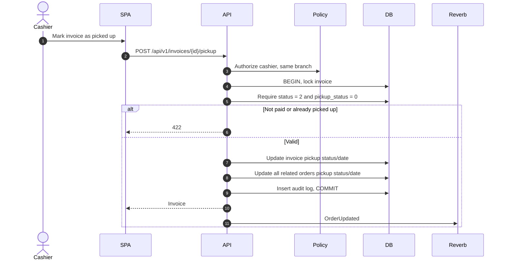

## 5. Inventory

### 5.1 Record Raw-Material Purchase

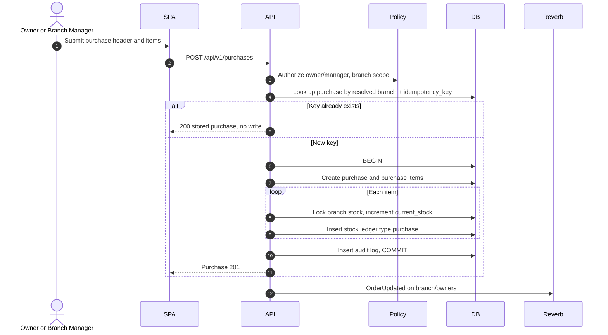

### 5.2 Stock View And Low-Stock Warning

```mermaid
sequenceDiagram
    autonumber
    actor A as Owner, Manager, or Production
    participant SPA
    participant API
    participant Policy
    participant DB

    A->>SPA: Open stock page and toggle low stock
    SPA->>API: GET /api/v1/materials?branch_id&low_stock=1
    API->>Policy: Authorize viewAny
    Policy-->>API: Owner all or selected, manager/production own branch
    API->>DB: Query current_stock and min_stock; filter current_stock <= min_stock
    opt Owner with branch_id=all
        API->>DB: Keep a material low in at least one branch (OR)
    end
    API-->>SPA: Materials, top-level is_low_stock (null for owner/all) and per-stock flags
```

### 5.3 Stock Adjustment With Reason

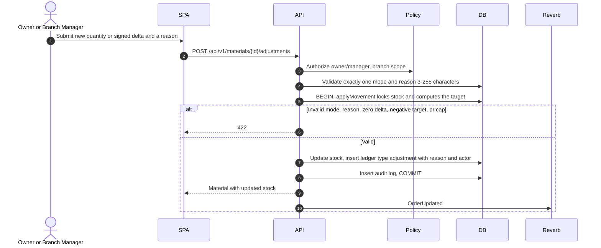

### 5.4 Waste Logging From The Production Queue

```mermaid
sequenceDiagram
    autonumber
    actor P as Production
    participant SPA
    participant API
    participant DB
    participant R as Reverb

    P->>SPA: Open the production queue and choose a job
    SPA->>API: GET /api/v1/waste/options
    API-->>SPA: Branch materials with units and branch designers
    P->>SPA: Submit failed print from the queue row
    SPA->>API: POST /api/v1/waste
    API->>DB: Require order in status 0, 1, or 3 and the same branch; designer optional
    API->>DB: Require material branch stock
    API->>DB: BEGIN, applyMovement locks stock, create waste, ledger type waste with order reference and actor, COMMIT
    API-->>SPA: Waste record with material unit
    API->>R: OrderUpdated
```

## 6. Production

### 6.1 Production Queue Read

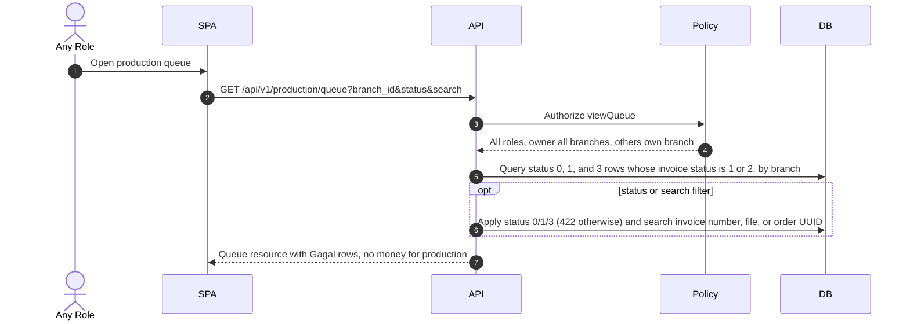

### 6.2 Start, Usage, And Complete Production

```mermaid
sequenceDiagram
    autonumber
    actor P as Production
    participant SPA
    participant API
    participant Policy
    participant Inventory
    participant DB
    participant R as Reverb

    P->>SPA: Start job
    SPA->>API: POST /api/v1/orders/{id}/start
    API->>Policy: Authorize production, same branch
    API->>DB: BEGIN, lock order, require status 0
    API->>Inventory: Record order-linked usage
    Inventory->>DB: Lock stock; deduct area * quantity for m2 (422 when area <= 0), otherwise quantity; ledger type usage with order reference
    API->>DB: Set status 1, operator, status log, audit, COMMIT
    API-->>SPA: Order
    API->>R: OrderUpdated

    P->>SPA: Complete job
    SPA->>API: POST /api/v1/orders/{id}/complete
    API->>DB: BEGIN, lock order, require status 1
    API->>DB: Set status 2, status log, audit, COMMIT
    API-->>SPA: Order
    API->>R: OrderUpdated
```

### 6.3 Fail And Reopen Production

```mermaid
sequenceDiagram
    autonumber
    actor P as Production
    participant SPA
    participant API
    participant Policy
    participant Inventory
    participant DB
    participant R as Reverb

    P->>SPA: Mark a processing job as failed and enter a note
    SPA->>API: POST /api/v1/orders/{id}/fail {note}
    API->>Policy: Authorize production, same branch
    API->>DB: BEGIN, lock order, require status 1 and note 3-255
    alt Wrong status or invalid note
        API-->>SPA: 422
    else Valid
        API->>DB: Sum usage minus usage_reversal per material and branch
        loop Each material with positive net usage
            API->>Inventory: Apply usage_reversal for the net quantity
            Inventory->>DB: Lock stock, add net usage, ledger type usage_reversal with order reference and actor
        end
        API->>DB: Set status 3, keep operator, status log with the note, COMMIT
        API-->>SPA: Order
        API->>R: OrderUpdated
    end

    P->>SPA: Reopen a failed job
    SPA->>API: POST /api/v1/orders/{id}/reopen
    API->>Policy: Authorize production, same branch
    API->>DB: BEGIN, lock order, require status 3
    alt Not status 3
        API-->>SPA: 422
    else Valid
        API->>DB: Set status 0, clear operator, status log "Production reopened", COMMIT
        API-->>SPA: Order
        API->>R: OrderUpdated
    end
```

### 6.4 Realtime Invalidation

```mermaid
sequenceDiagram
    autonumber
    participant Writer as Any API client
    participant API
    participant DB
    participant R as Reverb
    participant SPA

    Writer->>API: Successful non-GET mutation
    API->>DB: Commit transaction
    API->>R: OrderUpdated
    R-->>SPA: Private branch/owner channel event
    SPA->>API: Refetch affected queries
```

### 6.5 No-Material Production Start

```mermaid
sequenceDiagram
    autonumber
    actor P as Production
    participant SPA
    participant API
    participant Inventory
    participant DB
    participant R as Reverb

    P->>SPA: Start a queued order whose stored material is null
    SPA->>API: POST /api/v1/orders/{id}/start
    API->>DB: BEGIN, lock order, eager-load order.material and order.product, require status 0
    alt orders.material_id is null but the product requires material, or the material is soft-deleted
        API-->>SPA: 422 material "Bahan untuk pesanan ini tidak ditemukan."
    else Product allows no material
        API->>DB: Set status 1 and operator, write status log "Production started"
        Note over API,Inventory: No m2 area guard (no material unit), no stock deduction, no usage ledger
        API->>DB: Audit ORDER_START with material_usage=[]
        API->>DB: COMMIT
        API-->>SPA: Order with status 1
        API->>R: OrderUpdated
    end
```

No new permission or route is introduced: this is the existing start action with the C1 guard. The material and its unit come from the order snapshot (`orders.material_id`, eager-loaded as `order.material`), never from a pricing row. Fail, complete, and reopen use the existing paths; waste remains material-only, so a no-material order produces no waste row unless a material is supplied later.

## 7. Reporting And System

### 7.1 Dashboard And Periodic Reports

```mermaid
sequenceDiagram
    autonumber
    actor A as Owner or Branch Manager
    participant SPA
    participant API
    participant Policy
    participant DB

    A->>SPA: Open dashboard/report with period and branch
    SPA->>API: GET /api/v1/dashboard or /api/v1/reports/{report}
    API->>Policy: Authorize dashboard/report
    Policy-->>API: Owner all branches, manager own branch
    API->>DB: Aggregate payments, invoice costs, waste, expenses
    API-->>SPA: Role-shaped totals, ledgers, margin
```

### 7.2 Export Report (PB-09, implemented)

```mermaid
sequenceDiagram
    autonumber
    actor A as Owner or Branch Manager
    participant SPA
    participant API
    participant Policy
    participant DB
    participant Exp as Excel/PDF Exporter

    A->>SPA: Choose report, period, branch (owner), format (xlsx|pdf)
    SPA->>API: GET /api/v1/reports/{type}/export?format=xlsx|pdf&filters
    API->>Policy: Authorize viewFinancialReports and branch scope
    API->>DB: Query summary and detail rows
    API->>DB: AuditLogger::record(EXPORT) before streaming
    API->>Exp: Build streaming XLSX (OpenSpout) or A4 PDF (Dompdf)
    API-->>SPA: Binary download with Content-Disposition filename
```

### 7.3 Audit Log Write And Read

```mermaid
sequenceDiagram
    autonumber
    participant Writer as Any API action
    participant API
    participant DB
    actor O as Owner
    participant SPA

    Writer->>API: Payment, order update, stock adjustment, or admin write
    API->>DB: BEGIN, business write + activity_log, COMMIT
    O->>SPA: Open audit trail
    SPA->>API: GET /api/v1/audit-logs?search&sort
    API->>DB: Query activity logs
    API-->>SPA: Paginated logs and detail
```

### 7.4 Manual Backup (PB-10, implemented)

```mermaid
sequenceDiagram
    autonumber
    actor O as Owner
    participant SPA
    participant API
    participant Policy
    participant DB
    participant Q as Queue
    participant W as Worker
    participant L as Local Disk
    participant R2 as R2/S3
    participant PG as pg_dump

    O->>SPA: Jalankan Backup
    SPA->>API: POST /api/v1/backups (no body)
    API->>Policy: Authorize create (owner)
    API->>DB: Any manual queued/running younger than 30 minutes?
    alt Recent manual run
        API-->>SPA: 409 Backup manual sedang berjalan.
    else No recent manual run
        API->>DB: Load backup_settings
        alt remote_enabled and not configured
            API-->>SPA: 422 Backup remote belum dikonfigurasi. (no row)
        else remote disabled
            API->>DB: Create backups row trigger=manual, destination=local, status=queued
        else remote enabled and configured
            API->>DB: Create backups row trigger=manual, destination=both, status=queued
        end
        API->>Q: Dispatch RunBackup(backup id)
        alt Dispatch throws
            API->>DB: Mark failed, meta cleanup targets, BACKUP audit
            API-->>SPA: 500 Backup gagal dimulai.
        else Dispatched
            API-->>SPA: 202 Backup dimulai. + BackupResource
        end
    end
    SPA->>API: GET /backups every 5 s while any active row is <= 2 min old
    W->>DB: Mark running, started_at, filename
    W->>PG: pg_dump --format=custom --compress=9 (PGPASSWORD in env)
    alt local or both
        PG-->>L: Write YYYY/MM/DD/pos_alja_*.dump
    end
    alt remote or both
        PG-->>W: Write temp dump (remote only) or reuse the local file
        W->>R2: Upload to <prefix>/YYYY/MM/DD/<file>.dump
        W->>W: Delete the temp dump
    end
    W->>L: Prune local GFS (newest overall, pinned exempt)
    W->>R2: Prune remote GFS (newest overall, pinned exempt)
    W->>DB: Final status success/partial/failed, size, paths, meta, finished_at
    W->>DB: One BACKUP audit row (manual actor)
```

### 7.5 Scheduled Local Backup (PB-10, implemented)

```mermaid
sequenceDiagram
    autonumber
    participant SCH as Scheduler
    participant CMD as backup:tick
    participant DB
    participant Q as Queue
    participant W as Worker
    participant L as Local Disk
    participant PG as pg_dump

    SCH->>CMD: Every minute, withoutOverlapping(5)
    CMD->>DB: Load backup_settings
    alt local disabled, before local_time, or last_local_date is today
        CMD-->>SCH: Skip
    else Due
        CMD->>DB: Create backups row trigger=scheduled, destination=local, status=queued
        CMD->>Q: Dispatch RunBackup
        opt Dispatch throws
            CMD->>DB: Mark failed + BACKUP audit (system actor)
        end
        CMD->>DB: Set last_local_date = today (also on dispatch failure)
    end
    W->>PG: pg_dump
    PG-->>L: Write local dump
    W->>L: Prune local GFS
    W->>DB: Final status + BACKUP audit (system actor)
```

### 7.6 Scheduled Remote Backup (PB-10, implemented)

```mermaid
sequenceDiagram
    autonumber
    participant SCH as Scheduler
    participant CMD as backup:tick
    participant DB
    participant Q as Queue
    participant W as Worker
    participant R2 as R2/S3
    participant PG as pg_dump

    SCH->>CMD: Every minute, withoutOverlapping(5)
    CMD->>DB: Load backup_settings
    alt remote disabled, before remote_time, or last_remote_date is today
        CMD-->>SCH: Skip
    else Due
        CMD->>DB: Create backups row trigger=scheduled, destination=remote, status=queued
        CMD->>Q: Dispatch RunBackup
        CMD->>DB: Set last_remote_date = today
    end
    W->>PG: pg_dump to storage/app/backup-tmp
    W->>R2: Upload YYYY/MM/DD/<file>.dump
    W->>W: Delete the temp dump
    alt Upload or dump fails
        W->>DB: status=failed, error
    else Upload succeeds
        W->>R2: Prune remote GFS
        W->>DB: status=success
    end
    W->>DB: BACKUP audit (system actor)
```

### 7.7 Backup Download (PB-10, implemented)

```mermaid
sequenceDiagram
    autonumber
    actor O as Owner
    participant SPA
    participant API
    participant Policy
    participant DB
    participant L as Local Disk
    participant R2 as R2/S3

    O->>SPA: Unduh
    SPA->>API: GET /api/v1/backups/{id}/download
    API->>Policy: Authorize download (owner)
    API->>DB: Load backup row
    alt local_path set and file exists
        API->>L: Resolve local file
    else remote_path set and file exists
        API->>R2: Resolve remote file
    else Neither file exists
        API-->>SPA: 410 Berkas backup tidak ditemukan.
    end
    API->>DB: DOWNLOAD audit (backup id, filename, source) before streaming
    API-->>SPA: Streamed file named filename
```

### 7.8 Backup Pin And Unpin (PB-10, implemented)

```mermaid
sequenceDiagram
    autonumber
    actor O as Owner
    participant SPA
    participant API
    participant DB

    O->>SPA: Sematkan or Lepas
    SPA->>API: PATCH /api/v1/backups/{id}/pin {pinned}
    API->>DB: Authorize update (owner), validate pinned boolean
    API->>DB: BEGIN, lock backup row
    API->>DB: Snapshot is_pinned before, save new value
    API->>DB: PIN or UNPIN audit with before/after, COMMIT
    API-->>SPA: 200 backup
    Note over DB: Pinned filenames are exempt from the next retention run; the file still counts toward usage.
```

### 7.9 Backup Settings (PB-10, implemented)

```mermaid
sequenceDiagram
    autonumber
    actor O as Owner
    participant SPA
    participant API
    participant Policy
    participant DB

    O->>SPA: Open /owner/backups
    SPA->>API: GET /api/v1/backup-settings
    API->>Policy: Authorize view (owner)
    API->>DB: BackupSetting::current() (create defaults on first access)
    API-->>SPA: settings + usage/quota/remote_configured/pinned_count

    O->>SPA: Change enable flags, times, retention and save
    SPA->>API: PUT /api/v1/backup-settings (all 12 fields)
    API->>Policy: Authorize update (owner)
    API->>API: Validate H:i times and 7-90 / 4-52 / 6-24 / 1-10 windows
    alt Invalid
        API-->>SPA: 422
    else Valid
        API->>DB: BEGIN, lock the singleton row
        API->>DB: Snapshot before, update, UPDATE audit with before/after, COMMIT
        API-->>SPA: 200 settings
    end
    Note over DB: backup:tick reads the row on its next minute, so no scheduler restart is needed.
```

## 8. Authorization Rules

Every request shown above:

1. Requires an authenticated session except login.
2. Is scoped to the actor's branch unless the actor is the owner.
3. Returns 403 for another branch and 422 for invalid business input.
4. Omits price, cost, profit, discount, receivable, and payment fields from production responses.
5. Denies invoice and receipt print to production; production uses the queue only.
6. Uses private Reverb channels for branch events; the owner channel is separate.
7. Runs multi-table mutations inside one database transaction with `lockForUpdate()` on invoices, orders, and stock rows.
