# Sequence Diagrams

- **Scope:** The principal end-to-end workflows in the current application (§1–17) and the workflows required by the target specification (§18).
- **Notation:** Mermaid `sequenceDiagram`. Participants are application roles, Livewire components, service classes, the database, and Reverb.
- **Source of truth:** Current flows come from `app/Livewire`, `app/Services`, `app/Models`, `app/Events`, and `routes/web.php`. Target flows come from `docs/requirements/fr.md` and `docs/architecture/api-contracts.md` §13.
- **Status:** Sections §1–17 describe shipped behavior, including known gaps. Section §18 describes required target behavior, not shipped code.

## Requirement Coverage

Every FR in `docs/requirements/fr.md` maps to at least one diagram.

| FR | Diagram(s) | Notes |
| :--- | :--- | :--- |
| FR1 | 8 | Login and role dispatch |
| FR2 | 12 | User creation and branch/role restrictions |
| FR3 | 13 | Profile update, password change, and logout |
| FR4 | 12 | Update, deactivate, and restore |
| FR5 | 8, 18.11 | Target access contract; branch checks also appear in 2, 5, 9, 10, 12, and 14 |
| FR6 | 17, 18.9 | Pricing is current; product and category CRUD are target |
| FR7 | 18.10 | Target paginated search |
| FR8 | 1, 10 | Intake and work-order ticket |
| FR9 | 18.1 | Target |
| FR10 | 18.2 | Target |
| FR11 | 4 | Down payment and settlement |
| FR12 | 4 | Repeated down payments use the same path |
| FR13 | 10 | 80 mm receipt |
| FR14 | 11 | Branch expense logging |
| FR15 | 18.3 | Target |
| FR16 | 2, 3, 18.5 | Start deduction, waste logging, and target usage ledger |
| FR17 | 14 | Current stock view; the separate low-stock alert is target |
| FR18 | 18.4 | Target |
| FR19 | 18.8 | Target queue contract |
| FR20 | 2, 9 | Start and completion |
| FR21 | 5, 10 | Pickup and receipt |
| FR22 | 6, 15 | Owner and manager summaries |
| FR23 | 6 | Periodic finance breakdowns |
| FR24 | 18.6 | Target |
| FR25 | 16, 18.1–18.4, 18.9 | View is current; target writes appear in those flows. Payment, usage, and waste audit writes remain gaps. |
| FR26 | 18.7 | Target |

---

## 1. Designer Order Intake

Covers customer selection or creation, quote calculation, cart assembly, invoice submission, and the broadcast that refreshes the production queue.

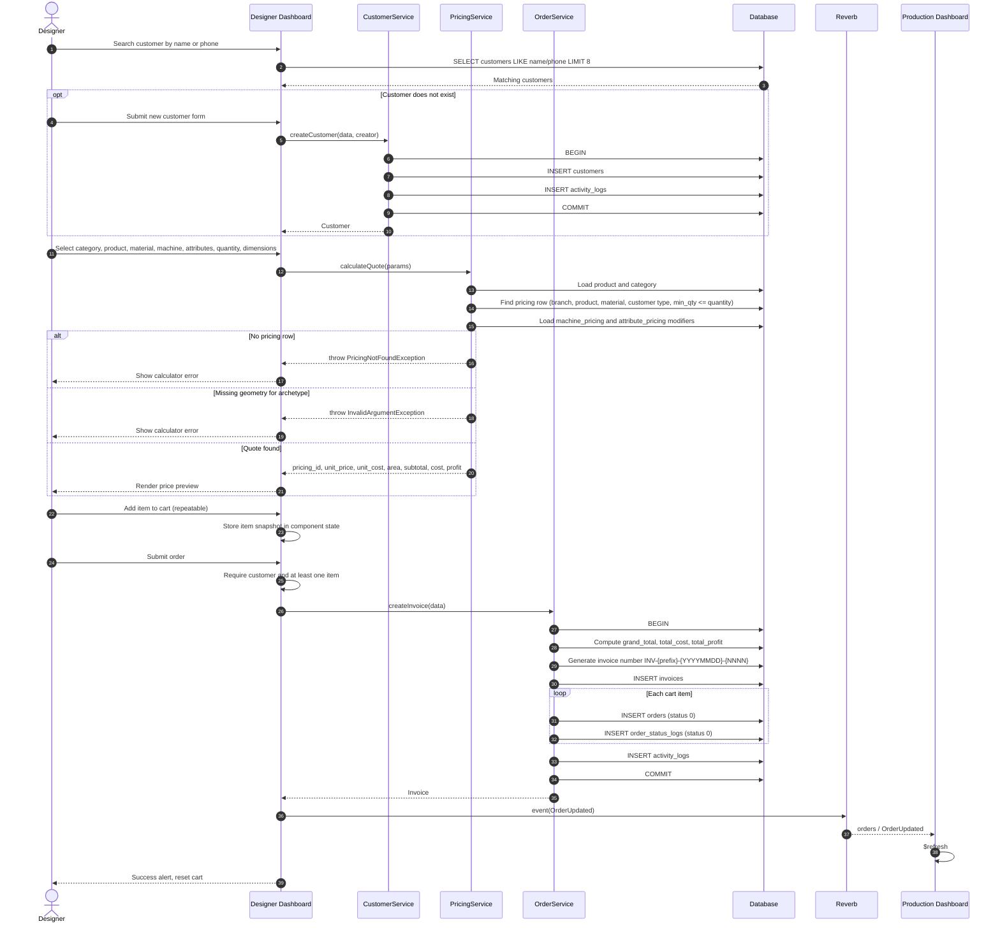

Notes:

- The invoice number sequence is `count(invoices for branch and date) + 1`; it is not protected by a lock.
- `file_name` is stored; no binary file is uploaded by this flow.
- Manual price override replaces the calculated unit price and cost for a cart line before submission.

---

## 2. Production Start and Stock Deduction

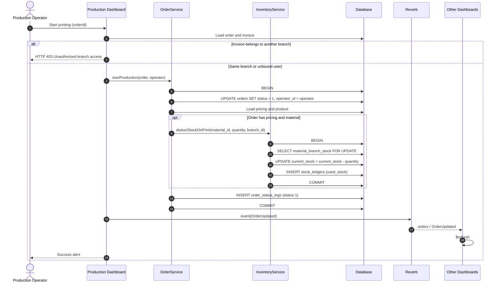

Deduction quantity:

- Product `pricing_type = area`: `order.area * order.quantity`
- Otherwise: `order.quantity`

Implementation note: the deduction happens at production start, not at completion.

---

## 3. Waste Logging

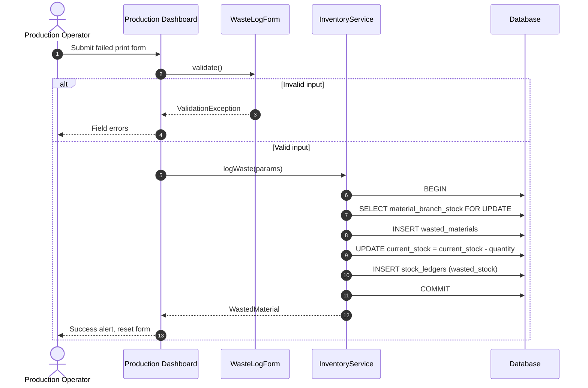

Implementation note: this flow does not dispatch `OrderUpdated`. Other dashboards do not refresh until their next request.

---

## 4. Down Payment and Settlement

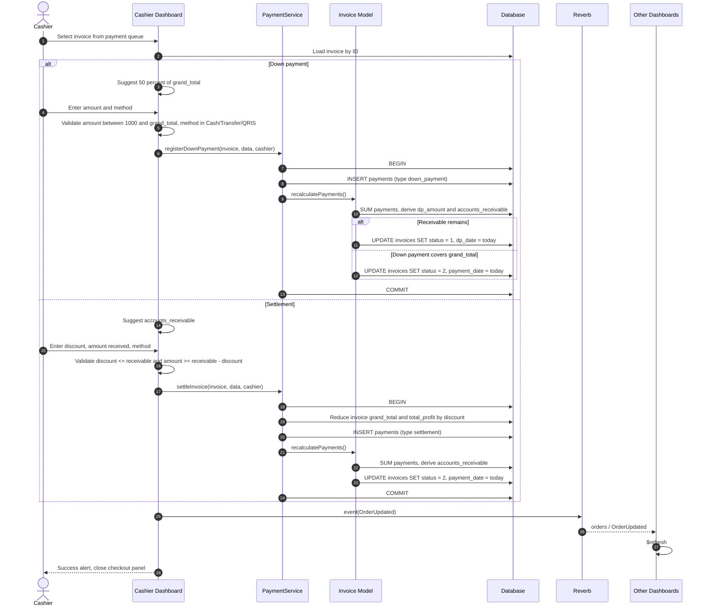

Status transitions:

| Before | Event | After |
| :--- | :--- | :--- |
| 0 Unpaid | Down payment smaller than the receivable | 1 Down payment |
| 0 Unpaid | Down payment equal to `grand_total` | 2 Paid |
| 1 Down payment | Remaining balance settled | 2 Paid |
| 0 Unpaid | Full settlement in one payment | 2 Paid |

Implementation note: `selectInvoice()` and `processCheckout()` load the invoice by primary key without an explicit branch assertion. The queue is branch-scoped. Down-payment validation caps the amount at `grand_total`, not at the remaining receivable; FR11 and FR12 require the receivable cap.

---

## 5. Customer Pickup

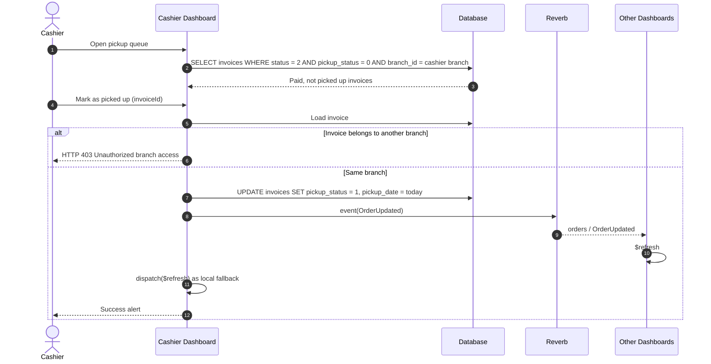

Notes:

- The current flow updates the invoice only. FR21 also requires every related order to store `pickup_status` and `pickup_date`.

---

## 6. Owner Financial Analytics

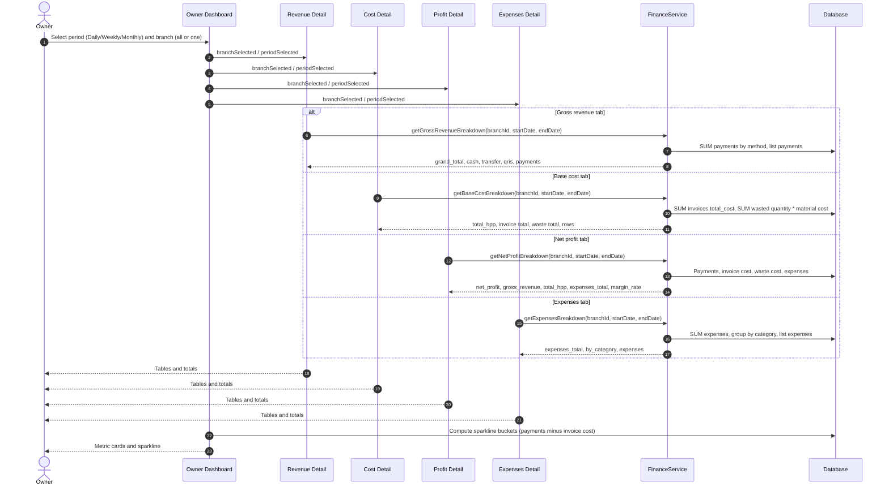

Implementation note: the owner headline cards compute `payments - invoice cost`. They do not subtract waste cost or expenses. The Net Profit Detail tab uses the full `FinanceService` calculation.

---

## 7. Real-Time Refresh

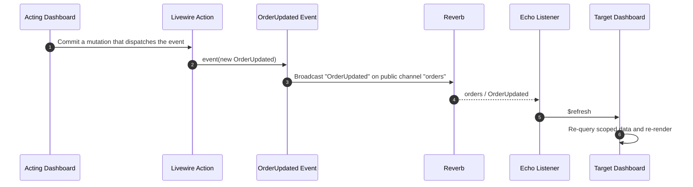

Contract:

- Channel: `orders` (public, no authorization callback)
- Event name: `OrderUpdated`
- Payload: empty object
- Broadcast driver: Laravel Reverb (`ShouldBroadcastNow`)
- Client listener: `protected $listeners = ['echo:orders,OrderUpdated' => '$refresh'];` on `Owner`, `Manager`, `Cashier`, and `Production`, plus `MachineManagement`, `MaterialManagement`, `CategoryManagement`, and the four owner detail components
- `Designer`, `BranchManagement`, and `UserManagement` do not register the listener.

Not every mutation dispatches the event. The following do not: waste logging, cashier expense logging, designer customer creation, manager stock restocking, attribute edits, and pricing create/update/delete via `savePricing`/`deletePricing`. `clonePricingTiers` does dispatch.

---

## 8. Authentication and Role Dispatch

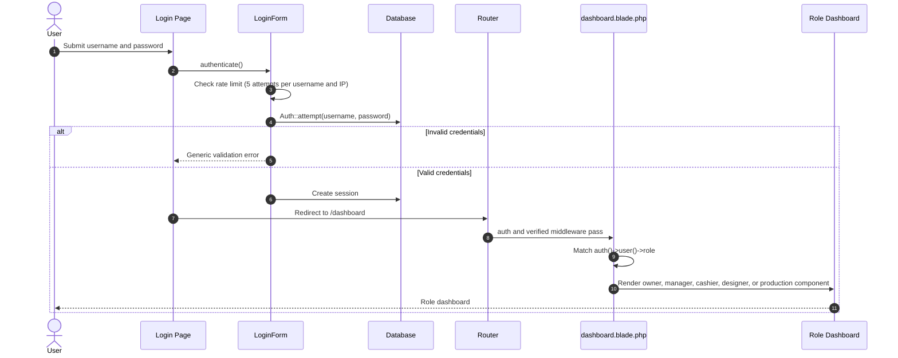

---

## 9. Production Completion

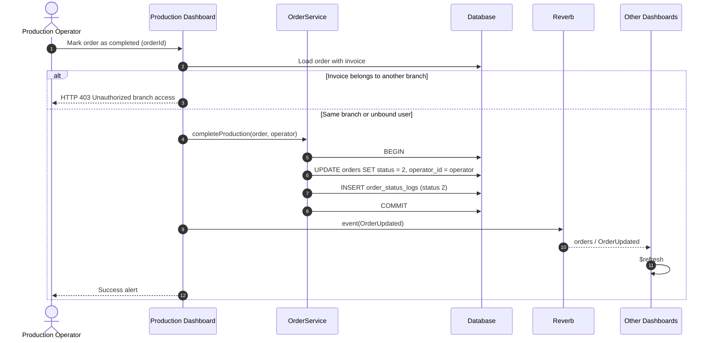

Notes:

- Completion does not change stock. The deduction already happened in §2 when production started.
- Completion does not change the invoice payment or pickup status.

---

## 10. Receipt and Work-Order Ticket

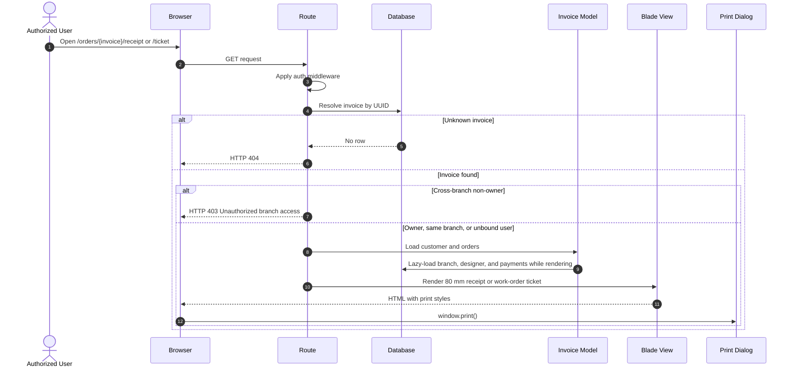

Notes:

- Receipt and ticket routes are read-only: no audit row and no `OrderUpdated`.
- The 80 mm receipt includes DP history, settlement, total paid, and the remaining receivable. The ticket is the printable work order for production.
- Branch blocking is skipped for owners and for users with no branch assignment.

---

## 11. Cashier Expense Logging

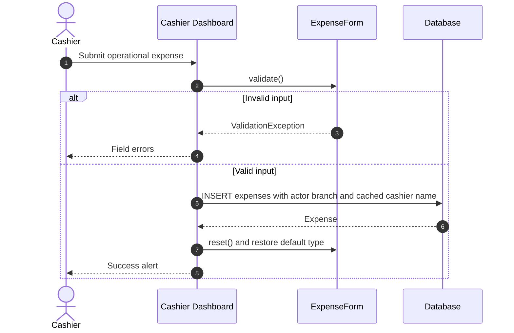

Notes:

- `ExpenseForm` validates an integer amount of at least 100, type `modal` or `laba`, an incurred date, and a description of at most 500 characters.
- The branch falls back to the first branch when the cashier has no branch assignment.
- This flow does not call a service, write `activity_logs`, or dispatch `OrderUpdated`. The expense is visible to `FinanceService::getExpensesBreakdown()` on the next report request.

---

## 12. User Account Management

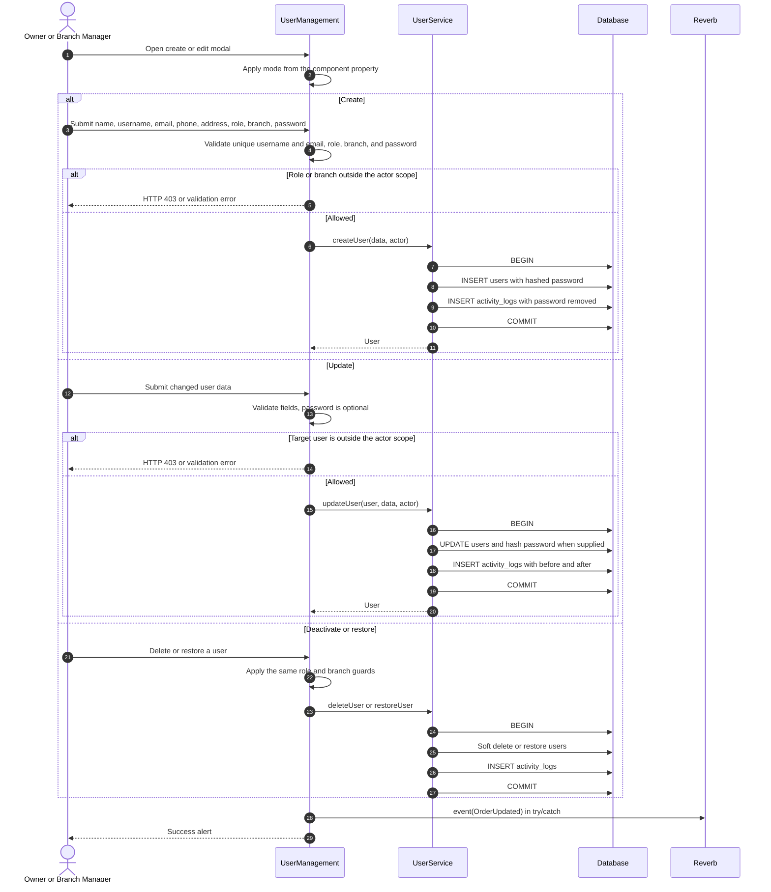

Notes:

- `mode` is a public Livewire property set by the owner or manager view. The target requires the role and branch to be derived server-side, so this property must not be client-writable.
- A secondary owner cannot edit or create owner accounts unless `isPrimaryOwner()` recognizes the actor.
- Managers only see their own branch and cannot manage owners or other managers.
- Password is removed from every audit payload.

---

## 13. Own Profile, Password, and Logout

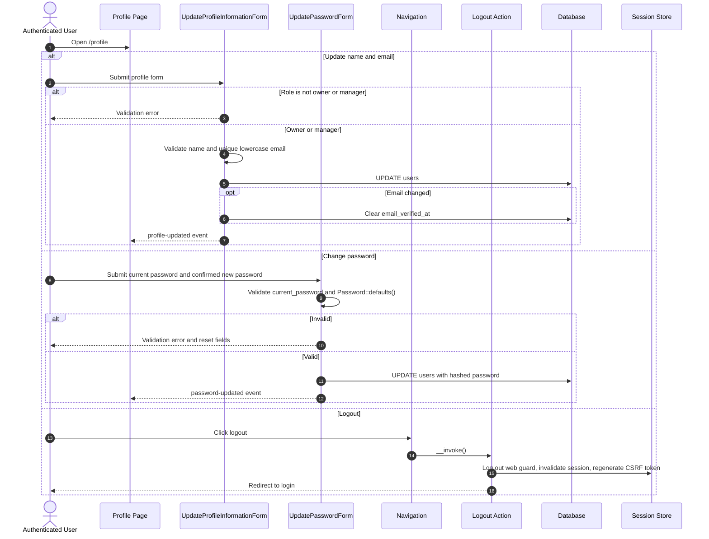

Notes:

- Cashier, designer, and production can change their own password but cannot update their name or email.
- The profile update is not written to the audit log.
- Account deletion is owner/manager-only and is handled by a separate profile form that logs the user out after deletion.

---

## 14. Branch Stock Visibility and Low-Stock Warnings

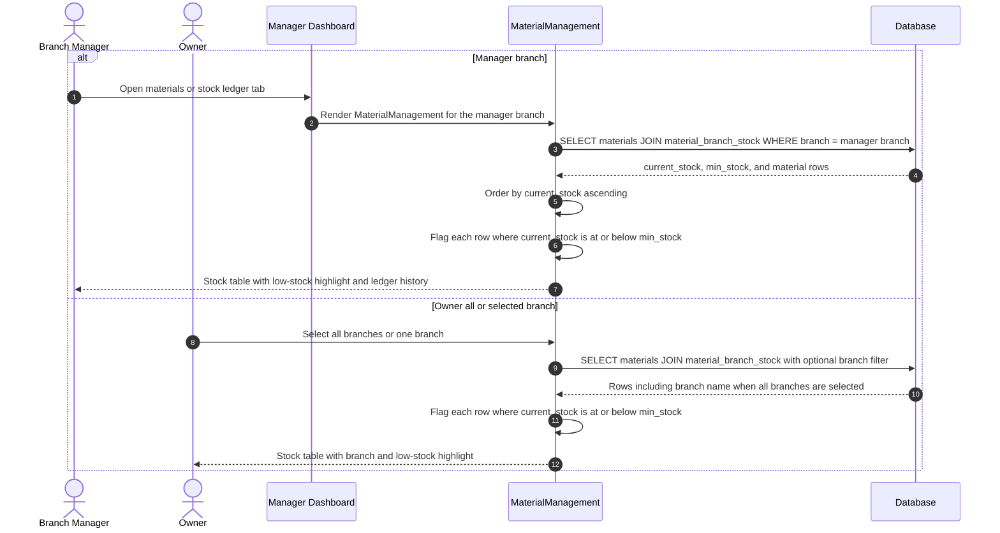

Notes:

- The low-stock state is a row highlight in the existing table. There is no separate alert list or dashboard warning yet.
- Production stock read and the FR17 warning surface are target behavior.
- Managers are fixed to their own branch. Owners may switch between `all` and a single branch.

---

## 15. Manager Branch Summary

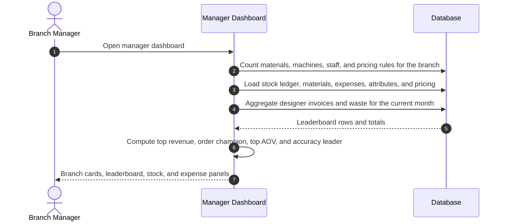

Notes:

- Every branch-owned query is fixed to the manager's branch. Products and attribute types are global reference data.
- The current summary does not show gross revenue, receivables, order counts, or queued/processing/completed counts. Those are target FR22 additions.
- The owner summary is covered in §6.

---

## 16. Audit Trail View

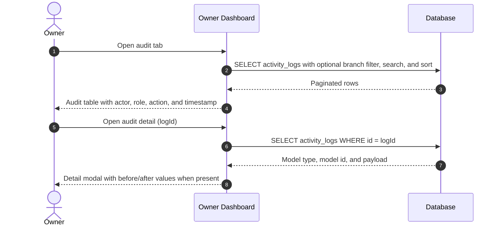

Notes:

- Search covers username, role, action, and description. Sorting is available on the displayed columns.
- Audit rows are append-only from the application code, but coverage is partial. Invoice creation, customer creation, user, branch, and machine changes write rows. Payments, order status changes, stock movements, pricing, categories, and expenses do not yet write `activity_logs`.
- Owner is the only role with an audit screen.

---

## 17. Pricing Matrix Management

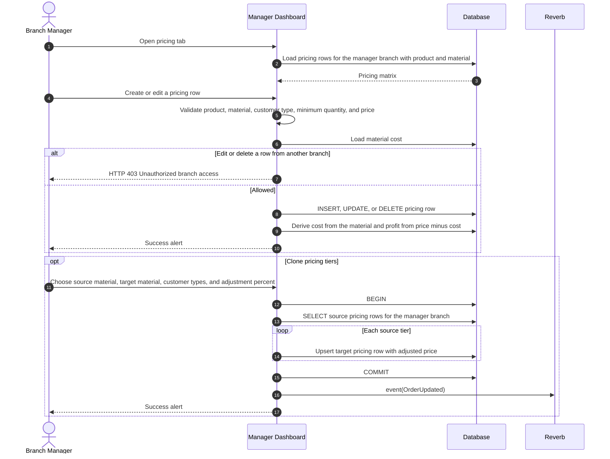

Notes:

- Pricing writes are branch-scoped to `auth()->user()->branch_id`, falling back to the first branch.
- `savePricing()` and `deletePricing()` do not write `activity_logs` and do not dispatch `OrderUpdated`. `clonePricingTiers()` dispatches the event but does not write an audit row.
- The owner has no pricing tab yet; target FR6 requires owner and manager price management.
- Machine and attribute master data use separate branch-scoped CRUD screens and are not part of this diagram.

---

## 18. Additional Target Workflows

These flows define the target contract for FR5–FR7, FR9–FR10, FR15–FR16, FR18–FR19, FR24, and FR26.

### 18.1 Update an Order Before Production (FR9)

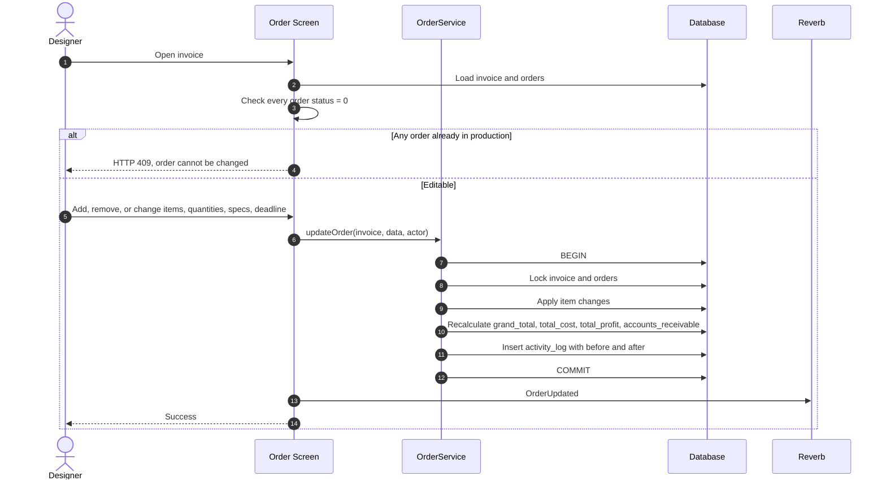

### 18.2 Update Design Status (FR10)

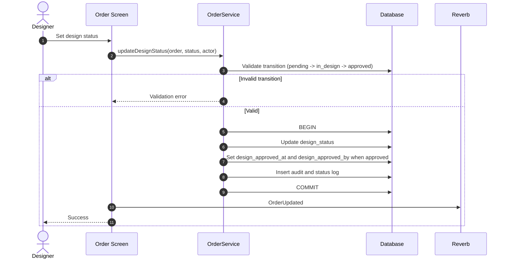

### 18.3 Record a Raw-Material Purchase (FR15)

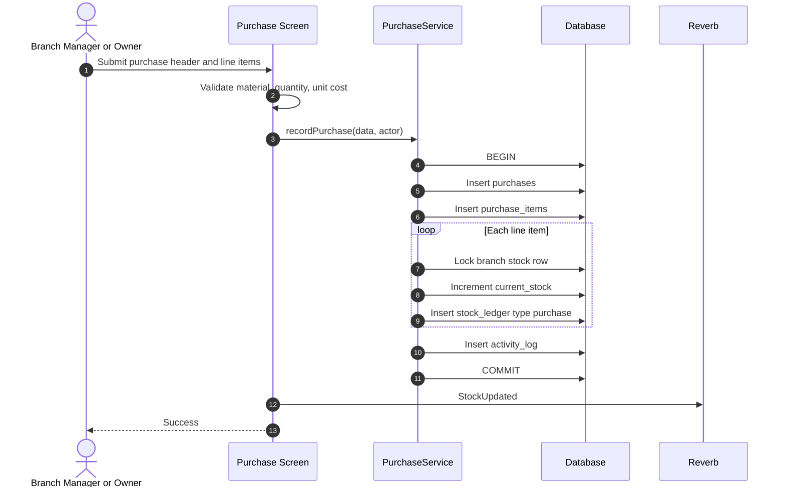

### 18.4 Adjust Stock with a Reason (FR18)

```mermaid
sequenceDiagram
    autonumber
    actor M as Branch Manager
    participant UI as Stock Screen
    participant SS as StockService
    participant DB as Database
    participant R as Reverb

    M->>UI: Submit new quantity or delta and reason
    UI->>UI: Require reason 3-255 characters
    UI->>SS: adjustStock(material, mode, quantity, reason, manager)
    SS->>DB: Validate result is not negative
    alt Negative result
        SS-->>UI: Validation error
    else Valid
        SS->>DB: BEGIN
        SS->>DB: Lock branch stock row
        SS->>DB: Update current_stock
        SS->>DB: Insert stock_ledger type adjustment with reason
        SS->>DB: Insert activity_log
        SS->>DB: COMMIT
        UI->>R: StockUpdated
        UI-->>M: Success
    end
```

### 18.5 Record Production Usage (FR16)

```mermaid
sequenceDiagram
    autonumber
    actor P as Production
    participant UI as Production Screen
    participant OS as OrderService
    participant IS as InventoryService
    participant DB as Database
    participant R as Reverb

    P->>UI: Start production or record usage
    UI->>OS: startProduction(order, operator)
    OS->>DB: BEGIN
    OS->>DB: Set order status = 1 and operator
    OS->>IS: recordUsage(order, material, quantity, operator)
    IS->>DB: Lock branch stock row
    IS->>DB: Decrement current_stock
    IS->>DB: Insert stock_ledger type usage with order reference
    OS->>DB: Insert order_status_log
    OS->>DB: COMMIT
    UI->>R: OrderUpdated
    UI-->>P: Success
```

### 18.6 Export a Report (FR24)

```mermaid
sequenceDiagram
    autonumber
    actor A as Owner or Branch Manager
    participant UI as Report Screen
    participant ES as ReportExportService
    participant DB as Database
    participant FS as Storage

    A->>UI: Choose report, period, branch, format
    UI->>ES: export(filters, format)
    ES->>DB: Query summary and detail rows
    ES->>ES: Build XLSX or PDF
    ES->>FS: Store generated file
    ES-->>UI: Download path
    UI-->>A: Download file
```

### 18.7 Manual and Scheduled Backup (FR26)

```mermaid
sequenceDiagram
    autonumber
    actor O as Owner
    participant SCH as Scheduler
    participant UI as Backup Screen
    participant BS as BackupService
    participant DB as Database
    participant FS as External Storage

    alt Manual
        O->>UI: Run backup
        UI->>BS: run(manual, actor)
        BS->>DB: Dump schema and data
        BS->>FS: Store encrypted backup
        BS->>DB: Insert backup audit log
        BS-->>UI: Success or failure
    else Scheduled
        SCH->>BS: run(scheduled)
        BS->>DB: Dump schema and data
        BS->>FS: Store encrypted backup
        BS->>DB: Insert backup audit log
        BS-->>SCH: Success or failure
    end
```

### 18.8 Read the Production Queue (FR19)

```mermaid
sequenceDiagram
    autonumber
    actor A as Any Role
    participant UI as Production Queue
    participant DB as Database

    A->>UI: Open production queue
    UI->>DB: Query orders by branch and status
    DB-->>UI: Rows sorted by deadline, priority, created_at
    UI-->>A: Queue with customer, deadline, priority, status, designer, operator
```

### 18.9 Manage the Product Catalog (FR6)

```mermaid
sequenceDiagram
    autonumber
    actor A as Owner or Branch Manager
    participant UI as Catalog Screen
    participant PS as ProductService
    participant CS as ProductCategoryService
    participant DB as Database
    participant R as Reverb

    A->>UI: Submit a product or category form
    UI->>UI: Derive role and branch from the authenticated user
    alt Product
        A->>UI: Create, update, or delete a product
        UI->>UI: Validate name, category, pricing type, and active status
        alt Create or update
            UI->>PS: create or update(data, actor)
            PS->>DB: BEGIN
            PS->>DB: INSERT or UPDATE products
            PS->>DB: INSERT activity_logs
            PS->>DB: COMMIT
        else Delete
            UI->>PS: delete(product, actor)
            PS->>DB: BEGIN
            PS->>DB: Soft delete products
            PS->>DB: INSERT activity_logs
            PS->>DB: COMMIT
        end
    else Category
        A->>UI: Create, update, or delete a category
        UI->>UI: Validate name, calculation archetype, and allowed attribute types
        UI->>CS: createCategory, updateCategory, or deleteCategory
        CS->>DB: BEGIN
        CS->>DB: INSERT, UPDATE, or delete product_categories
        CS->>DB: INSERT activity_logs
        CS->>DB: COMMIT
    end
    UI->>R: event(OrderUpdated)
    UI-->>A: Success alert
```

Notes:

- `ProductService` is target behavior. Products and categories are global master data; the pricing matrix that uses them is branch-scoped (§17).
- `ProductCategoryService` exists, wraps its writes in a transaction, and logs failures, but it does not write `activity_logs` yet. FR6 requires the audit row.
- A category delete cascades to products, materials, and pricing rows unless a restrictive reference blocks it.

### 18.10 Search and Paginate Products (FR7)

```mermaid
sequenceDiagram
    autonumber
    actor A as Designer or Cashier
    participant UI as Product Browser
    participant PS as ProductService
    participant DB as Database

    A->>UI: Enter search text and choose category and active filters
    UI->>PS: paginate(search, category_id, is_active, per_page)
    PS->>DB: SELECT products JOIN product_categories with filters ORDER BY name
    DB-->>PS: Current page and total count
    PS-->>UI: LengthAwarePaginator with 20 rows by default
    UI-->>A: Product grid with previous and next navigation

    A->>UI: Select a product
    UI-->>A: Feed the product into the order calculator or checkout
```

Notes:

- The target is 20 products per page and a p95 response under the NFR1 target.
- Products are global; branch-specific availability comes from the pricing matrix, not from the product row.
- The current designer screen loads categories and products without pagination, so FR7 remains target.

### 18.11 Enforce Role and Branch Scope (FR5)

```mermaid
sequenceDiagram
    autonumber
    actor A as Authenticated User
    participant E as Route or Livewire Action
    participant G as Access Guard
    participant S as Service
    participant DB as Database
    participant B as Broadcast Auth

    A->>E: Submit a request or action
    E->>G: auth, verified, role, and policy checks
    alt Unauthenticated
        G-->>A: Redirect to login
    else Wrong role
        G-->>A: HTTP 403
    else Allowed role
        G->>G: Derive actor, role, and branch from the session
        E->>S: Call the service with the explicit actor
        S->>DB: Query or mutate with a branch predicate
        alt Record belongs to another branch
            S-->>E: Branch access denied
            E-->>A: HTTP 403
        else In scope
            S->>DB: COMMIT when the flow mutates
            E-->>A: Response or success alert
            opt Mutation broadcasts state
                E->>B: Broadcast on private-branch.{branchId}
                B->>G: Authorize owner or matching branch
            end
        end
    end
```

Notes:

- The target derives role and branch server-side. Client-writable fields such as `UserManagement::$mode` and request branch parameters are ignored or rejected.
- The same check applies to ticket and receipt routes, report exports, stock actions, and private broadcast channels.
- Private branch channels replace the current public `orders` channel described in §7.
- Production responses and exports omit price, cost, and profit fields.

---

## Diagram Maintenance

Add a sequence diagram when a new cross-component workflow is introduced or when a service contract changes enough that the existing diagram would mislead. Keep each diagram at the level of service calls and database effects, not private helper methods. Keep the requirement coverage table current when an FR is added, removed, or re-scoped. Do not move target behavior into the current sections until it ships.
