# Use Case Diagram (Target Specification)

- **Status:** Target scope. Green = implemented; amber = partial; dashed blue = target, required but not implemented.
- **Source:** `docs/requirements/fr.md` FR1–FR26, `docs/requirements/access-matrix.md`, and the capstone proposal.
- **Role mapping:** Pemilik = `owner`, Branch Manager = `manager`, Kasir = `cashier`, Designer = `designer`, Produksi = `production`.

```mermaid
flowchart LR
    Owner((Pemilik))
    Manager((Branch Manager))
    Cashier((Kasir))
    Designer((Designer))
    Production((Produksi))
    Scheduler((Penjadwal Sistem))

    subgraph SYS["Sistem Alja Digital Printing"]
        direction TB

        subgraph ADM["Administrasi"]
            direction TB
            UC01(["Kelola Pengguna"])
            UC02(["Kelola Cabang"])
            UC03(["Audit Log"])
        end

        subgraph CAT["Katalog & Konfigurasi"]
            direction TB
            UC04(["Kelola Produk"])
            UC05(["Kelola Kategori Produk"])
            UC06(["Kelola Harga"])
            UC07(["Cari & Filter Produk"])
            UC08(["Kelola Mesin"])
        end

        subgraph INV["Inventaris"]
            direction TB
            UC09(["Catat Pembelian Bahan Baku"])
            UC10(["Catat Pemakaian Bahan Baku"])
            UC11(["Lihat Stok & Peringatan Minimum"])
            UC12(["Penyesuaian Stok"])
        end

        subgraph TRX["Transaksi"]
            direction TB
            UC13(["Catat Pesanan"])
            UC14(["Perbarui Pesanan"])
            UC15(["Perbarui Status Desain"])
            UC16(["Lihat Daftar Transaksi"])
            UC17(["Kelola Pelanggan"])
        end

        subgraph PAY["Pembayaran & Pickup"]
            direction TB
            UC18(["Proses Pembayaran (DP/Pelunasan)"])
            UC19(["Catat Pengeluaran Operasional"])
            UC20(["Antrean Pickup"])
            UC21(["Cetak Nota & Tiket"])
        end

        subgraph PROD["Produksi"]
            direction TB
            UC22(["Lihat Antrean Produksi"])
            UC23(["Perbarui Status Produksi"])
            UC24(["Catat Waste"])
        end

        subgraph REP["Pelaporan"]
            direction TB
            UC25(["Dashboard Ringkasan"])
            UC26(["Laporan Keuangan Periodik"])
            UC27(["Ekspor Laporan Excel/PDF"])
        end

        subgraph SYSADM["Sistem"]
            direction TB
            UC28(["Backup Manual & Terjadwal"])
        end
    end

    Owner --- UC01
    Owner --- UC02
    Owner --- UC03
    Owner --- UC04
    Owner --- UC05
    Owner --- UC06
    Owner --- UC07
    Owner --- UC08
    Owner --- UC11
    Owner --- UC16
    Owner --- UC22
    Owner --- UC25
    Owner --- UC26
    Owner --- UC27
    Owner --- UC28

    Manager --- UC01
    Manager --- UC04
    Manager --- UC05
    Manager --- UC06
    Manager --- UC07
    Manager --- UC08
    Manager --- UC11
    Manager --- UC12
    Manager --- UC16
    Manager --- UC22
    Manager --- UC25
    Manager --- UC26
    Manager --- UC27

    Cashier --- UC07
    Cashier --- UC09
    Cashier --- UC11
    Cashier --- UC14
    Cashier --- UC16
    Cashier --- UC17
    Cashier --- UC18
    Cashier --- UC19
    Cashier --- UC20
    Cashier --- UC21
    Cashier --- UC22

    Designer --- UC07
    Designer --- UC13
    Designer --- UC14
    Designer --- UC15
    Designer --- UC16
    Designer --- UC17
    Designer --- UC21
    Designer --- UC22

    Production --- UC10
    Production --- UC11
    Production --- UC16
    Production --- UC21
    Production --- UC22
    Production --- UC23
    Production --- UC24

    Scheduler --- UC28

    UC18 -.->|include| UC21
    UC13 -.->|include| UC17
    UC14 -.->|extend| UC13
    UC27 -.->|extend| UC26

    classDef implemented fill:#dcfce7,stroke:#16a34a,color:#14532d
    classDef partial fill:#fef9c3,stroke:#ca8a04,color:#713f12
    classDef target fill:#dbeafe,stroke:#2563eb,color:#1e3a8a,stroke-dasharray: 5 5

    class UC02,UC05,UC08,UC13,UC17,UC19,UC21,UC23 implemented
    class UC01,UC03,UC06,UC10,UC11,UC16,UC18,UC20,UC22,UC24,UC25,UC26 partial
    class UC04,UC07,UC09,UC12,UC14,UC15,UC27,UC28 target
```

## Target Role Summary

| Role | Data Akun | Data Transaksi | Data Stok | Status & Antrean | Laporan Keuangan |
| :--- | :--- | :--- | :--- | :--- | :--- |
| Pemilik | CRUD | R | CRUD | R | R |
| Branch Manager | CRUD (branch staff) | R | CRUD (branch) | R | R (limited) |
| Kasir | - | CRU | CR | R | - |
| Designer | - | CRU | - | R | - |
| Produksi | - | R | RU | RU | - |

Notes:

- **Kasir `U`** covers order changes before production (FR9) and pickup status (FR21).
- **Designer `U`** covers order changes before production (FR9) and design-status updates (FR10).
- **Manager `Data Stok`** is branch-scoped CRUD; global material deletion remains owner-only.
- **Owner `Data Stok`** is CRUD through material management; the reason-required adjustment workflow (FR18) is manager-scoped unless extended to the owner.
- **Kasir `Data Stok`** is create and read for purchases and stock visibility; adjustment is manager-only.
- **Production `Data Stok`** is read plus usage/waste updates.

## Use Case Status

| ID | Use case | Status | Current behavior or target gap |
| :--- | :--- | :--- | :--- |
| UC01 | Kelola Pengguna | Partial | Owner and manager branch staff; `UserManagement::$mode` is client-writable. |
| UC02 | Kelola Cabang | Implemented | Owner-only branch CRUD and status toggle. |
| UC03 | Audit Log | Partial | Owner views activity logs; payments, order updates, and stock adjustments are not logged. |
| UC04 | Kelola Produk | Target | No product CRUD screen; products are data-setup records. |
| UC05 | Kelola Kategori Produk | Implemented | Categories, archetypes, and allowed attribute types. |
| UC06 | Kelola Harga | Partial | Manager pricing matrices work; owner has no pricing tab. |
| UC07 | Cari & Filter Produk | Target | No product list, search, filter, or pagination; calculator uses dropdowns. Designer and cashier are the primary users; owner and manager use it inside product management. |
| UC08 | Kelola Mesin | Implemented | Owner global, manager branch-scoped, machine cost. |
| UC09 | Catat Pembelian Bahan Baku | Target | Current restock has no purchase header, supplier, or unit-cost record. |
| UC10 | Catat Pemakaian Bahan Baku | Partial | Stock is deducted on production start; no explicit order-linked usage record; waste tab fails to render. |
| UC11 | Lihat Stok & Peringatan Minimum | Partial | Owner/manager stock views; low stock is sorted, not alerted; cashier/production access is missing. |
| UC12 | Penyesuaian Stok | Target | No adjustment flow with mandatory reason. |
| UC13 | Catat Pesanan | Implemented | Designer creates invoice and orders with pricing. |
| UC14 | Perbarui Pesanan | Target | No update flow; order changes before production are not implemented. |
| UC15 | Perbarui Status Desain | Target | No design-status column or action. |
| UC16 | Lihat Daftar Transaksi | Partial | Owner financial/audit lists, cashier queues, designer order list; manager general list is missing. |
| UC17 | Kelola Pelanggan | Implemented | Designer searches and creates customers; cashier can search for order updates. |
| UC18 | Proses Pembayaran (DP/Pelunasan) | Partial | Cashier DP/settlement; invoice status recalculates. DP validation caps at `grand_total`, not remaining receivable, so overpayment is possible. |
| UC19 | Catat Pengeluaran Operasional | Implemented | Cashier logs branch expenses. |
| UC20 | Antrean Pickup | Partial | Invoice pickup is updated; related orders are not. |
| UC21 | Cetak Nota & Tiket | Implemented | Work-order ticket and 80 mm receipt. |
| UC22 | Lihat Antrean Produksi | Partial | Production-only queue, sorted by `created_at`; no priority or all-role view. |
| UC23 | Perbarui Status Produksi | Implemented | Production start/complete with status logs and stock deduction. |
| UC24 | Catat Waste | Partial | Service works; production waste tab fails to render. |
| UC25 | Dashboard Ringkasan | Partial | Owner financial cards; manager dashboard lacks order count and production summary. |
| UC26 | Laporan Keuangan Periodik | Partial | Owner full reports; manager limited to revenue leaderboard and expenses. |
| UC27 | Ekspor Laporan Excel/PDF | Target | No export implementation. |
| UC28 | Backup Manual & Terjadwal | Target | No backup command, schedule, storage, or restore flow. |

## Notes

1. `Scheduler` is a secondary actor for the scheduled backup (FR26), not a human role.
2. `Perbarui Pesanan` and `Perbarui Status Desain` are target because the current code supports create and read only.
3. `Catat Pembelian Bahan Baku` replaces the proposal's "catat pembelian bahan baku"; the target uses a purchase header and line items.
4. `Ekspor Laporan` extends `Laporan Keuangan Periodik`; it is not a separate report source.
5. The access matrix remains the authority for role and branch scope; this diagram only shows who uses each use case.
