# Use Case Diagram (Target Specification)

- **Scope:** Target scope. All use cases shown are required. Implementation progress is tracked in `docs/requirements/implementation-gaps.md`.
- **Source:** `docs/requirements/fr.md` FR1–FR26, `docs/requirements/access-matrix.md`, and the capstone proposal.
- **Role mapping:** Pemilik = `owner`, Branch Manager = `manager`, Kasir = `cashier`, Designer = `designer`, Produksi = `production`.
- **Implementation:** These actors use the React SPA. Every use case maps to `/api/v1` endpoints enforced by Laravel policies; see `docs/architecture/api-contracts.md`.

```mermaid
flowchart LR
    Owner((Pemilik))
    Manager((Branch Manager))
    Cashier((Kasir))
    Designer((Designer))
    Production((Produksi))
    Scheduler((Penjadwal Sistem))

    subgraph SYS["Sistem Alja Digital Printing"]
        direction TB

        subgraph ADM["Administrasi"]
            direction TB
            UC01(["Kelola Pengguna"])
            UC02(["Kelola Cabang"])
            UC03(["Audit Log"])
        end

        subgraph CAT["Katalog & Konfigurasi"]
            direction TB
            UC04(["Kelola Produk"])
            UC05(["Kelola Kategori Produk"])
            UC06(["Kelola Harga"])
            UC07(["Cari & Filter Produk"])
            UC08(["Kelola Mesin"])
        end

        subgraph INV["Inventaris"]
            direction TB
            UC09(["Catat Pembelian Bahan Baku"])
            UC10(["Catat Pemakaian Bahan Baku"])
            UC11(["Lihat Stok & Peringatan Minimum"])
            UC12(["Penyesuaian Stok"])
        end

        subgraph TRX["Transaksi"]
            direction TB
            UC13(["Catat Pesanan"])
            UC14(["Perbarui Pesanan"])
            UC15(["Perbarui Status Desain"])
            UC16(["Lihat Daftar Transaksi"])
            UC17(["Kelola Pelanggan"])
        end

        subgraph PAY["Pembayaran & Pickup"]
            direction TB
            UC18(["Proses Pembayaran (DP/Pelunasan)"])
            UC19(["Catat Pengeluaran Operasional"])
            UC20(["Antrean Pickup"])
            UC21(["Cetak Nota & Tiket"])
        end

        subgraph PROD["Produksi"]
            direction TB
            UC22(["Lihat Antrean Produksi"])
            UC23(["Perbarui Status Produksi"])
            UC24(["Catat Waste"])
        end

        subgraph REP["Pelaporan"]
            direction TB
            UC25(["Dashboard Ringkasan"])
            UC26(["Laporan Keuangan Periodik"])
            UC27(["Ekspor Laporan Excel/PDF"])
        end

        subgraph SYSADM["Sistem"]
            direction TB
            UC28(["Backup Manual & Terjadwal"])
        end
    end

    Owner --- UC01
    Owner --- UC02
    Owner --- UC03
    Owner --- UC04
    Owner --- UC05
    Owner --- UC06
    Owner --- UC07
    Owner --- UC08
    Owner --- UC11
    Owner --- UC16
    Owner --- UC22
    Owner --- UC25
    Owner --- UC26
    Owner --- UC27
    Owner --- UC28

    Manager --- UC01
    Manager --- UC04
    Manager --- UC05
    Manager --- UC06
    Manager --- UC07
    Manager --- UC08
    Manager --- UC11
    Manager --- UC12
    Manager --- UC16
    Manager --- UC22
    Manager --- UC25
    Manager --- UC26
    Manager --- UC27
    Owner --- UC09
    Manager --- UC09

    Cashier --- UC07
    Cashier --- UC16
    Cashier --- UC17
    Cashier --- UC18
    Cashier --- UC19
    Cashier --- UC20
    Cashier --- UC21
    Cashier --- UC22

    Designer --- UC07
    Designer --- UC13
    Designer --- UC14
    Designer --- UC15
    Designer --- UC16
    Designer --- UC17
    Designer --- UC21
    Designer --- UC22

    Production --- UC10
    Production --- UC11
    Production --- UC16
    Production --- UC21
    Production --- UC22
    Production --- UC23
    Production --- UC24

    Scheduler --- UC28

    UC18 -.->|include| UC21
    UC13 -.->|include| UC17
    UC14 -.->|extend| UC13
    UC27 -.->|extend| UC26


```

## Target Role Summary

| Role | Data Akun | Data Transaksi | Data Stok | Status & Antrean | Laporan Keuangan |
| :--- | :--- | :--- | :--- | :--- | :--- |
| Pemilik | CRUD | R | CRUD | R | R |
| Branch Manager | CRUD (branch staff) | R | CRUD (branch) | R | R (limited) |
| Kasir | - | CRU | - | R | - |
| Designer | - | CRU | - | R | - |
| Produksi | - | R | RU | RU | - |

Notes:

- **Kasir `U`** covers pickup status only (FR21); order changes are Designer-only.
- **Designer `U`** covers order changes before production (FR9) and design-status updates (FR10).
- **Manager `Data Stok`** is branch-scoped CRUD; global material deletion remains owner-only.
- **Owner `Data Stok`** is CRUD through material management; the reason-required adjustment workflow (FR18) is manager-scoped unless extended to the owner.
- **Kasir `Data Stok`:** no stock access. Purchases are Owner/Branch Manager; stock visibility is Owner/Branch Manager/Production.
- **Production `Data Stok`** is read plus usage/waste updates.

## Notes

1. `Scheduler` is a secondary actor for the scheduled backup (FR26), not a human role.
2. `Catat Pembelian Bahan Baku` uses a purchase header and line items.
3. `Ekspor Laporan` extends `Laporan Keuangan Periodik`; it is not a separate report source.
4. The access matrix remains the authority for role and branch scope; this diagram only shows who uses each use case.
