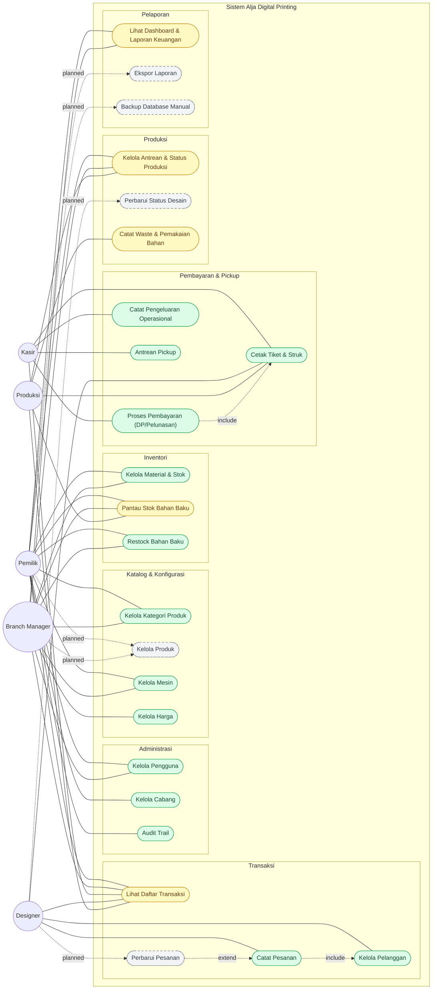

# Use Case Diagram (Proposed Capstone Scope)

- **Status:** Hybrid view. Green = implemented; amber = partial; dashed grey = planned.
- **Purpose:** Show the intended capstone scope, including planned items, without presenting them as working features.
- **Source of truth for current behavior:** `docs/requirements/fr.md`, `docs/requirements/access-matrix.md`, and the code.

Legend:

- **Implemented** — exists and is demoable.
- **Partial** — exists for some actors or has a known limitation.
- **Planned** — agreed scope, not implemented yet.

## Use Case Status

| ID | Use case | Status | Current behavior or gap |
| :--- | :--- | :--- | :--- |
| UC01 | Kelola Pengguna | Implemented | Owner manages all users; manager manages cashier/designer/production in their own branch. `UserManagement::$mode` is client-writable and has no mount guard. |
| UC02 | Kelola Kategori Produk | Implemented | Categories, calculation archetypes, and allowed attribute types; no product CRUD screen. |
| UC03 | Kelola Material & Stok | Implemented | Global material catalog, branch stock, restock, stock ledger, soft delete/restore. |
| UC04 | Kelola Mesin | Implemented | Owner global, manager branch-scoped; base cost (HPP) per machine. |
| UC05 | Kelola Harga | Implemented | Manager pricing matrices, tiered quantities, attribute and machine modifiers. Owner has no pricing tab. |
| UC06 | Kelola Cabang | Implemented | Owner-only branch create, edit, toggle, soft delete. |
| UC07 | Lihat Dashboard & Laporan Keuangan | Partial | Owner has full revenue, cost, profit, and expense reports. Manager has a dashboard and designer revenue leaderboard, not full P&L reports. |
| UC08 | Ekspor Laporan | Planned | No export function exists. |
| UC09 | Backup Database Manual | Planned | No backup command or UI exists. |
| UC10 | Lihat Daftar Transaksi | Partial | Owner has financial detail and audit lists; cashier has payment/pickup queues; designer has an order list. A manager general transaction list is planned. |
| UC11 | Pantau Stok Bahan Baku | Partial | Owner and manager can view stock. Production stock read is broken because `Production::render()` queries `materials.branch_id`. |
| UC12 | Kelola Antrean & Status Produksi | Partial | Production can read the queue and update status. Read-only owner/manager access is planned. |
| UC13 | Proses Pembayaran (DP/Pelunasan) | Implemented | Cashier registers down payments and settlements; invoice status recalculates. |
| UC14 | Catat Pengeluaran Operasional | Implemented | Cashier logs drawer expenses with branch and cashier name. |
| UC15 | Restock Bahan Baku | Implemented | Adds stock and writes a stock ledger. There is no purchase order, supplier, or purchase-cost record. |
| UC16 | Catat Pesanan | Implemented | Designer selects or creates a customer, builds a cart, and submits an invoice with orders. |
| UC17 | Perbarui Pesanan | Planned | Designer `CRU` on Data Transaksi: add items to a submitted order when the customer requests changes. Current code supports create and read only. |
| UC18 | Perbarui Status Desain | Planned | There is no design status column or action; only order status `0/1/2`, updated by production. |
| UC19 | Catat Waste & Pemakaian Bahan | Partial | Waste logging and stock deduction work. The production `waste` tab fails to render, so the UI path is not demoable. |
| UC20 | Antrean Pickup | Implemented | Cashier sees paid, unpicked invoices and marks them picked up. |
| UC21 | Cetak Tiket & Struk | Implemented | Authenticated branch users can print the work-order ticket and 80 mm receipt. |
| UC22 | Kelola Pelanggan | Implemented | Designer searches and creates customers. |
| UC23 | Audit Trail | Implemented | Owner views activity logs. Material and pricing actions are not logged. |
| UC24 | Kelola Produk | Planned | Products exist as data records but there is no product CRUD screen. |

## Role Summary Used by This Diagram

| Role | Data Akun | Data Transaksi | Data Stok | Status & Antrean | Laporan Keuangan |
| :--- | :--- | :--- | :--- | :--- | :--- |
| Pemilik | CRUD | R | CRUD | R (planned) | R |
| Branch Manager | CRUD (branch staff) | R (planned general list) | CRU (branch) | R (planned) | R (limited) |
| Kasir | - | CRU (U = pickup only) | - | R | - |
| Designer | - | CRU (U planned) | - | R | - |
| Produksi | - | R | RU | RU | - |

Notes:

- Designer `CRU` includes `Perbarui Pesanan` as planned scope. It is not implemented.
- Kasir `U` on transactions is limited to pickup status; payment and invoice amounts are not editable.
- Manager financial reporting is limited to the designer revenue leaderboard and recent expenses, not the owner's full report tabs.
- Manager account CRUD is limited to cashier/designer/production in the manager's branch; `UserManagement::$mode` is currently client-writable and should be fixed.
- Manager `Data Stok` is proposed as `CRU`; the current code also permits delete, which is a documented gap.
- Owner and manager production-queue read access is planned; production already has read/update.
- Production stock read is partial because the waste tab query is broken.
